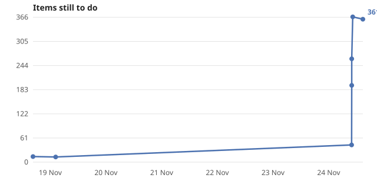

# Progress to the first full edition

This is the list behind the progress bar under the title of the
[README](README.md).

The bar is the share of the items below that are done. Each item counts the
same, so the number is rough. Long jobs are split by chapter or by group of
chapters, so a tick is a small step. An item with a count, such as (1 of 2), counts
for that fraction. The list is what the first full edition needs: what stands
today, and the work planned for the existing book in
[the current plan](book/proposals/proposal-20261117.md). New projects in that
plan are not counted. To change the bar, tick an item here and run
[`scripts/readme_progress.py`](scripts/readme_progress.py).

## Burn-down

<!-- burndown:start -->

No ETA yet: the history covers 5.7 days, and no pace can be read from items ticked in it. As of 2026-11-24. The blue line is read from git (every commit that changed this list); the dashed line is the straight line to zero at that pace. When items are added to the list the blue line goes up.
<!-- burndown:end -->

## Proofs

- [x] The squiggly line theorem, checked by Lean and rebuilt on every push
- [x] Every Lean statement quoted in the book matches the sources
- [x] Chapter 18: strong directions first for any kernel, and the Fourier version
- [ ] Chapter 17: the two open items about plates (1 of 2)
- [ ] Chapter 5: a proof that standard initialisation gives the same loss at every width
- [ ] Theorem names in the same style as the rest of the code
- [ ] Long proof steps split into named lines, and long repeated steps made lemmas

## Book

- [x] All 47 chapters written
- [x] At least one figure in chapters 1 and 3 to 47
- [ ] Every "recalled" claim checked against its paper: chapters 17 to 20
- [ ] Every "recalled" claim checked against its paper: chapters 21 to 25
- [ ] Every "recalled" claim checked against its paper: chapters 26 to 30
- [ ] Every "recalled" claim checked against its paper: chapters 31 to 35
- [ ] Every "recalled" claim checked against its paper: chapters 36 to 40
- [ ] Every "recalled" claim checked against its paper: chapters 41 to 47
- [ ] A "Preliminaries" section at the start of chapters 1 to 10
- [ ] A "Preliminaries" section at the start of chapters 11 to 20
- [ ] A "Preliminaries" section at the start of chapters 21 to 30
- [ ] A "Preliminaries" section at the start of chapters 31 to 40
- [ ] A "Preliminaries" section at the start of chapters 41 to 47
- [ ] Under each open item, what stood in the way of a proof
- [ ] Units for the numbers in the worked examples
- [ ] One shared BibTeX file: every citation of the book gathered in it
- [ ] One shared BibTeX file: the book builds from it
- [ ] One shared BibTeX file: the paper builds from it
- [ ] The planned edits to chapter 2
- [ ] The planned edits to chapter 6
- [ ] The planned edits to chapter 7
- [ ] The planned edits to chapter 8
- [ ] The planned edits to chapter 17
- [ ] The planned edits to chapter 18
- [ ] The planned edits to chapter 19
- [x] Chapter 17: the notebook check of the quarter turn matches the Lean statement
- [ ] Chapters 16 and 44: the damage law, read against the chapter and settled
- [ ] Chapter 20: weight decay against early stopping, read and settled
- [ ] Chapter 28: the gap to the product bound, read and settled
- [ ] Chapter 30: the signal after 50 layers, read and settled
- [ ] Chapter 31: the stretch of a random skip stack, read and settled
- [ ] Chapter 32: the loose depth-separation bound, read and settled
- [ ] Chapter 33: the reach of a convolution stack, read and settled
- [ ] Chapter 39: the hypothesis on the Hopfield state, read and settled
- [ ] Chapter 46: which distance on inputs the chapter uses, stated

## Experiments

- [x] A notebook for chapters 1 and 3 to 47
- [x] The notebooks of chapters 16 to 20, 22, 24, 26, 28, 30 to 32, 34, 39, 43 and 44 read by a second reader
- [ ] The notebooks of chapters 14 and 15 read by a second reader
- [ ] The notebooks of chapters 21 and 23 read by a second reader
- [ ] The notebooks of chapters 25, 27 and 29 read by a second reader
- [ ] The notebooks of chapters 33 and 35 to 38 read by a second reader
- [ ] The notebooks of chapters 40 to 42 read by a second reader
- [ ] The notebooks of chapters 45 to 47 read by a second reader
- [ ] A test of whether the theory can guess hyperparameters

## Publishing

- [x] A PDF built on every push, and a web edition
- [x] A draft of the paper
- [x] Lean highlighting on the website, built and looked at
- [ ] Lean code blocks in `docs/` checked against the sources
