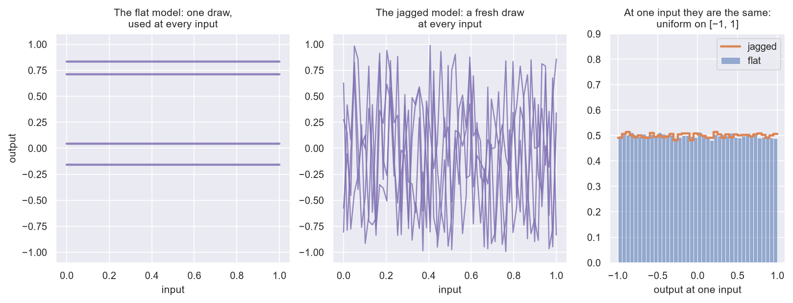
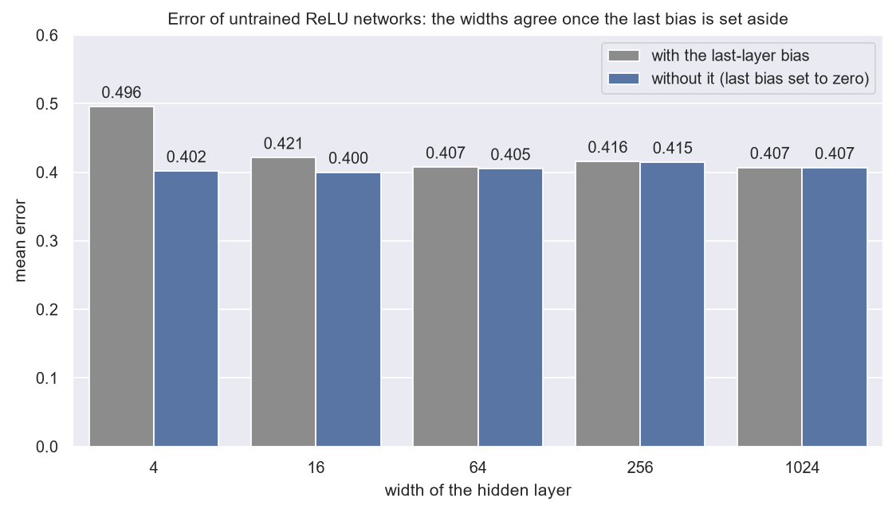

# 5. What the loss cannot see

**In the repository:**
[`RandomFunction.lean`](../lean/SquigglyLine/Theorem/RandomFunction.lean),
[`Marginal.lean`](../lean/SquigglyLine/Theorem/Marginal.lean).
**You need:** chapters 1 and 2.

## The idea

Before training, a network's weights are drawn at random. So the model is
random, and "the loss at the start" means the loss averaged over that
draw.

Here are two random models. Both produce numbers between −1 and 1.

- **The flat one.** Draw one number. Output it at every input. Every draw
  is a flat line.
- **The jagged one.** Draw a fresh number at every input. Every draw is as
  squiggly as a curve can be.

Now look at one input only. The flat model gives a uniform random number
there. So does the jagged one. Looking at one input at a time, you cannot
tell them apart.

A regression loss looks at one input at a time. On a data point it reads
the label and the model's output at that point's input, and nothing else.
So the two models have the same loss on average over the draw, on any
data. For a label `y` and squared error, that average is `y² + 1/3` for
both.

This is the **marginal lemma**. The distribution of the output at one
single input is called the one-point **marginal**. The average loss at the
start depends on the marginals and on nothing else. How the output moves
between two inputs, which is what "squiggly" means, does not enter.



## The words

A randomly initialised model is a `RandomFunction`. These are the parts
of it you will see in statements.

| Name | Meaning |
|---|---|
| `.Param` | the type of its parameters |
| `.prior` | how the parameters are drawn |
| `.eval parameters` | the model you get with those parameters |
| `.marginal input` | the distribution of the output at one input |
| `.expected cost data` | a cost, averaged over the data and over the draw |

## The statement

```lean
theorem expected_residualLoss_congr [MeasurableSpace Inputs]
    (loss_is_measurable : Measurable loss_fn)
    (same_marginals : random_model.marginal = other_model.marginal)
    (data_distribution : DataDistributionOver Inputs) :
    let expected_loss :=
      random_model.expected (GET_RESIDUAL_LOSS loss_fn) data_distribution
    let other_expected_loss :=
      other_model.expected (GET_RESIDUAL_LOSS loss_fn) data_distribution
    expected_loss = other_expected_loss := by
```

Read aloud: *two random models with the same marginals have the same
expected loss, for any loss on the residual and any data.*

`GET_RESIDUAL_LOSS loss_fn` is a loss that reads only
`label - model(input)`. Squared error and absolute error are both of this
kind. `Measurable` is fine print that every loss in common use passes.

## Why it is true

The expected loss is an average of averages: over the data points, and
for each data point over the draw of the parameters. Take one data point.
Its loss reads the output at one input. So its average over the draw is
an average over the marginal at that input
(`integral_residualLoss_eq_integral_marginal`). Equal marginals give
equal averages, one data point at a time, and so in total.

## What it does to the conjecture

Claim 3 of chapter 1 said a curve nearer to the data starts with a
smaller loss. The nearest distance is not a one-point quantity: it
depends on the curve at inputs to the side. The loss is a one-point
quantity. So a family of models can get nearer and nearer while its loss
does not move at all. Chapter 6 builds such a family.

It is also consistent with a measurement. Untrained networks of five
widths, from 4 to 1024, start with the same error on average over the
draw. The graph below came from `scripts/initial_mse.py`, which used
He-initialised weights, no biases, 10 inputs and 200 points. In that
setup the widths agree.


Standard initialisation of the weights is designed to keep the size of
the output the same at every width, and squared error at the start reads
only that. For a network with one hidden layer this is **proved**, in
[`Initialisation.lean`](../lean/SquigglyLine/Networks/Initialisation.lean).

First in plain English. The network adds up its hidden units, each
multiplied by an outer weight:

```
output = sum over the hidden units of outer_weight × hidden_value
```

Draw the outer weights independently of each other and of the first layer.
Give each a mean of zero and a mean square of `outer_scale / width`. This
is what the standard schemes do. Suppose every hidden unit has the same
mean square at the input, `hidden_mean_square`. Then:

- the mean of the output is zero;
- the mean of the squared output is `outer_scale × hidden_mean_square`.

The width has cancelled. There are `width` units, and the mean square of
each outer weight is `outer_scale / width`. Two different units add nothing
to the mean square, because their weights are independent and have mean
zero.

```lean
theorem output_mean_is_zero_and_mean_square_has_no_width
    {FirstLayer : Type*} [MeasurableSpace FirstLayer]
    [Nonempty Units]
    (weight_distribution : Measure ℝ)
    [IsProbabilityMeasure weight_distribution]
    (first_layer_distribution : Measure FirstLayer)
    [IsProbabilityMeasure first_layer_distribution]
    (hidden : Units → FirstLayer → ℝ)                 -- the value of each hidden unit at the input, for each draw of the first layer
    {outer_scale : ℝ}
    {hidden_mean_square : ℝ}
    (weight_is_square_integrable :
      MemLp (fun weight : ℝ => weight) 2 weight_distribution)
    (weight_mean_is_zero : ∫ weight, weight ∂weight_distribution = 0)
    (weight_mean_square_is_scale_over_width :
      ∫ weight, weight ^ 2 ∂weight_distribution
        = outer_scale / Fintype.card Units)
    (hidden_is_square_integrable :
      ∀ unit, MemLp (hidden unit) 2 first_layer_distribution)
    (hidden_mean_square_is_same :
      ∀ unit, ∫ first_layer, hidden unit first_layer ^ 2
        ∂first_layer_distribution = hidden_mean_square) :
    let prior :=
      (Measure.pi (fun _ : Units => weight_distribution)).prod
        first_layer_distribution                      -- outer weights and first layer, drawn independently
    let output := fun parameters : (Units → ℝ) × FirstLayer =>
      ∑ unit, parameters.1 unit * hidden unit parameters.2
    let mean_output        := ∫ parameters, output parameters ∂prior
    let mean_square_output := ∫ parameters, output parameters ^ 2 ∂prior
    mean_output = 0
      ∧ mean_square_output = outer_scale * hidden_mean_square := by
```

*Read aloud:* under those assumptions, the mean output is zero and the mean
squared output is the scale times the mean square of one hidden unit.

The notation: `Units` is the set of hidden units, and `Fintype.card Units`
is how many there are, the width. `Measure.pi (fun _ => weight_distribution)`
draws one outer weight for each unit, independently, all from the same
distribution. `.prod` draws a pair, the two parts independently: here the
outer weights and the first layer. `∫ weight, weight ^ 2 ∂weight_distribution`
is the mean of the squared weight. `MemLp ... 2 ...` says that a square has a
finite mean. `hidden unit first_layer` is the value of one hidden unit at
the input, for one draw of the first layer.

Squared error reads only those two numbers (the formula is just below). So
the expected squared error at the start is
`label² + outer_scale × hidden_mean_square` at every width. That is
`expected_squared_error_at_start_has_no_width`, and
`expected_squared_error_at_start_is_same_at_two_widths` compares two
networks of different widths directly.

What the proof needs and does not need:

- It needs no Gaussian weights and no ReLU. Any activation and any
  distribution with these two moments will do.
- It assumes that a hidden unit has the same mean square at every width.
  That holds when the incoming weights of each unit are drawn in the same
  way at every width: a hidden unit does not know how many others there
  are.
- It is about the weights. A bias on the output is outside it, and the
  second measurement below shows what such a bias does.
- It is for one hidden layer and for squared error. For deeper networks
  and for other losses the flat loss is **measured**, not proved here.
- It is not the lemma of this chapter. That lemma asks for equal one-point
  marginals, and a real network does not have them across widths. Only
  these two numbers agree.

**A common misunderstanding.** The same loss at every width does not
mean the same distribution of outputs at every width. Squared error
reads only two numbers, the mean of the output and the mean of its
square:

```
mean((label − output)²) = label² − 2 × label × mean(output) + mean(output²)
```

A narrow network and a wide one can agree on those two numbers while
their outputs are spread in different shapes. So the flat graph above
does not show equal marginals across widths, and it does not need them.
**argued**

A separate measurement in PyTorch is not a re-run of that script. It has
one input, one hidden layer, 256 new points per network and PyTorch's
default initialisation (which has biases). It adds one detail. The mean error over the draw is 0.50 at width 4 and 0.41
at width 1024, so the widths are not quite equal. The gap is the last-layer bias, which PyTorch draws from
a range that shrinks with the width and so adds `1 / (3 × width)` to the
error. Set that bias to zero in the same networks and the five widths agree,
at 0.400 to 0.415, around the exact width-free value 0.407.
The claim holds for the weights. An initialisation with a large last
bias at small width can hide it.



## What is not shown

A cost that reads two inputs at once is not covered, and the nearest
distance is such a cost. That is not a gap in the lemma. It is the reason
the two distances of chapter 1 can part ways.

## Run it yourself

[`ch05_the_blind_loss.ipynb`](../experiments/part1/ch05_the_blind_loss.ipynb)
draws 400,000 flat models and 400,000 jagged ones. For labels `0`, `0.5`
and `−1` both have the same average over the draw, `y² + 1/3` for
squared error and `(1 + y²) / 2` for absolute error, to within 0.003. They are not alike draw by draw: over
100 data points the flat model's loss has a spread of 0.30 and the
jagged one's has 0.07, around the same average. The same script checks
that a random-phase sine has one marginal at every input and frequency,
and repeats the width measurement above, zeroing the last bias in the same networks. All of it is measurement. The
lemma itself is in `Marginal.lean`.

## Check yourself

1. A random model outputs a fair coin flip, +1 or −1, the same at every
   input. Another flips a fresh coin at every input. The data is one
   point with label 0. What is the expected squared error of each?
2. Would the lemma still hold for absolute error?
3. Two random models have the same marginals. Must their draws look
   alike?

**Answers.** (1) Both are 1. (2) Yes. It holds for any loss that reads
only the residual. (3) No. The flat and jagged models have the same
marginals and look nothing alike.

Previous: [4. Nearness](04-nearness.md) · Next: [6. The theorem for sines](06-the-sine.md)
