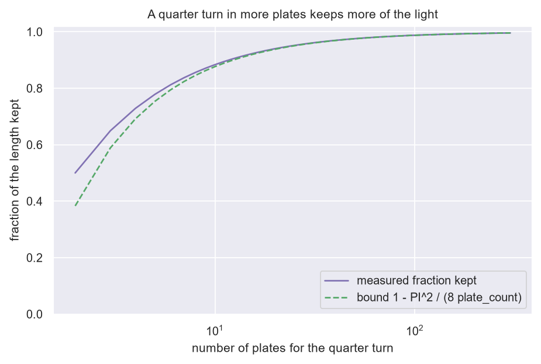
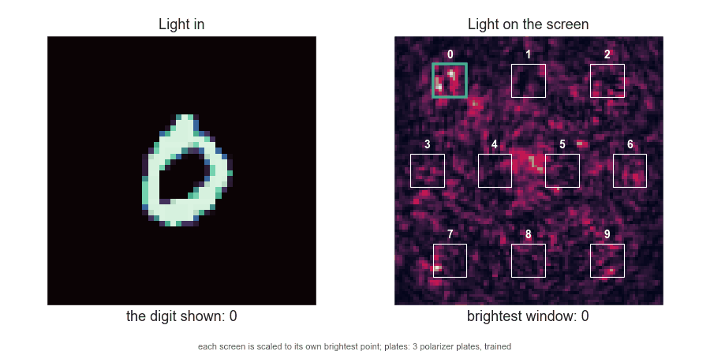
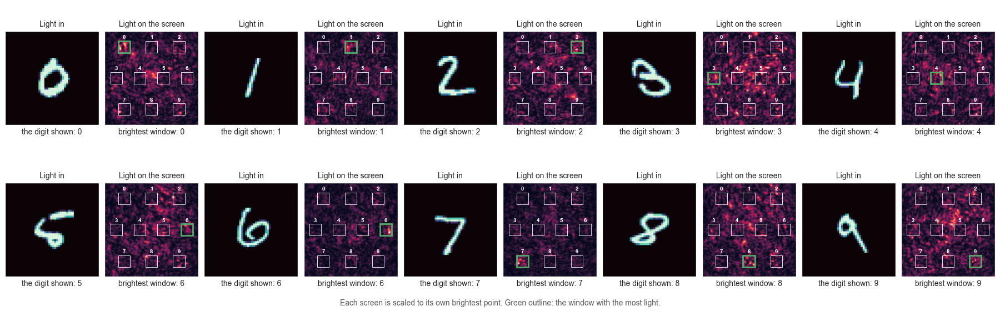
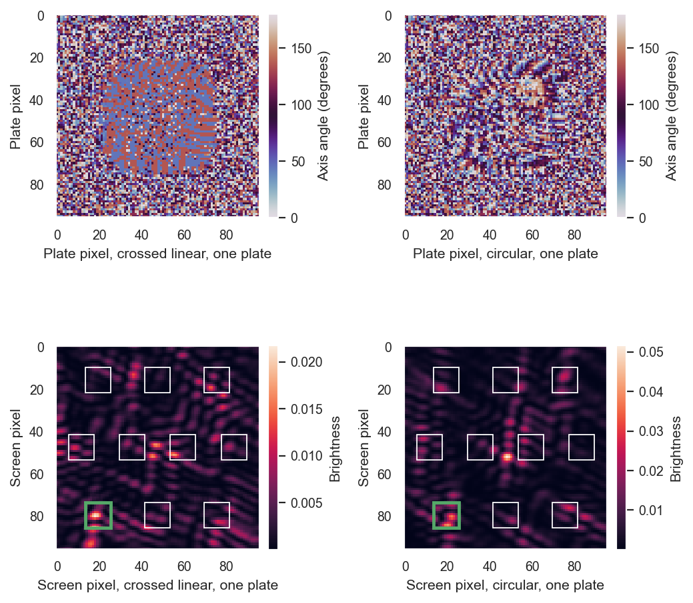

# 12. Layers as polarizers

**In the repository:**
[`Polarizer.lean`](../lean/SquigglyLine/Networks/Polarizer.lean),
[`ThreePolarizers.lean`](../lean/SquigglyLine/Networks/ThreePolarizers.lean),
[`MarkovChains.lean`](../lean/SquigglyLine/Networks/MarkovChains.lean),
notes [`three-polarizers.md`](../docs/networks/three-polarizers.md) and
[`wind-tunnel-and-polarizers.md`](../docs/networks/wind-tunnel-and-polarizers.md).
**You need:** chapter 8. This chapter is a picture, and nothing in Part
III depends on its proofs.

## The idea

A layer of a network does two things. It turns its input, and then it
keeps part of it. A polarizer does the same to light: it keeps only the
part of the light that lines up with its axis.

**ReLU is a wide polarizer.** Take a point in the plane and apply ReLU to
both coordinates. The result is the nearest point of the positive
quadrant (`relu2_nearest`). So ReLU is a projection: it presses each
point onto a region. A polarizer presses each arrow of light onto a line.

**Malus's law.** Light of strength `amplitude` meets a polarizer whose
axis is turned by an angle from the light. What passes has strength
`amplitude × cos(angle)` (`malus`). At 90° nothing passes
(`polarizer_crossed`).

## Three polarizers

Here is the surprise that makes the picture useful. Two plates at 90° to
each other block everything. Slip a third plate between them at 45° and
light gets through: each of the two 45° turns keeps `cos(45°)`, and
`cos(45°) × cos(45°)` is one half (`three_polarizers`).

Adding a plate let **more** light through. One big turn loses
everything. Two smaller turns lose half. And many small turns lose
almost nothing:

```lean
theorem quarter_turn_arrives
    {plate_count : ℕ}
    (at_least_two_plates : 2 ≤ plate_count) :                -- then each plate turns by at most 45°, small enough for the bound
    let turn_angle     := PI / (2 * plate_count)             -- a quarter turn is PI / 2, cut into equal steps
    let incoming_light := MAKE_LIGHT 1 0                     -- strength 1, pointing across
    let outgoing_light :=
      PASS_THROUGH_PLATES turn_angle plate_count incoming_light
    let kept_fraction  := cos turn_angle ^ plate_count       -- Malus's law, once per plate
    let light_pointing_up : LightArrow := (0, kept_fraction)
    let lower_bound    := 1 - PI ^ 2 / (8 * plate_count)     -- plate_count * turn_angle ^ 2 / 2, worked out
    let arrives_pointing_up      := outgoing_light = light_pointing_up
    let keeps_most_of_its_length := lower_bound ≤ kept_fraction
    arrives_pointing_up ∧ keeps_most_of_its_length := by
```

Read aloud: *turn light a quarter turn using `plate_count` plates. It
arrives pointing up, and it keeps at least `1 − PI² / (8 × plate_count)`
of its strength.* With 10 plates that is at least 87%. With 100, at
least 98.7%.

**Measured**, from the notebook below:



## Why it matters for networks

- **Depth is affordable.** A deep stack of layers that each turn the
  signal a little loses very little. A shallow stack that turns it all
  at once can lose it all.
- **Change things gradually.** The same sum explains warm-up, small
  learning rates and easy examples first: if the cost of a step goes as
  the square of its size, `N` small steps cost `1 / N` of one big one
  ([`SmallSteps.lean`](../lean/SquigglyLine/Supporting/Training/SmallSteps.lean)).
- **A layer has no memory.** What comes out of a layer depends only on
  what went in. So two inputs that land on the same place after some
  layer stay together for good (`merged_stays_merged`), and a state that
  every layer leaves alone is never left (`dead_stays_dead`). The second
  is the "dying ReLU" problem.

**A common misunderstanding.** More plates do not make a deeper network.
Each plate is a linear map, so a stack of any number of plates is one
linear map. A plate with a different angle at each point still treats
each point by itself, so light from two points never meets inside the
stack. It meets only if it spreads in a gap between plates. A detector
reads brightness, which is the square of the light. So a stack with gaps
and a detector computes, at most, sums of products of two inputs.
**argued**

## A chain of chains

Training has the same shape one level up. Each training step runs the
chain of layers, and the steps themselves form a chain: the next weights
depend only on the current ones. For tight features (chapter 9) the
outer chain is the one-factor rule of chapter 10: after `step_count`
steps the error is `(1 − learning_rate × squared_length) ^ step_count`
times what it was (`HAS_TIGHT_FEATURES.residual_iterate_gradientStep`).

## A plate you can train

Go back to the three plates: horizontal, 45°, vertical. Now let the middle
plate have a different angle at every point, like a picture drawn in angles.
At a point where its angle is 0° or 90° nothing gets through the three
plates. At 45° the most gets through. In between, the angle sets how much:

```lean
theorem plate_between_crossed_polarizers
    (amplitude : ℝ)
    (axis_angle : ℝ) :
    let incoming_light := MAKE_LIGHT amplitude 0             -- pointing across
    let after_plate    := PASS_THROUGH_POLARIZER axis_angle incoming_light
    let vertical_axis  := PI / 2                             -- 90°: at right angles to the light that came in
    let outgoing_light := PASS_THROUGH_POLARIZER vertical_axis after_plate
    let mask_value     := sin (2 * axis_angle) / 2           -- between -1/2 and 1/2, set by the angle of the plate
    let expected_light : LightArrow := (0, amplitude * mask_value)
    outgoing_light = expected_light := by
```

Read aloud: *horizontal light of strength `amplitude` goes through a plate
at `axis_angle` and then through a vertical plate. What comes out points up
and has `sin(2 × axis_angle) / 2` of the strength.* At 45° that is one half,
the three-polarizer experiment again. At 135° it is minus one half: the same
brightness, with the wave turned upside down. Light from a 45° point and a
135° point cancels where the two meet.

So the three plates are a **mask**: a number between `−½` and `½` at every
point, set by the angle there, which multiplies the light. A mask with fine
stripes bends light, as a diffraction grating does. The angle at each point
is a weight, and the weights can be trained: write the plates and the travel
of the light as a program, and run gradient descent on the angles.

This was done in a simulation
([`docs/networks/polarizer-classifier.md`](../docs/networks/polarizer-classifier.md)).
A handwritten digit is the shape of the light. Behind the plates the light
travels to a screen with ten marks, and the brightest mark is the answer.
**Measured**, on the 10,000 MNIST test digits, mean of three runs:

| what the light passes | digits read correctly |
|---|---|
| one trained plate between crossed polarizers | 87.9% |
| three trained plates with gaps between them | 97.5% |
| the same three plates, never trained | 9.1% |

Here are the three trained plates at work on the first test image of each
digit from 0 to 9. On the left is the light going in. On the right is the
light on the screen, with the ten windows drawn and the brightest one
outlined. Nine of the ten are read correctly. The 5 is read as a 6
(**measured**).





The picture above is all ten at once. [The animation](figures/12-optical-digits.gif)
steps through them one at a time, and is made by
[`make_digit_animation.py`](../experiments/optics/make_digit_animation.py).



Two things the simulation showed are worth keeping. The gap between the
plates matters as much as the plates: with gaps twenty times shorter the
same stack read 79.7%, because light from different parts of the digit has
to meet, and it needs room to spread. And the price is light. The three
plates put less than 1% of the light into the ten marks. A plate made of
polarizers computes by throwing light away.

**Could such a plate be made?** A made plate has a few angle levels, not
any angle, and it sits a little off. Both were tried in the simulation
(**measured**, three runs each). With only four angles (0°, 45°, 90°, 135°)
and trained that way, the three plates read 96.6%, against 97.5% with free
angles. An error of 5° in every angle costs almost nothing. Position is
the hard part: moving the second and third plates sideways by 2 pixels
(4 wavelengths) drops the reading to between 67% and 82%. A stack that was
trained with the plates shaken a little at every step reads 94% at the
same shift. Two of my five predictions for these runs were wrong, and the
note says which.

## How the plate is trained

The training happens in a computer, on a simulation of the light. When it
is done the angles are fixed, and a plate made with those angles would do
the same job with no computer. Here is every part of it. The code is
[`experiments/optics/optics.py`](../experiments/optics/optics.py).

**The input is the digit, as light.** A digit is a picture of 28 × 28
pixels, each a number from 0 (black) to 1 (white). That number is the
**strength** of the light at that point: black is no light and white is
full light. All of it vibrates horizontally, as if it had passed a
horizontal polarizer. The picture is not turned into a list. A pixel on
the left of the digit is light on the left of the plate. Each digit pixel
covers 2 × 2 plate pixels, so the digit is 56 plate pixels wide, in the
middle of a plate 96 pixels wide. A plate pixel is 2 wavelengths wide.

**The weights are the angles.** Each plate has one angle per pixel:
96 × 96 = 9,216 angles. Three plates have 27,648. They start as random
angles between 0° and 180°. There is nothing else to train.

**The output is ten patches of brightness.** The light leaves the last
plate and travels 636 wavelengths to a screen. The screen reads
brightness, the square of the strength, at every point. Ten square
windows are marked on it, 12 pixels wide, in three rows:

```
 0   1   2
3   4   5   6
 7   8   9
```

Add up the brightness inside each window. That gives ten numbers, and the
largest is the answer. Light that lands between the windows counts for
nothing.

**The loss.** It has two parts.

```python
shares    = window_sums / window_sums.sum()         # ten numbers that add up to 1
scores    = 100 * shares                            # the temperature
mistake   = cross_entropy(scores, correct_digit)    # small when the correct window has the largest share
delivered = window_sums.sum() / light_from_digit    # how much of the light reached any window
loss      = mistake - delivered
```

The first part is the usual loss for choosing one of ten (chapter 25):
turn the ten scores into ten chances with softmax, and take minus the
logarithm of the chance given to the correct digit. The shares are divided
by their total first, so a brighter lamp changes nothing. They are
multiplied by 100 because shares differ by only a few hundredths, and
softmax barely reacts to differences that small.

An example by hand. Say the correct window holds 0.12 of the light in the
windows and the other nine hold the rest equally, 0.098 each. The scores
are 12 and 9.8. The chance softmax gives the correct digit is
`1 / (1 + 9 × exp(9.8 − 12))`, about 0.51, and the loss is `−ln(0.51)`,
about 0.68. Move the correct share up to 0.20 and the chance is 0.9999.
So the plate does not need to put most of the light in the correct
window. It needs that window to be a little ahead.

The second part rewards light in the windows. Without it a plate can be
right and nearly dark.

**The step.** Every operation between the angles and the loss has a
slope: the shadow on an axis (`cos` and `sin` of the angle), the travel
across the gap (a fixed linear map), the square, the sums, the division
and the softmax. So the computer can work out, for every one of the
angles, how the loss changes when that angle changes a little. This is
backpropagation, the same as for any network. The slope is carried
backwards through the gaps, from the screen to the plates.

For one plate between crossed polarizers the slope at one plate pixel is
a product of three things (**derived**, by the chain rule; on a small
made-up example it agreed with the computer's own slopes):

```
slope of the loss in θ  =  (strength of the digit's light at that pixel)
                         × cos(2θ)
                         × (how much the loss wants more light from that pixel at the screen)
```

`cos(2θ)` is how fast the mask value `sin(2θ)/2` changes with the angle.
The first factor explains something **measured**: plate pixels that no
digit lights have slope zero, so they never move. Outside the digit the
trained plate still has its random starting angles.

Then each angle takes a step downhill:

```python
angle = angle - step_size * slope
```

The runs here used Adam (chapter 23), which divides each angle's step by
the usual size of its recent slopes. The other numbers: 100 digits per
step, 550 steps to pass once over 55,000 training digits, 4 passes, so
2,200 steps. The step size starts at 0.1 radians, about 6°, and falls
smoothly to zero by the last step. The step size, the 100 and the weight
of the light term were chosen once on 5,000 held-out digits.

## Run it yourself

[`ch12_polarizers.ipynb`](../experiments/part2/ch12_polarizers.ipynb) checks the
six claims on exact small models: ReLU on the plane, polarizers as 2 by 2
projection matrices, random layers on a finite set of states, and a linear model
with tight features. All numbers below are **measured**. An experiment is
evidence, not a proof.

- **ReLU is a projection.** For 200 random points, the ReLU point is no further
  than any of 90 000 grid points of the quadrant (largest excess `4e-16`), and
  the best grid point is within 0.006 of it.
- **Malus's law.** At 721 angles and three amplitudes the passed length matches
  `amplitude × cos(angle)` to `2e-15`. A crossed plate passes `6e-17`, which is
  nothing.
- **Three polarizers.** 90° alone passes 0. 45° then 90° passes 0.500000.
- **Many small turns.** For 2 to 300 plates the light arrives pointing up with
  length `cos(turn_angle) ^ plate_count`, and the bound `1 − PI² / (8 × plate_count)`
  holds every time. Kept against bound: 0.5000 against 0.3831 at 2 plates, 0.8835
  against 0.8766 at 10, and 0.9877 against 0.9877 at 100 (the gap is 0.00008).
- **No memory.** Over 300 random stacks of 12 layers on 30 states, 311 390 merged
  pairs stayed merged (0 broken), and a state every layer fixes never moved.
  Controls: 530 138 pairs that were apart did merge later, and without the fixing
  state 0 moved in 293 of 300 stacks.
- **A chain of chains.** With tight features (8 points, 40 weights, squared
  length 5) the residual after 20 steps matches
  `(1 − learning_rate × squared_length) ^ step_count` times the start to `2e-15`
  for four learning rates, and one step with the rate one over `squared_length`
  leaves `9e-16`. With rows of different lengths the law fails (gap 0.17).

Run it with

```bash
jupyter nbconvert --to notebook --execute --inplace experiments/part2/ch12_polarizers.ipynb
```

## What is not shown

This is a way of seeing layers, with the arithmetic checked. A stack of
real polarizers is one linear map, so it is a network with no activation
function, and nothing has been built. The
[README](../README.md#a-network-made-of-polarizers) says what is missing.

The trained plate is a simulation of ideal plates and light of one colour
from one source. The only step that is not linear is the screen, which reads
brightness, the square of the light. The theorem above is about one point of
the plate. Nothing about light that travels is in Lean.

## Check yourself

1. Light passes a plate turned 60° from it. How much of its strength is
   kept?
2. A quarter turn in 2 plates keeps one half. What does the bound in the
   theorem promise for 2 plates, and is it consistent?
3. Two inputs give the same values after layer 3 of a network. Can layer
   7 tell them apart?
4. The middle plate of three is at 30° at one point and at 150° at
   another. How much of the strength leaves the three plates at each
   point, and what happens where light from the two points meets?

**Answers.** (1) `cos(60°)`, one half. (2) At least `1 − PI² / 16`,
about 0.38. One half is more than that, so yes. (3) No, unless a skip
connection carries something round layers 3 to 7. Chapter 14.
(4) `sin(60°) / 2`, about 0.43, at the first, and `sin(300°) / 2`, about
−0.43, at the second. Equal strength and opposite sign, so they cancel.

Previous: [11. The lift](11-the-lift.md) · Next: [13. One factor, again and again](13-one-factor.md)
