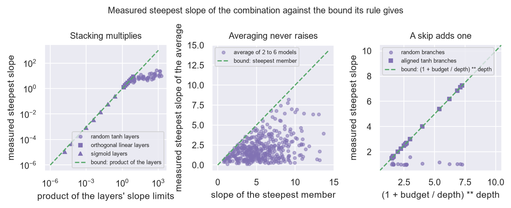

# 14. Three ways to combine slope

**In the repository:** the files in
[`Supporting/NetworkShape/`](../lean/SquigglyLine/Supporting/NetworkShape),
with notes in
[`docs/supporting/network-shape/`](../docs/supporting/network-shape).
**You need:** chapters 3 and 7.
**The proofs, one by one:** part V, chapters 28 to 35.

## The idea

Chapter 3 said nearness is bought with slope. So the question to ask of
any network design is: what does it do to slope? Across every result
about architecture in the repository there are only three answers.

> Stacking multiplies slope. Averaging never raises it. A skip adds one.

## Stacking multiplies it

A network is no steeper than the product of the slopes of its layers,
and the gradient comes back through the same product
([`NetworkSlope`](../lean/SquigglyLine/Supporting/NetworkShape/NetworkSlope.lean)).
Several known facts are this one fact.

- **Adversarial examples.** To flip a classifier whose slope is at most
  `slope_limit`, an input must move by at least
  `score / slope_limit`. A steep classifier can be fooled by a small
  nudge. This is chapter 3 read backwards.
- **Vanishing and exploding gradients.** If each layer has gain `gain`,
  then `depth` layers have gain `gain ^ depth`. It dies below one and
  blows up above
  ([`VanishingGradients`](../lean/SquigglyLine/Supporting/NetworkShape/VanishingGradients.lean)).
  A sigmoid's slope is never above one quarter, so sigmoid layers fade
  fast
  ([`Activations`](../lean/SquigglyLine/Supporting/NetworkShape/Activations.lean)).
- **Initialisation.** A fold keeps exactly half the mean squared size of
  a signal that is as often negative as positive. The factor two in He
  initialisation puts it back
  ([`Gain`](../lean/SquigglyLine/Supporting/NetworkShape/Gain.lean)).
- **Convolution.** A convolution layer is no steeper than the summed
  sizes of its kernel weights. Reading every second position is a
  squeeze by two, so by chapter 7 it doubles the slope
  ([`Convolution`](../lean/SquigglyLine/Supporting/NetworkShape/Convolution.lean)).
- **Temperature.** Dividing the scores by a temperature divides their
  slope and never changes their order.

## Averaging never raises it

An average of models is no steeper than the steepest of them
([`Averaging`](../lean/SquigglyLine/Supporting/NewInputs/Averaging.lean)).
The same holds for the higher of two lines, which covers max-pooling,
and for a model averaged over shifted or turned copies of its input,
which covers augmentation. Chapter 15 is about what averages can and
cannot do.

## A skip adds one

A residual layer outputs its input plus a branch. If the branch has
slope at most `branch_slope`, the layer has slope between
`1 − branch_slope` and `1 + branch_slope`
([`Residual`](../lean/SquigglyLine/Supporting/NetworkShape/Residual.lean)).
That one line says a lot.

- With `branch_slope` below one, the lower bound is above zero. So the
  layer never merges two inputs, which answers question 3 of chapter 12.
- A stack of `depth` such layers, each with a branch of slope
  `budget / depth`, has total slope at most `e ^ budget`, however deep
  it is. Depth without explosion.
- The memory cell of an LSTM is the same thing. Its slope per step is
  the forget gate, and exactly one with the gate open.

In the optics picture of chapter 12, a skip is a beam that goes round
the plate and rejoins, and a normalisation is an amplifier after it
([`SkipAndNorm`](../lean/SquigglyLine/Supporting/NetworkShape/SkipAndNorm.lean)).
Both hold the factor of chapter 13 at one.

## Gates, the one way round the rules

A gate blends several experts using weights that depend on the input.
Its output changes by at most what the experts change, **plus** the
spread between the experts times how fast the gate changes
([`Mixtures`](../lean/SquigglyLine/Supporting/NetworkShape/Mixtures.lean)).
So a blend of gentle experts can still be steep where the gate switches
quickly between experts that disagree. Attention is such a gate.

## What follows

Squiggle can only come from stacking pieces that are steep or that fold
(chapter 8). No amount of averaging makes it, and skips only carry it.

## Run it yourself

[`ch14_combining_slope.ipynb`](../experiments/part3/ch14_combining_slope.ipynb)
checks one thing per rule, on small random networks of `tanh`, sigmoid and
linear layers, with the steepest slope read off a grid of 6001 inputs. Slopes
and gaps below are **measured** (the networks were run); a number that comes
from evaluating a formula is called **from the formula**. An experiment is
evidence, not a proof.



- **Stacking.** Forty-eight random `tanh` stacks of 1 to 8 layers are never
  steeper than the product of their layer slope limits; the measured slope is
  between 5.6e-03 and 1.00 of the product. Orthogonal linear layers of gain 1.3
  meet the product (relative gap 3.3e-16), so the depth-8 stack has slope 8.16
  against 1.3 for one layer: the slopes multiply. Sigmoid layers on orthogonal
  weights stay below `0.25 ^ depth`, at 0.70 to 1.00 of it. For a depth-3
  classifier with `slope_limit` 181.33 (its measured steepest slope is 25.06),
  the smallest input move that flipped it, over 300 inputs, was at least 11.50
  times `score / slope_limit`.
- **Averaging.** Over 400 trials of 2 to 6 networks with random shares, the
  average was never steeper than its steepest member (largest ratio 0.9946), and
  the pointwise maximum of two never steeper than the steeper (largest ratio
  1.0000). Averaged over 7 shifted copies of its input, a network was at most
  0.9460 of its own steepest slope. The control, adding the members instead of
  averaging them, was steeper than the steepest member in 215 of the 400 trials.
- **A skip.** One residual layer with a random branch of slope 0.3 had output
  gap over input gap between 0.933 and 1.093 (allowed, from the formula, 0.7 to
  1.3), and with slope 0.9 between 0.720 and 1.217 (allowed 0.1 to 1.9). In one
  dimension a branch of slope 0.9 never merged two inputs (smallest difference
  quotient 0.100), while one of slope 1.5 turned (smallest -0.500) and sent 0 and
  1.2878 to the same output. Stacks of 1 to 100 layers, with budgets 0.5, 1 and
  2, were never steeper than `(1 + budget / depth) ^ depth` (at most 0.700 of
  it) or than `e ^ budget` (at most 0.9988 of it). Stacks of aligned `tanh`
  branches meet the bound (relative gap 9.8e-15). With a hundred branches of
  slope 0.01 the bound from the formula is 2.7048; random branches measured
  1.0040 and aligned branches 2.7048. Without skips the bound from the formula is
  `1e-200`, and the measured slope underflowed to 0.0. Over all the random-branch
  skip stacks the measured slope was between 0.953 and 1.591, where the bound
  from the formula reaches 7.245. The LSTM cell multiplied the gap between two
  memories by the product of the forget gates.
- **The gate.** With three gentle experts (slope at most 0.17) and a sharp
  softmax gate, 20 000 pairs of inputs all changed the blend by at most the
  stated limit (largest ratio 1.000), and the blend's steepest slope was 5.75.
  With the gate made constant the blend's slope was 0.087, below the
  experts' 0.167.

Two further lines are printed as "by construction, cannot fail" and are not
evidence: a branch that is 0.9 times the identity gives the ends 1.900 and 0.100,
and an LSTM cell with open gates keeps the gap. In the random networks the
bounds are usually far from tight. That the real slope is that much gentler is
not proved here.

Not run: convolution, initialisation, temperature, attention, rotated copies of
the input, and the vanishing-gradient table beyond the product of layers.

Run it with:

```bash
jupyter nbconvert --to notebook --execute --inplace experiments/part3/ch14_combining_slope.ipynb
```

## What is not shown

These are upper limits on slope. A real network is usually far gentler
than the product of its layers allows, and how much gentler is not
proved here.

## Check yourself

1. A network has five layers, each with slope at most 2. How steep can
   it be?
2. A classifier has slope at most 10, and gives a score of 0.5 to its
   answer. What is the smallest move of the input that could flip it?
3. A hundred residual layers each have a branch of slope 0.01. How steep
   can the stack be? What if the same branches were stacked without
   skips?

**Answers.** (1) At most 32. (2) At least 0.05. (3) At most `e`, about
2.72. Without skips the slope is at most `0.01 ^ 100`: the signal is
gone.

Previous: [13. One factor, again and again](13-one-factor.md) · Next: [15. Averages](15-averages.md)
