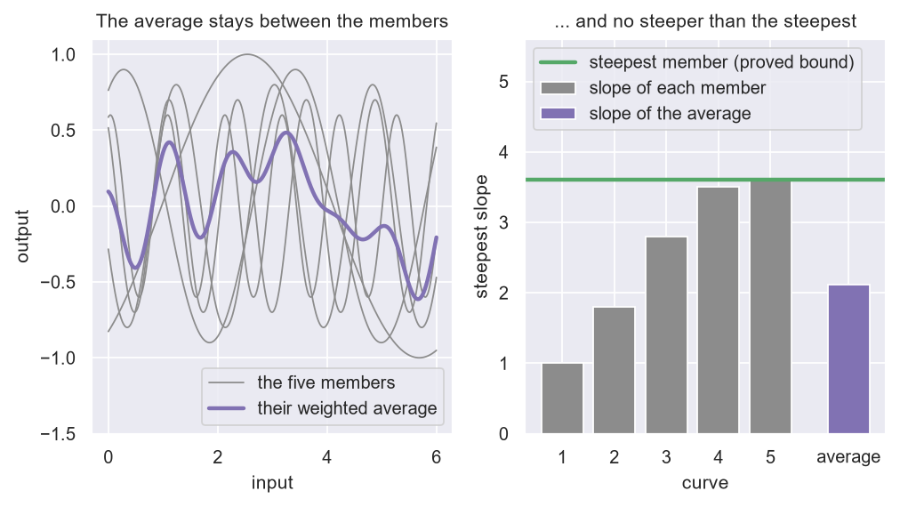
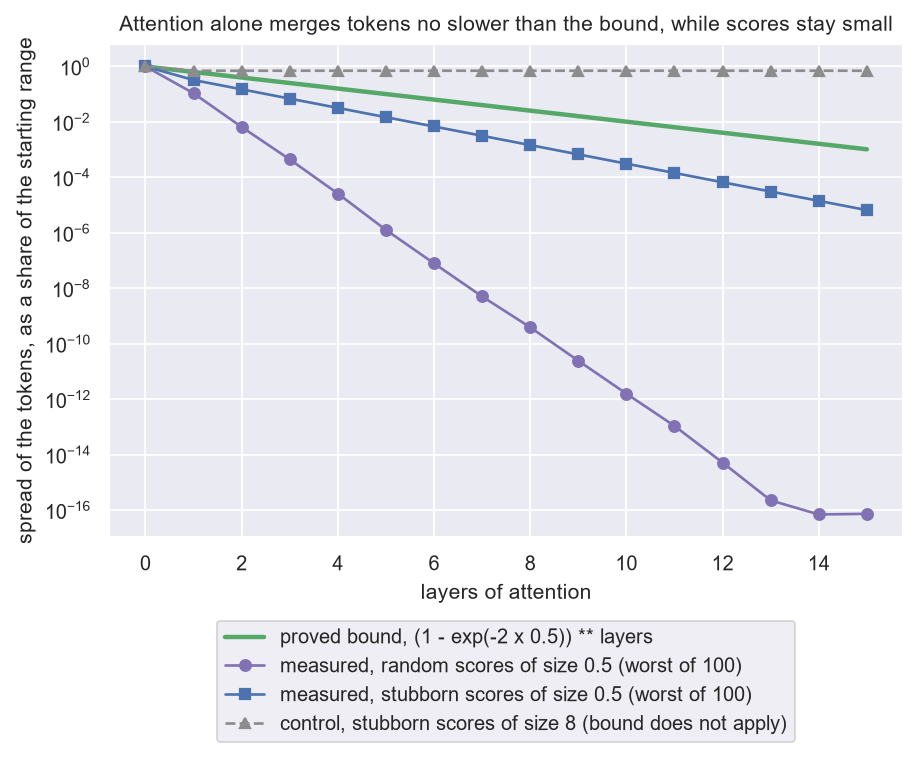

# 15. Averages

**In the repository:**
[`Attention.lean`](../lean/SquigglyLine/Supporting/NetworkShape/Attention.lean),
[`AttentionRate.lean`](../lean/SquigglyLine/Supporting/NetworkShape/AttentionRate.lean),
[`Averaging.lean`](../lean/SquigglyLine/Supporting/NewInputs/Averaging.lean),
[`Counting.lean`](../lean/SquigglyLine/Supporting/NewInputs/Counting.lean),
[`Temperature.lean`](../lean/SquigglyLine/Supporting/NetworkShape/Temperature.lean),
[`Neighbours.lean`](../lean/SquigglyLine/Supporting/NewInputs/Neighbours.lean).
**You need:** chapters 10, 11 and 14.
**The proofs, one by one:** part VI, chapters 36 to 41.

## The idea

A great deal of modern deep learning is built from weighted averages:
attention, ensembles, diffusion models, nearest neighbours. An average
has one plain property.

> An average never leaves the region its inputs span.

The average of 2, 4 and 9 lies between 2 and 9, whatever the weights.
This chapter is that one property, used five times.

**Measured** (notebook, one random draw): five sine curves with slopes up to 3.6
and their weighted average. The average stays between them, and its steepest
slope is 2.11, below the steepest member's 3.60.



## Attention is an average

An attention head scores each token, turns the scores into shares that
add up to one, and returns that blend of the tokens' values. So its
output is a weighted average, and any stack of such heads keeps every
token inside the region the tokens started in.

Stacked alone, attention also pulls the tokens together. If the scores
are at most `score_bound` in size, each layer shrinks the spread of the
tokens by a fixed factor below one, so `depth` layers shrink it by that
factor to the power `depth` (`abs_iterate_attentionLayer_sub_le`). This
is the one-factor rule of chapter 13, and the reason transformers need
their skip connections.

**Measured**, against the **proved** bound, for scores of size at most 0.5:
over 100 runs of 24 tokens, the spread after each of 15 layers never exceeds
`0.632 ** layers`, and scores that make each query favour its own side of the
median reach at most 0.513 of the bound (a fraction of it, which is not
"close to" the slowest merging the bound allows). With scores of size 8 the
bound is broken and, at layer 15, the spread ends between 382 and 683 times
above it (683 is also the largest ratio over all layers).



## Attention is one step of training

Take a model that is linear in its weights, starting from zero. Give it
some examples and one step of gradient descent. By the kernel trick of
chapter 11, its prediction at a new input is

```
learning_rate × Σ kernel(example, new input) × label of the example
```

Read that as an attention head. The tokens are the examples. The score
of a token is its overlap with the query. Its value is its label. Leave
out the softmax. Then the head's output is that prediction
(`prediction_one_step_eq_linearAttention`).

So a stack of such heads can run gradient descent on the examples in
its prompt, one step per layer, without changing its own weights. This
is the simplest account of in-context learning. With the softmax kept,
the question is open here.

## The ideal denoiser is an average of the training set

A diffusion model learns to remove noise. The best possible denoiser has
a closed form: it is an attention head over the training examples, with
nearer examples scored higher
([`Averaging.lean`](../lean/SquigglyLine/Supporting/NewInputs/Averaging.lean)).
So it never leaves the region the training examples span.

## A count is the worst thing to ask of an average

A count is a whole number, and it jumps. Averages and limited slopes do
not jump. [`Counting.lean`](../lean/SquigglyLine/Supporting/NewInputs/Counting.lean)
has three short facts.

- A read-out that changes smoothly from `count` to `count + 1` says
  `count + 1/2` somewhere on the way (`exists_half_count`).
- At a noisy input equally far from two training examples, the ideal
  denoiser returns the point half way between them
  (`denoiser_two_of_equidistant`). If one is a hand with five fingers and
  the other a hand with six, the answer is a blend of the two.
- Telling `count` from `count + 1` takes slope at least one over the
  distance between the inputs (`one_le_slope_mul_dist_of_count`, the
  statement you read in chapter 2).

**From the formula** (the denoiser evaluated, not trained), and the head
**evaluated** (a softmax computed on chosen scores, not trained or fitted). For two examples at 0 and 1 read as five and six fingers, the
denoiser says 5.5 at 0.5 for every noise level tried, 0.1 to 1. Its steepest
slope is `1 / (4 * noise_level ** 2)` (25 at 0.1, 6.25 at 0.2, 1 at 0.5 and
0.25 at 1), and the read-out changes by 1.000, 1.000, 0.762 and 0.245 between
the two examples, never more than the slope allows. For a head run over `total`
tokens with `copies` of one marked token, equal scores give the output `copies / total`
(so this holds by construction): one more copy moves it by 0.100, 0.050 and
0.025 at 10, 20 and 40 tokens.


These show that counting is hard for a model made of averages and
limited slope. They do not show that this is why a real image model
draws six fingers. That needs experiments.

## More averages

- **Ensembles.** The squared error of an average of models is the
  average of their errors minus the spread between them. So an ensemble
  is never worse than its members are on average, and it gains exactly
  what they disagree by.
- **Temperature.** Sample from a softmax of scores divided by a
  temperature. As the temperature falls, the average score of a sample
  never falls (`expectedScore_softmax_mono`), and the samples
  concentrate on the top score (`one_sub_softmax_div_le`). One dial moves
  quality up and variety down.
- **Nearest neighbours.** Copying the label of the nearest training input
  is wrong by at most the slope of the truth times the distance to that
  input. Nearness times slope again.

## Run it yourself

`experiments/part3/ch15_averages.ipynb` has one experiment for each rule of this
chapter. Of its printed lines, 23 are checks that could fail and passed, and 10 are
marked "by construction, cannot fail" and are not evidence (they hold by symmetry,
by the grid, or by algebra). It is evidence, not a proof: the proofs are in Lean.
Seeded runs of attention heads, stacks, blends, gradient steps and the nearest-label
rule are **measured**; the denoiser read-outs, the head with equal scores and the
temperature sweep are **evaluated**, from the formula, and are labelled so.

- **Range.** 2000 random heads and 300 stacks of 20 layers with scores up to
  30 in size: no output or token leaves the interval of the values. Dividing
  nothing by the sum of the weights (control) leaves it in 1756 of 2000 heads.
- **Merging rate.** Spread / starting range is at most `0.632 ** layers` for
  random and for stubborn scores of size 0.5; the worst ratios to the bound
  at layers 1 to 15 are 0.171 and 0.513 (stubborn scores reach 0.513 of the
  bound; that is not "close to" the slowest merging). Scores of size 8: at
  layer 15 the ratio is between 382 and 683, and 683 is also the largest over
  all layers.
- **Slope of an average.** In 200 blends the slope is at most 0.992 of the
  steepest member's, and no blend leaves the members' range. (Shares adding up
  to 2 give 1.983 times it, but that is by construction and not counted.)
- **Attention is a gradient step.** One step from zero weights, with the
  gradient of the squared loss computed by autograd (not from the formula),
  matches the linear-attention head to 4.4e-16; the head with the softmax kept
  differs from it by 2.71.
- **Denoiser.** 2000 noisy inputs, 4 noise levels, some far out: always
  inside the examples' range, and no other output has a smaller weighted
  squared distance, among 500 candidates uniform in [-3, 3] per input and also
  among 500 per input at noise 0.01 and 500 at noise 0.1 around the denoiser's
  output (0 better candidates in each case). The equal-share mean does worse on
  1999 of 2000.
- **Counts.** As above (from the formula for the denoiser, evaluated for the
  head). The checks that could fail are that the read-out never decreases, that
  the steepest slope is `1 / (4 * noise_level ** 2)` to 0.1 percent, and that the
  wide average (noise level 1) separates the two examples by only 0.245. The
  read-out 5.5 at 0.5, the crossing at 0.5, the slope times 1 being at least the
  gap, and everything about the head with equal scores are by construction.
- **Ensembles.** The error identity (largest gap 2.1e-14 in 1000 draws) and
  the ensemble never being worse than its members' average with non-negative
  shares are algebra, by construction, not counted. The check that could fail is
  the control: with a negative share the inequality fails in 392 of 1000 draws.
- **Temperature** (from the formula, exact evaluations). Over 500 score vectors, the average score never fell as
  the temperature went from 4 to 0.05, and the share missing from the top
  stayed within `(answers - 1) * exp(-gap / temperature)` in all 20000 checks.
  Not a claim of the chapter: the variety (entropy) also fell at every step in
  all 500 draws.
- **Nearest neighbours.** The error of the copied label (vertical) was at most
  0.859 of `6.5 * distance` for 5000 queries (largest error 1.559 at distance
  0.339). A jump in the truth gives error 1.0 at distance 0.0002, by
  construction, not counted.

```bash
jupyter nbconvert --to notebook --execute --inplace experiments/part3/ch15_averages.ipynb
```

## What is not shown

- In-context learning with the softmax kept.
- Any measure of variety that falls at every step as the temperature
  falls. Only the two ends are proved.
- That real attention layers, with their skips and other layers between
  them, merge tokens. The rate is for attention alone.

## Check yourself

1. An attention head sees values 2, 4 and 9. Can it output 10?
2. An attention head gives two examples the same score. Their values are
   5 and 6. What does it return?
3. Why can an average of gentle models not draw a sharp step?

**Answers.** (1) No. A weighted average stays between 2 and 9. (2) 5.5
(`attend_two_of_const_score`). (3) An average is no steeper than its
steepest member (chapter 14), and a sharp step needs a large slope.

Previous: [14. Three ways to combine slope](14-combining-slope.md) · Next: [16. New inputs](16-new-inputs.md)
