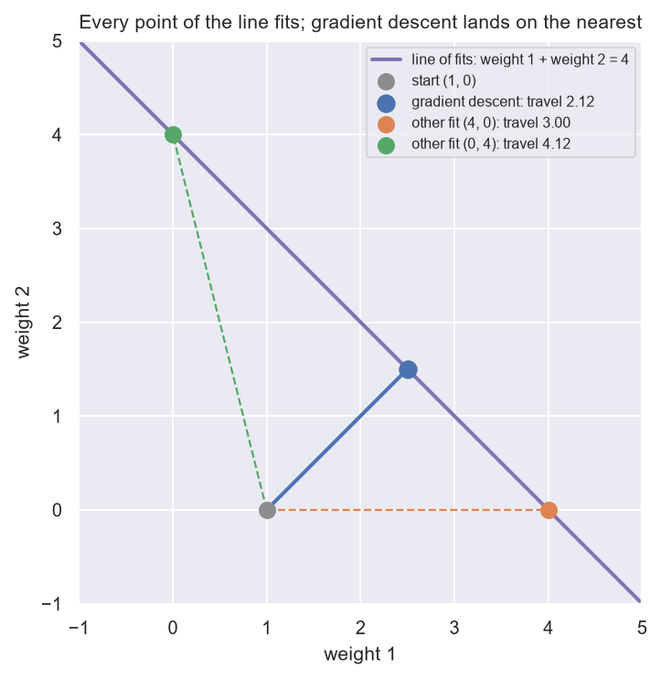
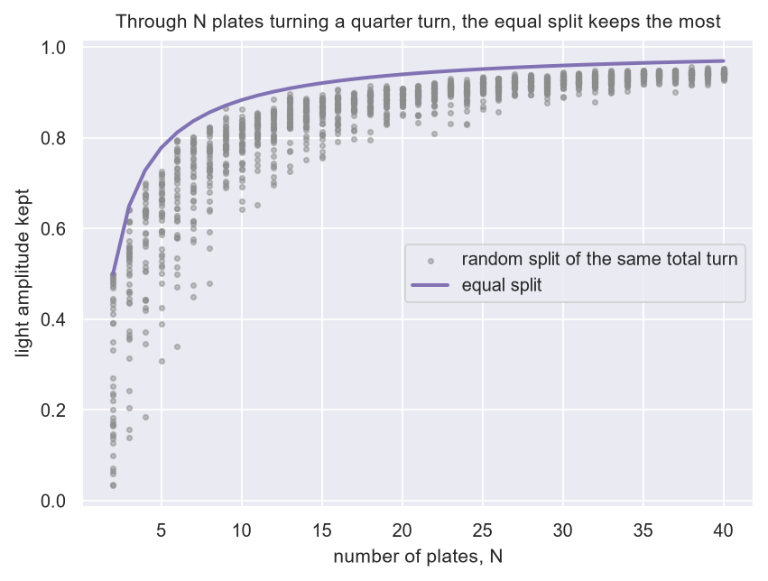

# 17. The shortest trip

**In the repository:**
[`LeastAction.lean`](../lean/SquigglyLine/Supporting/Training/LeastAction.lean),
note [`least-action.md`](../docs/supporting/training/least-action.md).
**You need:** chapters 9, 10 and 12.

## The idea

Physics has an old rule, the principle of least action: a ball rolls
along the path that costs least. It is natural to ask whether training
does the same. A network is trained a step at a time, so what it arrives
at should be, in some sense, the cheapest place to arrive.

For a model that is linear in its weights, the idea can be made exact.
Chapter 9 measured the **travel** to a fit: how far the weights must
move. Gradient descent never wastes movement. Each step moves the weights
only along the features, and a move along the features is the shortest way
to change the outputs.

> If gradient descent arrives at a fit, no other fit is nearer to where
> it started.

The same idea holds, in a smaller way, for the polarizers of chapter 12.
Of two plates that turn the light by different angles, the pair that
turns by the average of the two angles keeps at least as much light.

## An example you can do by hand

One data point and two weights. The model is `output = weight_1 +
weight_2`, so its features are `(1, 1)`. The label is 4 and the start is
`(1, 0)`, so the output is 1 and the error is 3.

Every fit lies on the line `weight_1 + weight_2 = 4`. With learning rate
0.5, one gradient step adds `0.5 × 3 × (1, 1)`, which is `(1.5, 1.5)`.
The weights land on `(2.5, 1.5)`, and 2.5 + 1.5 = 4. The travel is
`√(1.5² + 1.5²) = √4.5`, about 2.12.

Now compare two other fits. `(4, 0)` needs a move of `(3, 0)`: travel 3.
`(0, 4)` needs a move of `(−1, 4)`: travel `√17`, about 4.12. Gradient
descent found the nearest of the three. It had to, because its move
`(1.5, 1.5)` points along the features `(1, 1)`, and the line of fits is
at right angles to that.

**Measured.** The line of fits, the start, the point gradient descent lands on, and two other fits, with the travel to each:



For the polarizers, take turns of 60° and 0°. The pair keeps
`cos 60° × cos 0° = 0.5 × 1 = 0.5`. Two turns of the average, 30°, keep
`cos 30° × cos 30° = 0.75`. The even pair keeps more.

## The statement

```lean
theorem gradient_descent_fit_is_the_nearest_fit
    (predict : Weights →L[ℝ] Outputs)
    (labels : Outputs)
    (learning_rate : ℝ)
    (start_weights : Weights)
    (step_count : ℕ)
    (trained_weights_fit :
      predict ((TAKE_GRADIENT_STEP predict labels learning_rate)^[step_count]
        start_weights) = labels)
    {other_weights : Weights}
    (other_weights_fit : predict other_weights = labels) :
    let trained_weights :=
      (TAKE_GRADIENT_STEP predict labels learning_rate)^[step_count]
        start_weights
    let trained_distance := ‖trained_weights - start_weights‖
    let other_distance   := ‖other_weights - start_weights‖
    trained_distance ≤ other_distance := by
```

*Read aloud:* if training for `step_count` steps lands on a fit, then
any other fit is at least as far from the start. The bars `‖ ‖` are the
length of a move, as in chapter 9. `[step_count]` on the step means
"apply it that many times".

The second statement is for the layers.

```lean
theorem two_turns_keep_at_most_two_equal_turns
    (first_turn : ℝ)
    (second_turn : ℝ) :
    let kept_by_two_turns := cos first_turn * cos second_turn
    let average_turn      := (first_turn + second_turn) / 2
    let kept_by_average   := cos average_turn ^ 2
    kept_by_two_turns ≤ kept_by_average := by
```

*Read aloud:* two turns never keep more than two turns of their
average. `even_turns_keep_more` is the same with a length in front.

The third statement is for any number of plates.

```lean
theorem equal_turns_keep_the_most
    {Plates : Type*}
    (plates : Finset Plates)
    (plates_nonempty : plates.Nonempty)
    (turn : Plates → ℝ)
    (turns_within_quarter :
      ∀ plate ∈ plates, turn plate ∈ Set.Icc (-(PI / 2)) (PI / 2)) :
    let plate_count     := plates.card
    let kept_by_turns   := ∏ plate ∈ plates, cos (turn plate)
    let average_turn    := (∑ plate ∈ plates, turn plate) / plate_count
    let kept_by_average := cos average_turn ^ plate_count
    kept_by_turns ≤ kept_by_average := by
```

*Read aloud:* take any number of plates, each turning by at most a
quarter turn either way. Multiply what each one keeps. The result is at
most what the same number of plates keep when every one turns by the
average turn. `∏` is a product over the plates, as `∑` is a sum.

## Why it is true

**Moving along the features.** After any number of steps, the weights
differ from the start by a move of the form `adjoint predict vector`, the
transpose of chapter 10 applied to some vector of outputs
(`gradient_descent_stays_in_the_directions_of_the_features`). The proof is by counting steps. One more
step adds a multiple of the error, and the error is itself pulled back by
the transpose.

**Why that move is shortest.** Call the move training made `move`, and
let `other_move` be the move to another fit. Both fits give the same
outputs, so the model sends `move` and `other_move` to the same place.
Because `move` lies along the features, its inner product with
`other_move` can be taken on the output side, where the two agree. So

```
‖move‖² = inner(move, other_move) ≤ ‖move‖ × ‖other_move‖
```

The last step is the Cauchy–Schwarz inequality of chapter 3. Divide by
`‖move‖` and you have `‖move‖ ≤ ‖other_move‖`
(`moving_along_the_features_is_moving_least`).

**The plates.** The product of two cosines is half the sum of the cosine
of their difference and the cosine of their sum. Two turns of the average
keep `1/2` plus half the cosine of the sum. The two differ only in the
cosine of the difference, and a cosine is at most 1.

**Any number of plates.** Two facts, one after the other. First, the
geometric mean of numbers that are not negative is at most their
ordinary mean. So the `plate_count`-th root of the product of the
cosines is at most the mean of the cosines. Second, between minus a
quarter turn and a quarter turn the cosine curve bends downward. So the
mean of the cosines is at most the cosine of the mean turn. That is
Jensen's inequality. Put the two together and raise both sides to the
power `plate_count`.

## What it explains

People often say that gradient descent has an **implicit bias**: of all
the fits, it prefers some. Here the preference is exact for a linear
model. It prefers the fit nearest the start, and the function it ends with
stays as close as possible to the starting function. That is why
`fit_near_the_start_is_tame_everywhere` of chapter 10 has a leash on the fit.

For the layers, the note says a trained network with skip connections is
reported to take straighter paths as it trains (**recalled**: Hosseini
and Fedorenko). The plate inequality gives the reason such a path would
lose least. It does not show that trained layers do turn evenly.

**A common misunderstanding.** "Equal steps lose least" says which path
is best. It does not say which path training takes. Nothing here gets
the second from the first.

## How this meets the squiggly line

The travel of chapter 9 is the cost the squiggly line has to pay, and
here it becomes the cost training actually pays. The transpose is the
lift-and-kernel machinery of chapters 10 and 11: the move lives in the
space the features span. The plates are the polarizers of chapter 12,
where a layer keeps only part of a signal.

## Run it yourself

[`ch17_the_shortest_trip.ipynb`](../experiments/part4/ch17_the_shortest_trip.ipynb)
runs gradient descent on linear models, and computes plate stacks with 2 by 2
matrices. **Measured**, in the example: one step lands on `(2.5, 1.5)` with
travel 2.1213 and vertical error 0. A real descent whose steps leave the
features (preconditioner `diag(1, 0)`) reaches the fit `(4, 0)` with the same
vertical error 0 but travel 3, so the vertical error cannot tell the fits
apart and only the travel can. **From the geometry of the example**, not a
model run: none of 100 001 points placed along the line of fits is nearer than
the landing point, and the travel of the hand-picked fits, 3 and 4.1231, is
arithmetic.

**Measured**, in 40 random linear models (3 to 8 data points, 12 to 30
weights): gradient descent reached the minimum-norm fit to within `2.3e-13`.
Another 240 fits were reached by descents from the same start with random
positive diagonal preconditioners, and none was nearer: the smallest margin was
2.56e-02. A further 80 000 fits were built as the minimum-norm move plus a
null-space move; those cannot be nearer by Pythagoras, so they are by
construction and not evidence. With the fixed preconditioner
`diag(1, 5, 1, 5, ...)` the fit reached was further in all 40, by up to 0.899.

**Computed with 2 by 2 plate matrices**, not measured, since this is the
product of cosines written as matrices: turns of 60° and 0° keep 0.5000 and two
turns of 30° keep 0.7500. Among 2000 random pairs of turns, the largest amount
by which a pair beat its average was `-2.1e-08`, that is, none did. For `N` plates
with a quarter turn in total (`N` = 2, 3, 10, 100), the largest amount by which any
of 2000 random splits beat the equal split was `-1.8e-08`: none did. At `N = 10` the
best random split kept 0.869165 and the equal split 0.883485.

**From the formula**: the product of cosines was evaluated on 960 000 random
splits of a total turn of at most a quarter turn. The largest amount by which any
beat the equal split was 0, so none did. The equal split's amplitude was at least
`1 - π²/(8N)` for each `N`, with smallest margin 7.53e-05. For two plates the
same formula on 200 000 random pairs gave `-1.7e-14`. The control, total turn `2π`
and `N = 3`, is also from the formula: a split beat the equal one by 1.125, because
past a quarter turn the cosine changes sign.



The experiment is evidence, not a proof. For turns within a quarter turn the
N-plate result is **proved** by `equal_turns_keep_the_most`. The "balanced layers"
under a gradient step were not tested.

## What is not shown

- **Deep networks.** The first result is for models that are linear in
  their weights. For a real network, gradient descent is known to favour
  some solutions, but "the nearest fit" is exact only in the linear case.
  This is **open**.
- **Reaching the fit.** Gradient descent usually approaches a fit
  without landing on it. The statement covers the case where it lands.
- **Turns of more than a quarter turn.** `equal_turns_keep_the_most`
  needs every plate to turn by at most a quarter turn either way. Past
  that a plate flips the sign of the light, and the equal split need not
  be the best. The notebook finds a split that beats it when three
  plates share a full turn.
- **That trained layers turn evenly.** That is an observation from the
  literature, not derived here. **open**

## Check yourself

1. In the example, the label is 4 and the start is `(0, 0)`. Where does
   one step with learning rate 0.5 land, and which fit is nearest?
2. Why can gradient descent not land on a fit that is further than
   another fit when both are available?
3. Turns of 90° and 0° meet two turns of 45°. What does each pair keep?

**Answers.** (1) The error is 4, so the step adds `0.5 × 4 × (1, 1)`,
which is `(2, 2)`. The output is 4, so it is a fit, and by
`gradient_descent_fit_is_the_nearest_fit` it is the nearest. Check: `(4, 0)` is
at distance 4, and `(2, 2)` is at `√8`, about 2.83. (2) Its move lies
along the features, and `moving_along_the_features_is_moving_least` shows a fit
reached that way is at least as near as any other. (3) `cos 90° ×
cos 0° = 0`, and `cos 45° × cos 45° = 0.5`. The even pair keeps more, as
`two_turns_keep_at_most_two_equal_turns` says.

Previous: [16. New inputs](16-new-inputs.md) · Next: [18. Strong directions first](18-strong-directions-first.md)
