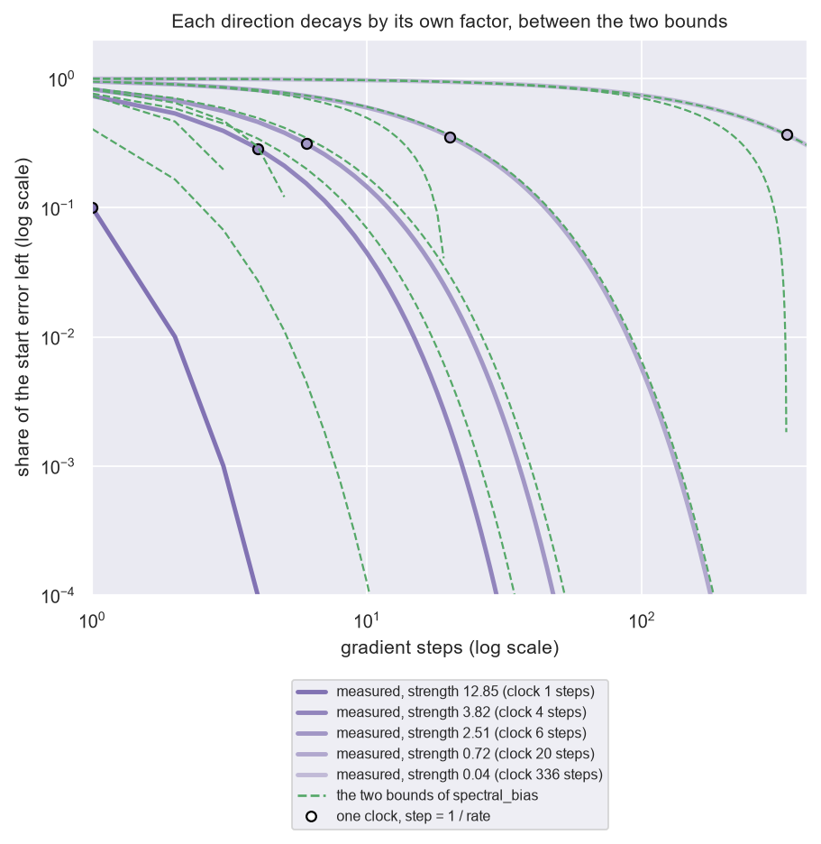
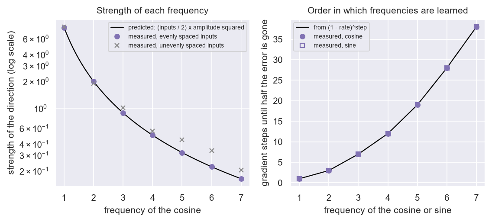

# 18. Strong directions first

**In the repository:**
[`SpectralBias.lean`](../lean/SquigglyLine/Supporting/Training/SpectralBias.lean),
note [`spectral-bias.md`](../docs/supporting/training/spectral-bias.md).
**You need:** chapters 10 and 13.

## The idea

People who train networks see a pattern. Early in training the model has
the broad shape of the data and misses the fine detail. The detail comes
later. This is called **spectral bias**: the model is reported to learn
the smooth, slow-changing part of a function first and the fine wiggles
last (**recalled**: Rahaman et al. 2019).

For a model that is linear in its weights, this is one line of algebra
from chapter 10. Along a pattern of strength `strength`, one gradient
step multiplies the error by `1 − learning_rate × strength`. Strong
patterns shrink fast. Weak ones shrink slowly. A pattern of strength
zero does not shrink at all.

> Each direction of the error has its own clock, of about
> `1 / (learning_rate × strength)` steps. A strong direction is learned
> first, no direction can be hurried, and every direction with some
> strength is learned in the end.

**A common misunderstanding.** "Spectral" here does not mean a spectrum
of sine waves. It means the spectrum of the kernel: its strengths, which
are its eigenvalues. The statement below is about any direction the
kernel only stretches. Those directions are sines in one special case:
inputs evenly spaced over a period, and a kernel that depends only on
the gap between two inputs, as the Fourier kernel of chapter 11 does.
With unevenly spaced inputs the sines are no longer such directions.
**argued**

## An example you can do by hand

Take learning rate 0.1 and two directions, as in chapter 10. One has
strength 5, so `rate = learning_rate × strength = 0.5`. The other has
strength 0.05, so its rate is 0.005.

The clocks are `1 / 0.5 = 2` steps and `1 / 0.005 = 200` steps.

After 10 steps the share of error left is:

- strong: `0.5^10`, about 0.001. It is learned.
- weak: `0.995^10`, about 0.951. Almost nothing has happened.

After 200 steps the weak direction has `0.995^200`, about 0.37 left. One
clock has run, and about two thirds of the error has gone.

## The statement

```lean
theorem spectral_bias
    (predict : Weights →L[ℝ] Outputs)
    (labels : Outputs)
    {learning_rate : ℝ}
    {kernel_strength : ℝ}
    (rate_le_one : learning_rate * kernel_strength ≤ 1)
    (start_weights : Weights)
    {direction : Outputs}
    (direction_is_stretched :
      predict (adjoint predict direction) = kernel_strength • direction)
    (step_count : ℕ) :
    let linear_predict : LinearPredictor Weights Outputs := predict
    let trained_weights :=
      (TAKE_GRADIENT_STEP predict labels learning_rate)^[step_count]
        start_weights
    let start_error   := inner ℝ direction
      (GET_RESIDUAL linear_predict labels start_weights)
    let trained_error := inner ℝ direction
      (GET_RESIDUAL linear_predict labels trained_weights)
    let rate          := learning_rate * kernel_strength
    let lower_bound   := (1 - step_count * rate) * |start_error|
    let upper_bound   := Real.exp (-(step_count * rate)) * |start_error|
    let not_hurried   := lower_bound ≤ |trained_error|
    let runs_out      := |trained_error| ≤ upper_bound
    not_hurried ∧ runs_out := by
```

*Read aloud:* along a direction that the kernel only stretches, the
error left after `step_count` steps is at least `1 − step_count × rate`
of what it was and at most `exp(−step_count × rate)` of it. Here `inner`
measures how much of the error lies along `direction`, and `Real.exp` is
the exponential, the number `e` raised to a power. The condition
`rate_le_one` says the step is not too big for this direction.

The second statement compares two directions.

```lean
theorem strong_directions_first
    {learning_rate : ℝ}
    {weak_strength : ℝ}
    {strong_strength : ℝ}
    (learning_rate_nonneg : 0 ≤ learning_rate)
    (weak_le_strong : weak_strength ≤ strong_strength)
    (strong_rate_le_one : learning_rate * strong_strength ≤ 1)
    (step_count : ℕ) :
    let strong_rate  := learning_rate * strong_strength
    let weak_rate    := learning_rate * weak_strength
    let strong_share := (1 - strong_rate) ^ step_count
    let weak_share   := (1 - weak_rate) ^ step_count
    strong_share ≤ weak_share := by
```

*Read aloud:* at every step, the strong direction has no more error
left than the weak one.

Two more results complete the picture.
`inner_residual_iterate_gradientStep` gives the exact share,
`(1 − learning_rate × kernel_strength) ^ step_count`, and
`inner_residual_iterate_of_kernel_eq_zero` says that a direction of
strength zero keeps its error for ever.

## Why it is true

**One step.** The kernel only stretches `direction`, by `kernel_strength`.
A gradient step removes `learning_rate` times the kernel applied to the
error. Along `direction` that is `learning_rate × kernel_strength` of the
error. So the error is multiplied by `1 − learning_rate × kernel_strength`
(`inner_residual_gradientStep`).

**Many steps.** Repeat. Each step multiplies by the same factor, so
`step_count` steps multiply by its power. The directions do not talk to
each other.

**The two bounds.** The share left is `(1 − rate) ^ step_count`. The lower
bound is Bernoulli's inequality, `one_sub_mul_le_pow_one_sub`: raising a
number just below 1 to a power cannot take away more than the power times
the gap. The upper bound uses the fact that `1 − x` is at most `exp(−x)`,
raised to the same power (`pow_one_sub_le_exp`). The comparison of two
directions is `pow_one_sub_anti`: a larger rate, up to 1, leaves a smaller
share.

## What it explains

**The order of learning.** The directions of chapter 10 are learned in
order of strength. The proof does not say which directions are strong in a
real network. For common networks the strong ones are reported to be the
smooth ones. Here the strengths are given, not derived. **open**

**Early stopping.** Suppose the true pattern lies in strong directions and
the noise lies in weak ones. Stop after 20 steps in the example. The
strong share is `0.5^20`, about one in a million. The weak share is about
0.90, and `spectral_bias` says it cannot be below `1 − 20 × 0.005 = 0.9`.
So the pattern is fitted and the noise has hardly been touched. This is
**argued** from the two bounds. That real data splits this way is **open**.

**Grokking.** A network sometimes fits its training data early and only
much later does well on new data. If the part that generalises lies in a
weak direction, its clock is long. The lower bound says nothing visible
happens for about that long, and the upper bound says it does get learned.
**argued**. Whether this is what happens in a real run is **open**.

## How this meets the squiggly line

This is the kernel of chapter 10, read one direction at a time. In the
Fourier model the strength of a frequency is the square of the size its
coefficient is allowed. If high frequencies get small sizes, the smooth
part is learned first and the squiggles last. So the order in which
squiggles appear in training is set by the same sizes that set how
squiggly the model is at the start.

## Run it yourself

[`ch18_strong_directions_first.ipynb`](../experiments/part4/ch18_strong_directions_first.ipynb)
trains models that are linear in their weights by real full-batch gradient
descent, and compares the error along each direction with the statement. These
are measurements on examples, not proofs. The proof is `spectral_bias`.

**One factor per direction, between the two bounds.** The model has 12 data
points and 8 weights, so its kernel has 4 strengths equal to zero; the other
8 run from 12.85 down to 0.043. The learning rate is 0.9 divided by the
strongest strength, so every `rate` is at most 0.9. Over 400 steps the
**measured** error along each of the 12 directions differs from
`(1 − rate) ^ step` times its start by at most `8e-15`. It lies between the
two bounds of `spectral_bias` to within `2e-14`, and the four directions of
strength zero do not move. The control is an error that starts along a
coordinate axis, which the kernel does not only stretch. It leaves its line
(it reaches 0.42 away from it), and the largest gap between the log of its
size and a straight line is 0.38, against `3e-12` for an eigen-direction.



The figure is **measured**. Each direction has its own slope. The three
strongest are below `1e-4` of their start within about 50 steps, while the
weakest shown (clock 336 steps) is still above 0.3 at step 400. The dots mark one clock of each.

**Where the bounds are tight, and where the lower one is empty.** In the same
run, 2685 points of (direction, step) have `step × rate` at least 1. At every
one of them the lower bound is not positive, so it says nothing there. The
upper bound divided by the true share, taken at the step where `step × rate`
is 0.1, 0.5, 1, 2 and 5, had medians (over the directions that had not yet
fallen below `1e-6`) of 1.002, 1.037, 1.078, 1.213 and 1.634. The lower bound
divided by the share had medians 1.000, 0.838, 0, 0, 0. The largest ratio, 4.07,
is the strongest direction, whose rate is 0.9. A formula worked out for this
section, that the log of that ratio is between `step × rate² / 2` and
`step × rate² / (2 (1 − rate))`, was checked at all 1424 points where the
share was above `1e-6`, and none was outside. So the upper bound is tight when
`rate` is small and loose when the rate is near 1, and the lower bound is useful only for
the first clock.

**The Fourier case.** With 16 inputs evenly spaced over one period and
features `amplitude × cos(k × input)` and `amplitude × sin(k × input)` for
`k` from 1 to 7, with `amplitude = 1 / k`, the sampled cosines and sines were
only stretched by the kernel, to within `3e-14`, each with strength
`(number_of_inputs / 2) × amplitude²`, which is `8 / k²`, to within a relative
`2e-15`. Gradient descent then needed 1, 3, 7, 12, 19, 28 and 38 steps to
remove half of the error for `k` from 1 to 7. The same numbers came from the
cosines, from the sines and from the exact factor. The control moves each input by up
to 0.3 of the spacing. The sampled cosines and sines were then not eigen-directions: the
gap was between 0.03 and 0.94, and the strengths read off them were off from
`8 / k²` by up to 1.8 times `8 / k²`.



The figure is **measured**. The order in which frequencies are learned here
follows the strengths, which come from the choice `amplitude = 1 / k`; the
experiment does not show that real networks choose such sizes.

**A step that is too big.** The same model, with the learning rate set so that
the strongest direction has `rate` equal to 0.5, 1, 1.5, 2 and 2.5. The error
along it was `(1 − rate) ^ step` times its start at every step, to within
`3e-14` (relative to the largest value). For `rate` at most 1 neither bound was
broken. For `rate` above 1 the sign changed at every one of 30 steps, and
the upper bound was broken at all 30 steps, since `rate_le_one` does not hold. The size after 30
steps was `9e-10` at rate 1.5, 1 at rate 2, and `2e5` at rate 2.5.

To run it:

```bash
jupyter nbconvert --to notebook --execute --inplace experiments/part4/ch18_strong_directions_first.ipynb
```

It makes 20 checks and prints the same lines every time.

## What is not shown

- **Deep networks.** The kernel of a deep network changes while it
  trains. The statement here is for a fixed kernel. **open**
- **That smooth means strong.** Here the strengths are given, not
  derived. **open**
- **Step size.** The bounds need `learning_rate × strength ≤ 1` for the
  direction in question. Chapter 19 covers larger steps.

## Check yourself

1. The learning rate is 0.01 and a direction has strength 20. What is its
   clock, and how much error is left after 5 steps?
2. A direction has strength 0. After a million steps, how much of its
   error is left?
3. Directions of strength 2 and 3 are trained with learning rate 0.1.
   Which has less error left after 4 steps?

**Answers.** (1) The rate is `0.01 × 20 = 0.2`, so the clock is 5 steps.
After 5 steps the share is `0.8^5`, about 0.33. It lies between the bounds
`1 − 5 × 0.2 = 0` and `exp(−1)`, about 0.37. (2) All of it, by
`inner_residual_iterate_of_kernel_eq_zero`. (3) The one of strength 3:
`0.7^4` is about 0.24, and `0.8^4` is about 0.41. That is
`strong_directions_first` with rates 0.3 and 0.2.

Previous: [17. The shortest trip](17-the-shortest-trip.md) · Next: [19. The largest step](19-the-largest-step.md)
