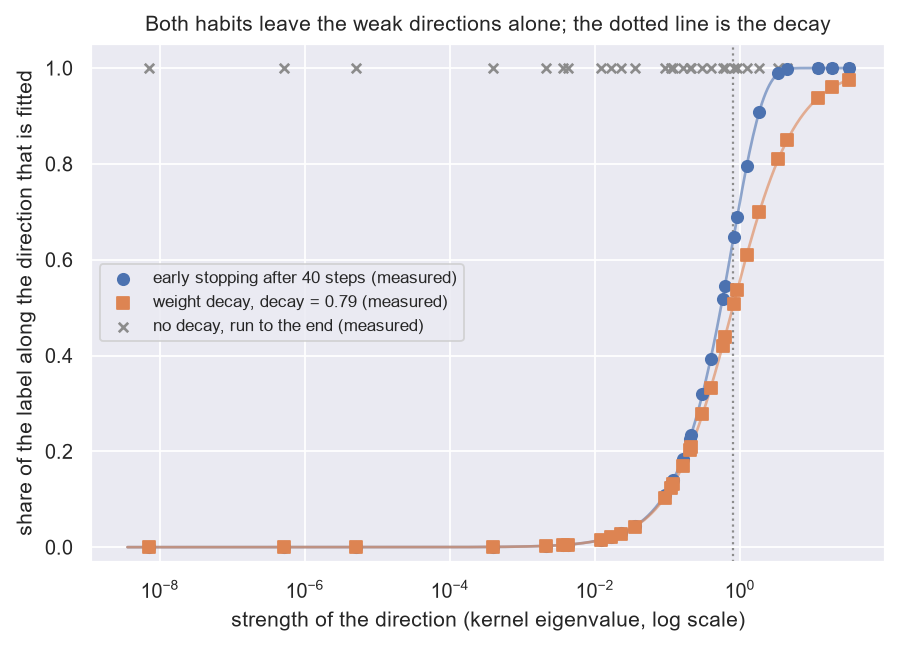
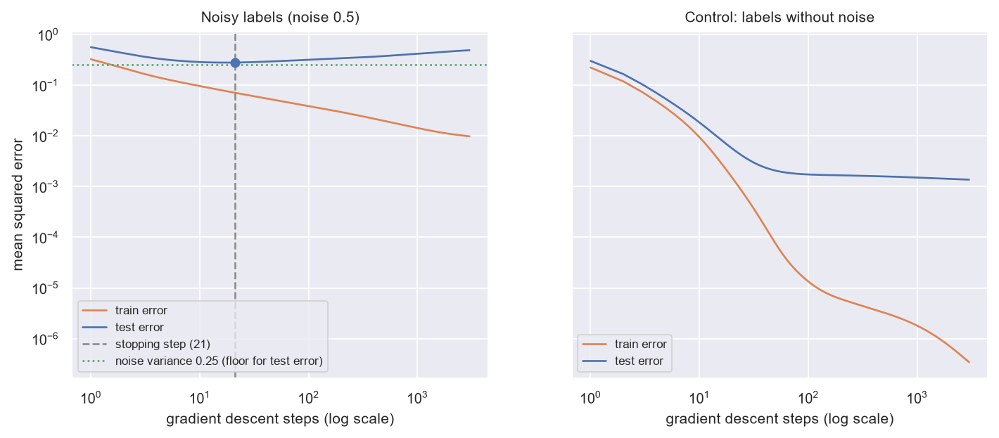

# 20. Weight decay and early stopping

**In the repository:**
[`WeightDecay.lean`](../lean/SquigglyLine/Supporting/Training/WeightDecay.lean),
note [`weight-decay.md`](../docs/supporting/training/weight-decay.md).
**You need:** chapters 10 and 13.

## The idea

People who train models use three habits to keep them from fitting
noise. **Weight decay** pulls the weights back a little at every step.
**Early stopping** ends training before the loss reaches zero. **Spare
parameters** means using a model far bigger than the data needs. They
look unlike each other. The first two are known to act alike
(**recalled**: Goodfellow, Bengio and Courville 2016, section 7.8).

Chapter 10 gives the way to see why. Along a pattern of the labels with
strength `kernel_strength`, training shrinks the error by a fixed factor
per step. Weight decay adds a penalty `decay_strength` on how far the
weights have moved from where they started. Then the error along that
pattern does not go to zero. It comes to rest.

> Weight decay leaves the share `decay_strength / (kernel_strength +
> decay_strength)` of the error. Early stopping after `step_count` steps
> leaves no more than the share weight decay leaves at
> `decay_strength = 1 / (learning_rate × step_count)`.

A pattern stronger than the penalty is learned almost fully. A pattern
weaker than the penalty is hardly touched.

**Measured** on a model with 30 data points and 41 weights, each of the 30 directions of the
kernel is one point. Its strength is on the horizontal axis and the share of the label along it that the fit has taken is
on the vertical axis. Early stopping and weight decay at the matching penalty (decay 0.791) follow the two curves of their
formulas. At a strength equal to the decay, weight decay has fitted 0.5. The early-stopping points lie on or above the
weight-decay points. Only 2 directions are stronger than 20 times the decay, so the top of the curves rests on few points.



## An example you can do by hand

One weight, one feature of size 2, so the kernel strength is
`2 × 2 = 4`. The label is 10 and the weight starts at 0. The error at the
start is 10.

With `decay_strength = 1`, the fit moves the weight by
`adjoint × error / (strength + decay)`. The adjoint of the feature
applied to the error is `2 × 10 = 20`, so the weight moves by
`20 / (4 + 1) = 4`. The model now says `2 × 4 = 8`. The error left is 2.
That is `1 / (4 + 1) = 0.2` of 10, the share the formula gives.

Check that it is a resting point. The pull of the data is the feature
times the error left: `2 × 2 = 4`. The pull of the penalty is
`decay_strength × (weight − start) = 1 × 4 = 4`. They balance. With
`learning_rate = 0.1` one step of gradient descent with decay gives
`4 + 0.1 × 4 − 0.1 × 1 × 4 = 4`. The weight does not move.

Now stop early instead. Take `learning_rate = 0.1`, strength 5 and
`step_count = 10`, so the rate per step is `0.1 × 5 = 0.5`. After ten
steps the share left is `0.5 ^ 10`, about 0.001. The bound is
`1 / (1 + 10 × 0.5) = 1 / 6`, about 0.17, and that is exactly what weight
decay with `decay_strength = 1 / (0.1 × 10) = 1` leaves:
`1 / (5 + 1) = 1 / 6`.

For a weak pattern, strength 0.05, the rate is 0.005. After ten steps the
share left is `0.995 ^ 10`, about 0.951. The bound is `1 / 1.05`, about
0.952. Both habits leave almost all of it.

## The statement

```lean
/-- **Early stopping cuts at least as hard as weight decay.** After
`step_count` steps at rate `rate` the share of the error left is at most
`1 / (1 + step_count * rate)`. -/
theorem early_stopping_leaves_at_most_what_weight_decay_leaves
    {rate : ℝ}
    (rate_nonneg : 0 ≤ rate)
    (rate_le_one : rate ≤ 1)
    (step_count : ℕ) :
    let stopped_share := (1 - rate) ^ step_count
    let ridge_share   := 1 / (1 + step_count * rate)
    stopped_share ≤ ridge_share := by
```

*Read aloud:* after `step_count` steps with rate `rate` per step, the
error left is at most one over one plus steps times rate.

Here `rate` is `learning_rate × kernel_strength`, the number from
chapter 10. The name `ridge_share` is the share weight decay leaves
once it is matched to the stopping time. A **ridge** fit is the old
statistics name for the weight-decay fit.

```lean
/-- **The matching penalty.** Weight decay with
`decay_strength = 1 / (learning_rate * step_count)` leaves the share
`1 / (1 + step_count * (learning_rate * kernel_strength))`. -/
theorem matching_penalty_gives_the_same_share
    {learning_rate : ℝ}
    {kernel_strength : ℝ}
    {step_count : ℕ}
    (learning_rate_pos : 0 < learning_rate)
    (step_count_pos : 0 < step_count)
    (kernel_strength_nonneg : 0 ≤ kernel_strength) :
    let decay_strength := 1 / (learning_rate * step_count)  -- the penalty that matches `step_count` steps of early stopping
    let ridge_share    := decay_strength / (kernel_strength + decay_strength)
    let stopped_share  :=
      1 / (1 + step_count * (learning_rate * kernel_strength))
    ridge_share = stopped_share := by
```

*Read aloud:* the share weight decay leaves, at the penalty one over
learning rate times steps, is the same number as the bound on early
stopping.

```lean
/-- **What weight decay leaves.** The share
`decay_strength / (kernel_strength + decay_strength)` of the error. -/
theorem weight_decay_leaves_a_share_of_the_residual
    (strengths_sum_ne_zero : kernel_strength + decay_strength ≠ 0)
    (residual_is_stretched :
      predict (adjoint predict
        (GET_RESIDUAL (predict : Weights →ₗ[ℝ] Outputs) labels
          start_weights))
        = kernel_strength
          • GET_RESIDUAL (predict : Weights →ₗ[ℝ] Outputs) labels
              start_weights) :
    let linear_predict : LinearPredictor Weights Outputs := predict
    let ridge_fit :=
      GET_RIDGE_FIT predict labels start_weights kernel_strength
        decay_strength
    let ridge_residual :=
      GET_RESIDUAL linear_predict labels ridge_fit
    let start_residual :=
      GET_RESIDUAL linear_predict labels start_weights
    let share_left     :=
      decay_strength / (kernel_strength + decay_strength)  -- the penalty's part of the total pull
    let left_over      := share_left • start_residual
    ridge_residual = left_over := by
```

*Read aloud:* if the error at the start is a pattern the kernel
stretches by `kernel_strength`, then the error at the weight-decay fit is
the start error times `decay_strength / (kernel_strength +
decay_strength)`.

`residual_is_stretched` is that condition: the kernel applied to the
error is `kernel_strength` times the error, as in chapter 10. `GET_RIDGE_FIT`
is the start weights plus the adjoint of the error divided by
`kernel_strength + decay_strength`. The theorems `weight_decay_fit_is_a_resting_point` and
`decay_step_rests_at_the_weight_decay_fit` say that this fit is where gradient descent with
weight decay (`TAKE_DECAY_STEP`) stays put, which the example checked
for one weight.

## Why it is true

**The share.** The fit moves the weights by the adjoint of the error,
divided by the total `kernel_strength + decay_strength`. The model's
answer moves by the kernel applied to the error, divided by the same
total. The kernel gives `kernel_strength` times the error, so the error
falls by the fraction `kernel_strength / (kernel_strength +
decay_strength)`. What is left is the rest, which is
`decay_strength / (kernel_strength + decay_strength)`. In Lean this is
`residual_after_fit` and then `share_coefficient`.

**Early stopping.** The factor per step is `1 − rate`. The number
`1 − rate` is at most `exp(−rate)`, so `step_count` steps leave at most
`exp(−step_count × rate)`. And `exp(x)` is at least `1 + x`, so that is
at most `1 / (1 + step_count × rate)`. Those are the three lines of the
`calc` chain.

**The match.** Put `decay_strength = 1 / (learning_rate × step_count)`
into the weight-decay share and clear the fractions. It becomes
`1 / (1 + step_count × learning_rate × kernel_strength)`. This is
`field_simp` and `ring`.

## What it explains

People often use weight decay and early stopping as if either would do.
The proof says how far that is true. Both put a floor under the strength
of every pattern. A pattern weaker than the floor is not learned. One
stronger is learned almost as before. Training for longer acts like
turning the penalty down. The two are alike and not equal. What is proved
is one-sided: at the matching penalty, early stopping leaves no more of
the error than weight decay does, in every direction. In the measurement
below it left less in 26 of 30 directions, so early stopping fitted a
little more than weight decay at the matched setting. The note adds that the weight-decay fit moves the answer at
a new input by `overlap / (kernel_strength + decay_strength)`
(`weight_decay_is_spare_parameters`). That is the same formula as when a pile of spare
features each add strength to every pattern. So a model with many spare
parameters acts like a smaller one with weight decay.

## How this meets the squiggly line

This uses the kernel and the one factor per step of chapters 10 and 13.
It also uses travel (chapter 9). A weak pattern is a long trip in weight
space, and a long trip disturbs the function everywhere. Each habit
refuses the long trips and takes the short ones.

## Run it yourself

[`ch20_weight_decay_and_early_stopping.ipynb`](../experiments/part4/ch20_weight_decay_and_early_stopping.ipynb) runs
gradient descent on a model linear in its weights, and solves the weight-decay fit directly. These are measurements, not
proofs. The chapter's example comes out as stated: with `decay_strength = 1` the weight rests at 4 and 0.2 of the error is
left, and each step multiplies the distance to the rest by 0.5. Without decay the weight goes to 5 and the factor is 0.6.
After 10 steps the strong pattern keeps 0.000977 of its error against the bound 0.1667, and the weak one 0.951110 against
0.952381. The bound held at every step from 0 to 300 for 40 rates in `[0, 1]`. At rate 1.9, which breaks `rate_le_one`, the
error share at step 3 was 0.729 against a bound of 0.149. Solving the weight-decay fit directly, the matched penalty gave
the stopping bound to within `3e-16` over 5 learning rates, 60 step counts and 40 strengths. The penalty for 20 steps
instead of 10 left 0.0909 and not 1/6, a miss of 0.0758.

The matched penalty was also solved on data: 8 random points, 12 weights, a linear solve for the ridge fit, and the share
left read along each eigenvector of the kernel. Over 2080 comparisons, 5 learning rates and up to 60 step counts, it differed
from `1 / (1 + step_count × learning_rate × strength)` by at most `2.1e-15`. With the penalty for twice the steps the largest
difference was 0.172. The one-weight values above (the weight resting at 4, the shares 0.2 and 1/6) come from gradient descent
or from the closed form for the resting weight, as stated in the notebook; the closed form is a formula, not a solve.

On random labels in a 30 by 30 kernel, with decay 0.791 matched to 40 steps, the share fitted in each direction (the decay fit
is a linear solve, the stopping fit is gradient descent) agreed with its formula to `1e-9` for both habits. In the 26 of 30
directions where the two differ by more than `1e-6`, early stopping fitted more than weight decay, by at least `3.55e-6`.
With no decay the weakest direction was fitted to 0.99986. That 11 directions weaker than `0.05 × decay` are barely fitted
(at most 0.0431 and 0.0440) and 2 stronger than 20 times the decay almost fully (at least 0.9596 and 1.0000) is printed, not
checked, because it follows from the definitions of weak and strong.

The figure below uses noisy labels with standard deviation 0.5. The stopping step, 21, was chosen on a separate validation
set. The test error there was 0.278, against 0.487 after 3000 steps, 43 percent lower. The train error fell at every step,
from 0.732 to 0.0098. Weight decay at the penalty matched to step 21 reached a test error of 0.290. With noise-free labels
the test error fell to the end, so there was nothing to stop for.



```bash
jupyter nbconvert --to notebook --execute --inplace experiments/part4/ch20_weight_decay_and_early_stopping.ipynb
```

## What is not shown

- The penalty pulls the weights towards where they started. With a start
  at zero that is ordinary weight decay. Otherwise the two differ.
- The statements follow one pattern of the labels. The patterns add
  because the model is linear, but the sum is not written out.
- This is a model linear in its weights with squared error and a fixed
  kernel. Weight decay inside Adam behaves differently. Deep networks
  are **open**.

## Check yourself

1. The decay is 3 and a pattern has strength 1. What share of the error
   is left?
2. `learning_rate = 0.05`, strength 10, stopped after 20 steps. Give the
   bound on the share left, and the matching decay.
3. The overlap with a new input is 6 and the strength is 2. How far does
   the answer move with decay 1? With decay 4?

**Answers.** (1) `3 / (1 + 3) = 0.75`, by `weight_decay_leaves_a_share_of_the_residual`. (2) The
rate is `0.05 × 10 = 0.5`, so by `early_stopping_leaves_at_most_what_weight_decay_leaves` the share is at
most `1 / (1 + 20 × 0.5) = 1 / 11`. The matching decay is
`1 / (0.05 × 20) = 1`, and `1 / (10 + 1) = 1 / 11` agrees, as
`matching_penalty_gives_the_same_share` says. (3) By `weight_decay_is_spare_parameters` the shift is
`6 / (2 + 1) = 2` and `6 / (2 + 4) = 1`.

Previous: [19. The largest step](19-the-largest-step.md) · Next: [21. Dropout, noise and other regularisers](21-dropout-and-noise.md)
