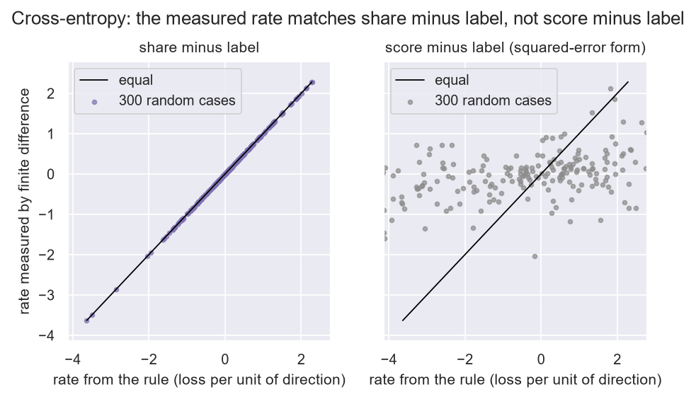
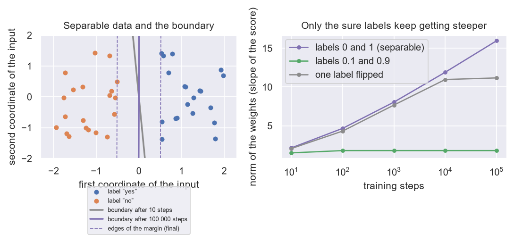

# 25. Classification

**In the repository:**
[`CrossEntropy.lean`](../lean/SquigglyLine/Supporting/Training/CrossEntropy.lean),
[`PolicyGradient.lean`](../lean/SquigglyLine/Supporting/Training/PolicyGradient.lean),
note [`cross-entropy.md`](../docs/supporting/training/cross-entropy.md).
**You need:** chapters 10, 17 and 19.

## The idea

Every chapter so far trained on squared error. Almost every classifier
in use trains on something else. Its scores go through a **softmax**,
which turns them into positive shares that add up to one, and the loss is
the **cross-entropy** of those shares against the label. With two classes
the softmax is a **sigmoid**.

The question is how much of the picture built on squared error survives.
Most of it does, for one reason. Squared error pushes each output by
"output minus label". Cross-entropy pushes each score by "prediction
minus label". The form is the same.

> The push on each score is its predicted share minus its label. So a
> classifier moves through the same kernel. What changes is that for a
> sure label no finite score is best.

## An example you can do by hand

Three classes with scores `(2, 0, 0)`. The exponentials are `e²` about
7.39, then 1 and 1, total about 9.39. The shares are about 0.787, 0.107
and 0.107. They add up to one. The label is `(1, 0, 0)`. Prediction
minus label is about `(−0.213, 0.107, 0.107)`: the first score is pushed
up and the other two down.

Two classes, label "yes". The loss is minus the log of the sigmoid of the
score.

| score | sigmoid | loss |
|---|---|---|
| 0 | 0.5 | 0.693 |
| 2 | 0.881 | 0.127 |
| 4 | 0.982 | 0.018 |

The loss keeps falling and is never zero. Now make the label soft: 0.9
in place of 1. The best score is the one whose sigmoid is 0.9, which is
`ln 9`, about 2.2. It is finite, and the loss stops falling there.

## The statement

```lean
theorem cross_entropy_slope_is_prediction_minus_label [Nonempty Classes]
    (labels scores direction : Classes → ℝ) :
    let rate := ∑ i, (APPLY_SOFTMAX scores i - labels i) * direction i
    HasDerivAt
      (fun fraction : ℝ =>
        GET_CROSS_ENTROPY labels fun i => scores i + fraction * direction i)
      rate 0 := by
```

*Read aloud:* move the scores a little in any direction, and the loss
changes at the rate "share minus label", summed against that direction.

`APPLY_SOFTMAX scores i` is the share of class `i`.
`GET_CROSS_ENTROPY labels scores` is the loss. `HasDerivAt f rate 0`
says `f` changes at `rate` where its input is zero. The shares are
positive and add up to one (`softmax_share_is_greater_than_zero`, `softmax_shares_add_to_one`). For two
classes the same push is `log_loss_slope_is_prediction_minus_label`.

**Measured**, in 300 random cases (see "Run it yourself"): the rate of change of the loss, taken by a finite difference, against the rate that share minus label predicts, and against the squared-error form "score minus label" as a contrast.



```lean
theorem error_step_moves_outputs_through_the_kernel
    (predict : Weights →L[ℝ] Outputs)
    (error_of : Outputs → Outputs)
    (learning_rate : ℝ)
    (weights : Weights) :
    let stepped_weights :=
      TAKE_ERROR_STEP predict error_of learning_rate weights
    let outputs_after  := predict stepped_weights
    let outputs_before := predict weights
    let kernel_push    :=
      predict (adjoint predict (error_of outputs_before))  -- `K e`, with `K = A A†`
    outputs_after = outputs_before - learning_rate • kernel_push := by
```

*Read aloud:* whatever rule `error_of` gives the push, one step moves the
outputs by the kernel applied to that push.

`TAKE_ERROR_STEP` is a step when the loss pushes the outputs by
`error_of outputs`. Squared error is the case "output minus label"
(`squared_error_step_is_an_error_step`). Cross-entropy is the case "prediction
minus label" (`total_log_loss_slope_is_error_times_features`, `overlap_with_pulled_back_vector_is_a_sum`).

```lean
theorem no_finite_score_is_best_for_label_yes :
    let loss_for_yes := GET_LOG_LOSS 1
    StrictAnti loss_for_yes := by
```

*Read aloud:* for the label "yes", a larger score always has a smaller
loss.

`StrictAnti` means strictly falling: a bigger input gives a smaller
output. With `log_loss_of_label_yes_is_greater_than_zero`, the loss is never zero either. With many
classes, `softmax_share_is_less_than_one` and `cross_entropy_of_a_sure_label_is_greater_than_zero` say the same:
no share reaches one, so the loss of a sure label is never zero. For a
soft label, `score_whose_prediction_equals_the_label_is_best` and `soft_label_has_a_finite_best_score` say the
score whose prediction equals the label is best.

Policy gradient, in reinforcement learning, is the same push.
`log_of_policy_share_is_minus_cross_entropy` says the log of a policy's share is
minus a cross-entropy against the label "this action was taken".
`push_on_scores_is_action_minus_prediction` says its push is "action taken minus share", and
`policy_gradient` says the expected reward changes at the rate:
share of each action, times its reward, times that push.

## Why it is true

**The push.** The loss is the log of the sum of the exponentials of the
scores, minus the label-weighted scores. Differentiating the log of a sum
gives each exponential over the sum, which is the share. Differentiating
the other term gives the label. Subtract.

**The kernel.** A step adds a multiple of the transpose of the model
applied to the push. The model is linear, so the outputs change by the
model applied to that. This is the argument of chapter 10, with
"output minus label" replaced by any `error_of`.

**No best score.** The slope of the loss for "yes" is the sigmoid minus
one. The sigmoid is always below one, so the slope is always negative and
the loss only falls. For a soft label the slope is the sigmoid minus the
label, which is zero where the prediction matches, and the loss is convex,
so that point is the lowest.

**Policy gradient.** The log of a share is minus the cross-entropy, so its
rate of change is that of the cross-entropy with the sign turned. The
expected reward is a sum of shares times rewards, and each share is the
exponential of its log.

## What it explains

- **A classifier is the same machine.** The same-kernel and least-travel
  results carry over. Two models with one kernel and the same start have
  the same outputs after every step, whatever the loss
  (`same_kernel_gives_same_outputs_for_any_loss`). Training reaches the nearest weights that
  give those outputs (`training_takes_least_travel_for_any_loss`). On a model linear
  in its weights, the cross-entropy has no hill between two settings
  (`no_hill_between_two_settings`).
- **Training longer means more confidence.** On data it can separate, a
  classifier's loss only falls as its scores grow, so there is no fit at
  a finite distance. The drift toward overconfidence is known
  (**recalled**: Guo et al. 2017). That it follows from the proved facts is
  **argued**.
- **Label smoothing gives the loss a floor.** This one is proved: for a
  label strictly between zero and one, a finite best score exists. Early
  stopping and weight decay do real work here too (**argued**).
- **Policy gradient is a cross-entropy step weighted by the reward**
  (**recalled**: Williams 1992).

## How this meets the squiggly line

It uses the **kernel** (chapter 10) and **travel** (chapter 9). The
theorem says a line gets near the data by being steep. For a model linear
in its weights, doubling the weights doubles every score and the slope.
A classifier trained for long on labels it can separate therefore grows
steeper without limit (**argued**). Cross-entropy is the pressure toward
a squigglier line, and the habits above are what hold it back.

**Measured**, on 40 separable points in the plane: the boundary after 10 and after 100 000 steps with the final margin, and the norm of the weights (the slope of the score) against steps, for sure labels, soft labels and one flipped label.



## Run it yourself

[`ch25_classification.ipynb`](../experiments/part4/ch25_classification.ipynb) uses small exact models: softmax scores on
2 to 6 classes, and a model linear in its weights (12 examples, 30 weights, a sigmoid on each output). It makes 16
checks that could fail and passed: 10 are checks of the theorem and 6 are controls. Six more are printed as "by
construction, cannot fail" and are not counted: the worked example's shares, the one-step kernel identity (matrix
associativity), the same-kernel match after 500 steps (an identity iterated), the null-space control (the extra vector is
built to leave the outputs unchanged), the score for label 1 rising (the update `score -= rate * (sigmoid - 1)` with the
sigmoid below 1 forces it), and the log share equal to minus the cross-entropy. Numbers printed "from the formula" are also
not evidence. The checks are measurements, not proofs.

- **The push.** In 300 random cases the finite-difference rate of the loss and the sum of (share minus label) times
  direction differ by at most `1.2e-9`. The wrong rules differ by up to 2.45 (shares alone) and 20.48 (score minus label).
- **The kernel.** One sigmoid step moves the outputs by the kernel applied to share minus label, to `8.9e-16`; this is
  matrix associativity and is by construction, not counted. With the identity in place of the kernel the gap is at least
  0.144 (a control). A model with a rotated weight space has the same kernel and, after 500 steps, the same outputs to
  `8.9e-15` (by construction, an identity iterated), with weights `11.6` apart (this is checked); a model with a different
  kernel is `2.4` away (a control). Training reaches the nearest weights that give its outputs, to `2.1e-14` (checked).
- **No best score.** From the formula, not a run: the loss for "yes" is 0.693, 0.127, 0.018 at scores 0, 2, 4, and
  0.000045 at 10; on a grid to 12 it falls at every step and its lowest point is the edge (loss `6.14e-6`), and on a grid to
  20 the lowest point moves to the new edge; the best grid score for the label 0.9 is 2.197, which is `ln 9`, and for 0.8 it
  is 1.386, which is `ln 4`. Measured, by training one score with gradient descent for 5 000 steps: the label 0.9 settles at
  2.197225 (`ln 9` is 2.197225) and the label 0.8 at 1.386294 (`ln 4` is 1.386294). With the label 1 the trained score is
  6.207, 8.516 and 10.820 at 1 000, 10 000 and 100 000 steps, still rising (forced by the update, by construction, so the numbers show how slowly), with losses `2.01e-3`, `2.00e-4` and `2.00e-5`.
- **Policy gradient.** The expected-reward rate matches share times reward times push to `1.7e-10` (a finite difference
  on sampled policies). Without the share weight the median gap is 0.709. That the log share equals minus the
  cross-entropy is by construction, cannot fail: both sides are the same logarithm of a sum of exponentials, so it is not evidence.
- **No hill.** For the linear model the loss between two settings never rose above the larger end (the largest rise was
  `-0.02`, a fall). Harder candidates, with their own seeded generator: mixes at 1e-4, 1e-3, 0.999 and 0.9999 of 500 pairs
  (largest rise `-2.14e-5`) and 500 pairs of settings with equal losses at 9 mixes each (largest rise `6.7e-16`, rounding
  error, far below the `1e-12` limit). For a model not linear in its weights, a sine of frequency times input plus phase, a hill of 1.218
  appeared.
- **More confidence.** On the separable data the weight norm was 2.16, 4.67, 8.06, 11.91, 15.96 at 10, 100, 1 000,
  10 000 and 100 000 steps, the smallest margin 0.9584 to 8.1556, and the loss `1.138e-1` to `3.251e-5`, never zero. With the labels
  0.9 and 0.1 the norm at 100 000 steps is 1.0000 times that at 10 000 (a control). With one label flipped it is 1.0187 times.
  That last number is reported and not tested: the test was first set at 1% and loosened to 5% after this ratio missed 1%, so
  the line describes one run. At 10, 100 and 1000 times the 1 000 steps (up to 1 000 000 steps), the norm over its value at 1 000
  steps is 1.4778, 1.9808 and 2.4968 for the separable data, 1.4286, 1.4553 and 1.4553 with one label flipped, and 1.0000
  throughout with the soft labels. The separable ratio from 10 000 to 100 000 steps is 1.3404. The claim that the line grows
  steeper without limit stays **argued**. What was measured is slow growth: the norm gained 3.39, 3.85 and 4.05 per factor of
  10 in steps, about the same each time, which is logarithmic growth, and it was 15.96 at the last step (100 000). This is one
  dataset, one learning rate and one seed.

The final direction of the weights (the widest margin) and the speed under cross-entropy are not checked.

```bash
jupyter nbconvert --to notebook --execute --inplace experiments/part4/ch25_classification.ipynb
```

## What is not shown

- **Speed.** Under squared error each direction shrinks at its own fixed
  rate. Under cross-entropy the error is not a linear function of the
  outputs, so those rates change as training goes. **Open** here.
- **Where the weights go.** On separable data the direction tends to the
  widest-margin one (**recalled**: Soudry et al. 2018). Not formalised.
- **Many classes on a model.** The statements about a model are for two
  classes. The one-example statements are for any number.
- **Policy gradient** is proved for one step only, not for a reward that
  depends on later actions.
- **Deep networks.** The kernel is fixed, as in every note here.

## Check yourself

1. Two classes with scores `(0, 0)` and the label `(1, 0)`. What is
   "prediction minus label"?
2. A classifier gives the label "yes" a score of 10. Is its loss zero?
   Could a higher score do better?
3. The label is 0.8. Which score is best, and is it finite?

**Answers.** (1) Both shares are 0.5, so it is `(−0.5, 0.5)`, by
`cross_entropy_slope_is_prediction_minus_label`. (2) No. By `log_loss_of_label_yes_is_greater_than_zero` the loss is
positive, about 0.000045 here. Yes: by `no_finite_score_is_best_for_label_yes` a higher
score always has a smaller loss. (3) The score whose sigmoid is 0.8,
which is `ln 4`, about 1.39. It is finite, by `soft_label_has_a_finite_best_score`.

Previous: [24. Symmetry: flat minima and normalisation](24-symmetry.md) · Next: [26. The perceptron, XOR and no free lunch](26-the-perceptron.md)
