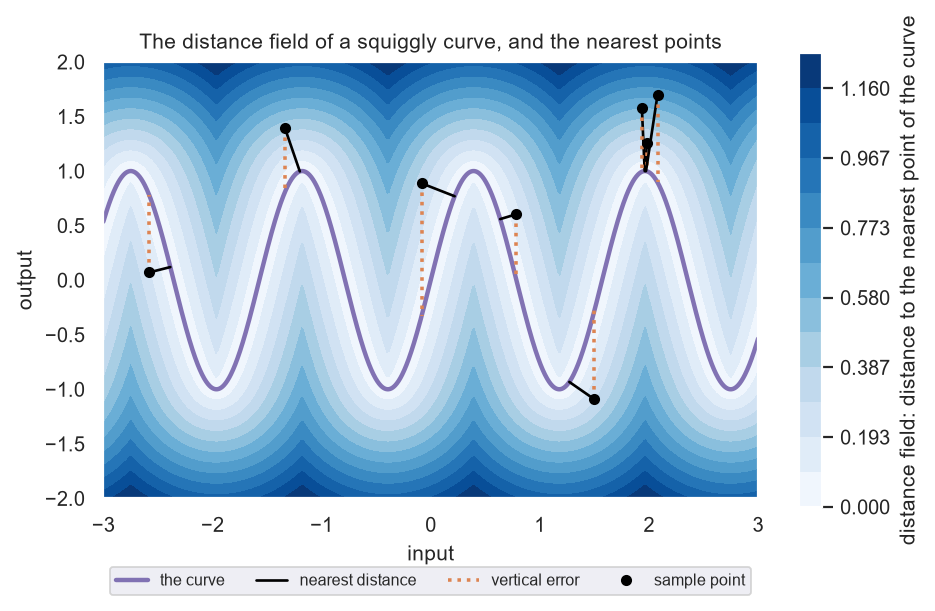
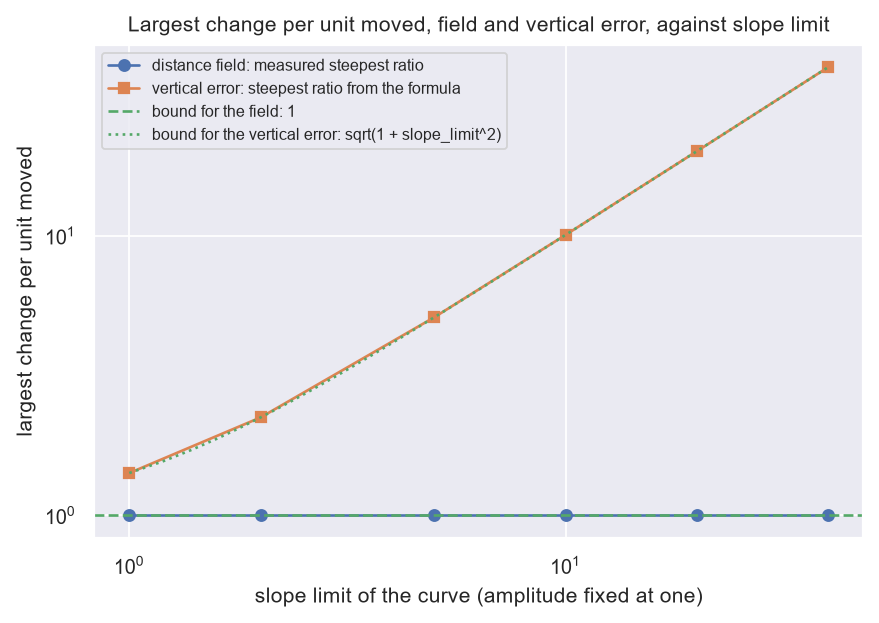

# 29. The distance field

**In the repository:**
[`SignedDistance.lean`](../lean/SquigglyLine/Supporting/NetworkShape/SignedDistance.lean),
[`Eikonal.lean`](../lean/SquigglyLine/Supporting/NetworkShape/Eikonal.lean),
note [`signed-distance.md`](../docs/supporting/network-shape/signed-distance.md).
**You need:** chapters 1, 3 and 14.

## The idea

There are two ways to store a curve. You can store its **height**: for
each input, the value the curve takes. That is what a regression network
learns. Or you can store a **field**: for each point of the plane, the
distance to the nearest point of the curve. This is a **signed distance
function** once you add a plus sign above the curve and a minus sign
below. Networks that learn shapes this way are in wide use in graphics
and 3D vision (**recalled**: Park et al. 2019, DeepSDF).

You have been using the field since chapter 1. The nearest distance of the
theorem is the field, read at the data points. So this project has been
about signed distance functions from the start, without the sign.

The field has one property the height does not. However squiggly the
curve is, the field is never steep.

> The distance field of a curve changes by at most the distance you move.
> Walk straight toward the nearest point of the curve, and it falls by
> exactly what you walk.

**Measured** (not a proof). Here is the field of `sin(4x)`, shaded by its value, with eight seeded sample points. The black line from each
point goes to its nearest point of the curve, and its length is the field. The dotted orange line goes straight to the curve, and its length is the
vertical error. The orange line is as long or longer, and the field changes gently across the plane while the curve climbs steeply.



## An example you can do by hand

Take the line `y = 3x`. Its height has slope 3. Look at the point
`(0, 1)`.

- The height above the line is 1. The nearest point of the line is
  `(0.3, 0.9)`. The distance to it is `√(0.3² + 0.1²) = √0.1`, which is
  about 0.316. That is the field at `(0, 1)`. It is `1 / √10`, as in
  chapter 3.
- The point is above the line, so its signed distance is +0.316. The
  point `(1, 0)` is below the line, at distance `|3 − 0| / √10`, about
  0.949, so its signed distance is −0.949.
- Walk half of the way from `(0, 1)` to `(0.3, 0.9)`. You reach
  `(0.15, 0.95)`. The field there is `|3 × 0.15 − 0.95| / √10 = 0.5 / √10`,
  about 0.158. That is half of 0.316. You walked half the distance and the
  field fell by half.
- **A safe step.** In sphere tracing, a program finds where a ray meets a
  shape by stepping along the ray, each step as long as the field. A
  step of 0.316 from `(0, 1)` cannot reach the line. A step as long as the
  height, 1, could overshoot. The height divided by `√(1 + 3²)` is
  `1 / √10`, which is 0.316 again, and that is safe.

## The statement

```lean
/-- **The field is never steep.** It changes by at most the distance moved,
however squiggly the line is. -/
theorem lipschitzWith_distanceField
    (model : Model Inputs) :
    let field := GET_DISTANCE_FIELD model
    LipschitzWith 1 field := by  -- one unit of field per unit moved
```

*Read aloud:* the distance field of any model has slope limit one.

`GET_DISTANCE_FIELD model` is the distance from a point of the plane to the
nearest point of the graph of `model`. The line in Lean is the graph, the
set of points `(input, model input)`.

```lean
/-- **Rate exactly one.** On the straight path from `start_point` to a nearest
point of the set, a fraction of the way along, the distance to the set is the
fraction `1 - fraction` of what it was. -/
theorem infDist_toward_nearest
    (nearest_is_in_set : nearest_point ∈ target_set)
    (nearest_is_closest :
      Metric.infDist start_point target_set = dist start_point nearest_point)
    {fraction : ℝ}
    (fraction_nonneg : 0 ≤ fraction)
    (fraction_le_one : fraction ≤ 1) :
    let walked_point    :=
      start_point + fraction • (nearest_point - start_point)
    let distance_now    := Metric.infDist walked_point target_set
    let distance_before := Metric.infDist start_point target_set
    let fraction_ahead  := 1 - fraction  -- the part of the path still to walk
    distance_now = fraction_ahead * distance_before := by
```

*Read aloud:* if you walk a fraction of the way to a nearest point of a
set, the distance to the set is the part of the way still ahead times the
distance you started with.

`Metric.infDist point set` is the distance from a point to the nearest
point of a set. In the example the fraction is a half and the distance
went from 0.316 to 0.158.

```lean
/-- **A step shorter than the field cannot reach the line.** From
`ambient_point`, every point nearer than the field's value there is off the
line. -/
theorem notMem_curve_of_dist_lt
    {ambient_point : Ambient Inputs}
    {other_point : Ambient Inputs}
    (step_is_short :
      dist ambient_point other_point
        < GET_DISTANCE_FIELD model ambient_point) :
    let line := GET_GRAPH model
    other_point ∉ line := by
```

*Read aloud:* a point closer than the field's value is not on the line.

The other results of the two files are named here.
`nearestDist_eq_distanceField` says the theorem's distance is the field.
`distanceField_eq_zero_iff` says that for a continuous model the field is
zero exactly on the line. `distanceField_lt_iff_mem_thickening` says the
tube round the line is where the field is below its
radius. `abs_signedDist` says the signed distance has the size of the
field, and `abs_signedDist_le_verticalDist` and
`verticalDist_le_abs_signedDist` put the slope sandwich in those terms.
`notMem_curve_of_dist_lt_verticalDist_div` makes the height divided by
`√(1 + slope_limit²)` a safe step. `infDist_sub_infDist_toward_nearest`
says the fall in the field equals the length walked, and
`distanceField_toward_nearest` is the same for the squiggly line.

## Why it is true

**Never steep.** Take two points of the plane, a distance `gap` apart.
Say the first is nearer to the line than the second. To go from the
second point to the line, you can go to the first point, then on to the
nearest point of the line to the first. That route has length at most `gap` plus the first
distance. So the second distance is at most the first plus `gap`. This is
true however the line wiggles, because the argument never looks at the
line, only at distances. In Lean it is a fact from the Mathlib library
about the distance to a set.

**Exactly one on the way in.** There are two inequalities.

- The nearest point is still in the set, and it is the fraction ahead of
  the old distance away. So the new distance is at most that.
- The field cannot fall faster than one for each unit walked, by the first
  argument. You walked the fraction times the old distance, so the field
  is at least the old distance minus that.

The two bounds meet at the fraction ahead times the old distance.

**No smaller limit.** Walk all the way to the nearest point. The field
falls from its starting value to zero while you walk exactly that far.
A slope limit below one would forbid it. That is
`not_lipschitzWith_infDist_of_lt_one`. A nearest point exists for every
point when the set is closed and closed balls in the space are compact,
as in the plane (`exists_nearest_with_unit_rate`).

**The safe step.** If a point were on the line and closer than the field's
value, that would be a point of the line nearer than the nearest. There is
none.

## What it explains

Sphere tracing is the main practice. The safe step is as long as the
field, and the proof shows it cannot be longer in general: the step
toward a nearest point lands on the line. When all you have is the height
above the line, the sandwich says the height overstates the distance by at
most `√(1 + slope_limit²)`, and dividing by that is safe. Dividing by a
bound on the slope is the usual fix (**recalled**: Hart 1996).

The second point is where the squiggle goes. The height of a squiggly line
can be as steep as you like. The field of the same line is never steeper
than one. Nothing is lost: for a continuous line the field is zero exactly
on the line. The squiggle has moved from the size of the slope into the
layout of the field, where it is zero and where it has creases.

**Measured** for the field, **from the formula** for the vertical error (not a proof). Here is the largest change per unit moved for six sines of amplitude one with slope limits 1 to 40. The field
stays at one. The vertical error, taken from its formula, rises with the slope limit and follows the bound `√(1 + slope_limit²)`.



That suggests why a field can be easier to learn than a height, since
training learns gentle functions first (chapter 18). This is **argued**,
not proved: the field has creases, which are a different kind of
difficulty.

## How this meets the squiggly line

The conjecture's loss is the mean size of the field at the data, so this
chapter is the loss itself. A squigglier line has a field that is small in
more of space, and that is the theorem. The ideas used are **slope** and
**nearness**, from chapters 3 and 4. The new fact is that nearness has a
slope of its own, and that slope is exactly one.

## Run it yourself

[`ch29_the_distance_field.ipynb`](../experiments/part5/ch29_the_distance_field.ipynb) measures the field of sines of amplitude one, with
slope limits 1, 2, 5, 10, 20 and 40, as the exact distance to a polyline of 600 000 samples. It reproduces the example by hand: the field at
`(0, 1)` is 0.316, at `(1, 0)` it is 0.949 with a negative sign, and halfway to the nearest point it is 0.158. Over 5 000 random pairs per curve, with gaps from `1e-3` to 0.5, the largest change in the field per unit moved was 0.99999995, 0.99999998, 0.99999999, 0.99999976, 0.99999989 and 0.99999981 for slope limits 1, 2, 5, 10, 20 and 40: at most one, and close to it. Over 5 000 more pairs per curve taken toward the nearest point it was 1.00000000 on every curve, which is the identity of the next claim, so these show that the bound is attained and the random pairs show that it is not exceeded. The vertical error, taken from its formula, reached 40.012 at slope limit 40, which is its bound
`√(1 + slope_limit²)`, so that is **from the formula** and not a measurement. Walking a random fraction of the way to the nearest point, the field matched `(1 − fraction) × field` to
`6.2e-16` on 12 000 walks. Claim 4 (no slope limit below one works) has no independent evidence in this notebook. Walking all the way, the fall per unit walked is one by the definition of the field; the end of the walk is on the curve (field at most `4.4e-16`) because the same routine searches the segments of the curve; and the segment distance never exceeds the nearest-vertex distance and is within `2.7e-4` of it, which is true of any minimum over segments that contain the vertex. All three are printed as **by construction, cannot fail** and are not counted. As a control, walking toward the
point straight above or below fell by less than the length walked in 97 percent of walks or more on every curve, with a median of 0.033 per unit at slope limit 40.
Steps as long as the field crossed the curve in 0 of 3 000 tries at slope limits 5 and 20, and so did the height divided by `√(1 + slope_limit²)`,
while steps as long as the height alone crossed it in 2 015 of 3 000 tries at slope limit 5 and 2 463 at slope limit 20. The control for the walk (toward the point straight above or below) was redesigned after its first prediction failed: the first version asked for the field to land above the rule by an absolute 0.05 on the steep curves, which was a wrong prediction, since the walk is longer and the field can land below the rule; it was replaced by the ratio of the fall to the length walked before the claim was rerun, and no threshold was loosened. The control for the vertical error (a ratio of 40.01 at slope limit 40) is the gradient length of its formula, so it is printed as by construction and not counted. The field was at most `8.0e-08` on
the curve, and `vertical / nearest` reached 40.010 against the bound 40.012. 15 checks could fail and passed; 5 lines are printed as by construction and are not counted (the vertical error bound and its steep control, and the three items of claim 4). This is evidence from sines, not a proof. Run it with
`jupyter nbconvert --to notebook --execute --inplace experiments/part5/ch29_the_distance_field.ipynb`.

## What is not shown

- **The eikonal equation as an equation.** The rate is exactly one along
  the straight path to a nearest point, and that is proved. That the field
  has a gradient of length one wherever it has a gradient at all is not
  stated in Lean.
- **Closed shapes.** The line here is the graph of a function. A closed
  surface needs a different rule for the sign. The statements without a
  sign hold for any set.
- **That networks learn fields more easily.** Argued above, not measured
  here.

## Check yourself

1. A line has slope at most 5, and a data point is 2 above it. What is the
   shortest distance from the point to the line at least, and what step is
   safe?
2. The field at a point is 0.8. You walk a quarter of the way to the
   nearest point of the line. What is the field now, and how far did you
   walk?
3. Can the distance field of a curve have a slope limit of 0.5, if some
   point off the curve has a nearest point on it?

**Answers.** (1) By `verticalDist_le_abs_signedDist` the height is at most
`√(1 + 5²)` times the distance, so the distance is at least
`2 / √26`, about 0.39. By `notMem_curve_of_dist_lt_verticalDist_div` a
step shorter than that cannot reach the line. (2) By
`infDist_toward_nearest` the field is `(1 − 0.25) × 0.8 = 0.6`. You walked
`0.25 × 0.8 = 0.2`, and by `infDist_sub_infDist_toward_nearest` the field
fell by exactly that, from 0.8 to 0.6. (3) No. By
`not_lipschitzWith_infDist_of_lt_one`, no slope limit below one holds.

Previous: [28. The slope of a network](28-the-slope-of-a-network.md) · Next: [30. Signals through depth](30-signals-through-depth.md)
