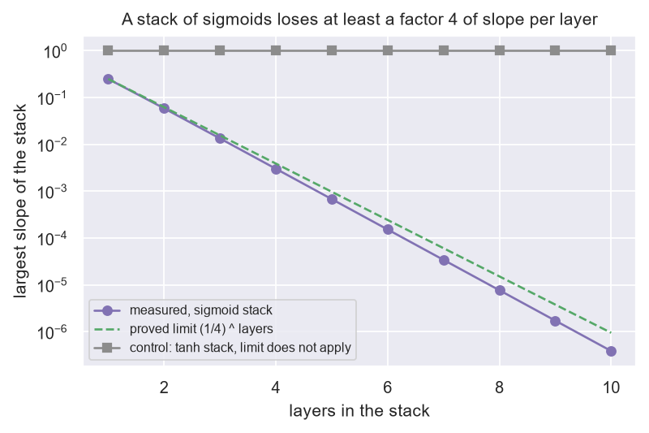

# 30. Signals through depth

**In the repository:**
[`VanishingGradients.lean`](../lean/SquigglyLine/Supporting/NetworkShape/VanishingGradients.lean),
[`Gain.lean`](../lean/SquigglyLine/Supporting/NetworkShape/Gain.lean),
[`Activations.lean`](../lean/SquigglyLine/Supporting/NetworkShape/Activations.lean),
notes [`vanishing-gradients.md`](../docs/supporting/network-shape/vanishing-gradients.md) and
[`gain.md`](../docs/supporting/network-shape/gain.md).
**You need:** chapters 12, 13 and 28.

## The idea

For a long time deep networks were hard to train. The signal died on its
way through the layers, or it blew up, and the gradient did the same on
its way back (**recalled**: Hochreiter 1991; Bengio, Simard and Frasconi
1994). The cures were careful starting weights, skip connections and
normalisation (**recalled**: Glorot and Bengio 2010; He et al. 2015).

In the picture of chapter 12 this is one piece of arithmetic. Suppose
each layer multiplies the size of the signal by a **gain**. After
`layer_count` layers the signal has been multiplied by
`gain ^ layer_count`.

> Below a gain of one the signal dies exponentially with depth. Above
> one it grows without limit. Only a gain of one survives every depth.

## An example you can do by hand

A gain of 0.9 sounds harmless. Over 50 layers it gives `0.9 ^ 50`, about
0.005. The proof's bound is `exp(−50 × 0.1) = exp(−5)`, about 0.0067, and
0.005 is below it. A gain of 1.1 over 50 layers gives `1.1 ^ 50`, about
117. The proof's bound says at least `1 + 50 × 0.1 = 6`, and 117 is above
that.

A sigmoid never has slope above one quarter. Ten sigmoid layers in a row
have slope at most `(1/4) ^ 10`, which is 1 over 1 048 576.

A fold keeps the positive part. For a signal of 3 the fold keeps 3 and
its square is 9. For a signal of −2 the fold keeps 0, and the mirror
image keeps 2, with square 4. In both cases the kept square and the mirror's
kept square add up to the square of the signal: `9 + 0 = 9` and
`0 + 4 = 4`. So a fold of a signal that is as often negative as positive
keeps half the mean squared size.

A unit adds up 100 inputs. Give each weight variance `2 / 100 = 0.02`.
The gain is `100 × 0.02 × 1/2 = 1`.

## The statement

```lean
/-- **A gain below one dies.** The loss is exponential in the depth. -/
theorem gain_below_one_dies
    {gain : ℝ}
    (gain_nonneg : 0 ≤ gain)
    (layer_count : ℕ) :
    let signal_after_layers := gain ^ layer_count
    let decay_bound := Real.exp (-(layer_count * (1 - gain)))  -- 1 - gain <= exp (-gain), raised to the depth
    signal_after_layers ≤ decay_bound := by
```

*Read aloud:* a gain that is not negative, raised to the number of
layers, is at most `exp` of minus the number of layers times one minus
the gain.

`Real.exp` is the exponential function. When the gain is below one the
exponent is negative and the bound falls fast as the layers pile up.

**Measured** in a ReLU network of width 512 with weight variance 1.62, 2
and 2.42 over the width (gains 0.9, 1 and 1.1), the slope of the log of the
signal size against the layers matches the log of the gain: −0.110, −0.007
and +0.096 against −0.105, 0 and +0.095. The size itself drifts from the
line `gain ^ layers`: after 50 layers it is 0.0034 against 0.0052, 0.83
against 1 and 103 against 117. The gradient sent back from the output
shows the same slopes:


```lean
/-- **The factor two of He initialisation.** A unit adds up `input_count`
inputs. With weights of variance `2 / input_count`, the half lost in the fold
is made up exactly, and the gain is one. -/
theorem he_gain
    {input_count : ℝ}
    (input_count_ne_zero : input_count ≠ 0) :
    let weight_variance : ℝ := 2 / input_count                     -- He's choice: the 2 is there to pay for the fold
    let kept_by_fold : ℝ    := 1 / 2                               -- a fold keeps half: `fold_keeps_half_of_a_symmetric_signal`
    let gain := input_count * weight_variance * kept_by_fold       -- each input adds its variance, then the fold halves it
    gain = 1 := by
```

*Read aloud:* with weights of variance two over the number of inputs, and
a fold that keeps half, the gain is one.

**Variance** is the mean squared size of a random weight about its mean,
and here it measures how large the weights are on average.

```lean
/-- **Sigmoid layers shrink differences.** `layer_count` sigmoids in a row have
slope at most `(1 / 4) ^ layer_count`. -/
theorem sigmoid_layers_shrink_differences
    (layer_count : ℕ) :
    let stack_slope_limit : SlopeLimit := (1 / 4) ^ layer_count  -- each sigmoid shrinks by at least 4
    let stack := sigmoid^[layer_count]
    LipschitzWith stack_slope_limit stack := by
```

*Read aloud:* a stack of sigmoids has a slope limit of one quarter to the
power of the number of layers.

**Measured**, the largest slope of a stack of sigmoids stays under that
limit, while a stack of `tanh` layers, the control, does not:



The rest is named here. `gain_above_one_blows_up` says a gain of at
least one gives at least `1 + layer_count × (gain − 1)`.
`plate_never_lengthens_the_light` says a polarizer plate never lengthens the light, and
`plates_vanish` says a stack with a fixed turn dims it exponentially.
`plate_acts_the_same_forwards_and_backwards` and `gradient_comes_back_through_the_same_plates` say the gradient comes back
through the same plates in the opposite order. `bypass_plates_blow_up`
says plates with a bypass make the light at least `2 ^ plate_count` times
its first overlap with the axis. `fold_splits_the_squared_size_in_two` and
`fold_keeps_half_of_a_symmetric_signal` are the fold facts of the example.
`sigmoid_is_no_steeper_than_one_quarter`, `leaky_relu_slope_is_at_most_one`, `leaky_relu_slope_is_at_least_its_leak`,
`leaky_relu_always_rises`, `pooling_never_steepens` and
`normalised_layer_slope_is_at_most_one` are the other activation results.
`sweep_slope_is_at_most_the_discount` and `repeated_sweeps_pull_every_guess_to_one_answer` are the gain below
one on purpose, in reinforcement learning.

## Why it is true

**One number per layer.** Below one, the key step is that
`1 − gain ≤ exp(−gain)` for any number. Writing the gain as one minus
`1 − gain`, raising to the depth, and using that step gives the bound.
Above one, the bound is Bernoulli's inequality: raising one plus a small
extra to a power gives at least one plus the power times the extra.

**Plates.** A plate keeps the part of the light along its axis. Its
strength is the size of the overlap of the light with the axis. By
Cauchy–Schwarz that overlap is at most the length of the light, so a
plate never lengthens it. For a stack with a fixed turn, each plate keeps
the cosine of the turn, a gain below one, and the first bound applies.

**Forwards and backwards.** A plate acts the same way read from either
side: `plate_acts_the_same_forwards_and_backwards`. For a stack, one plate at a time is moved
across the inner product, and each move swaps the order. So the output of
a stack read along one direction equals the input read along that
direction sent back through the plates in reverse. The gradient is dimmed
by the same plates as the signal.

**A bypass.** A plate with a bypass adds the light to what the plate
passes. Along the axis that doubles the overlap, so `plate_count` of them
multiply it by `2 ^ plate_count`. The overlap is a lower bound for the
length.

**The fold.** If the signal is positive the kept square is the whole and
the mirror's is zero. If it is negative it is the other way round. Either
way the two add up to the whole, which is `fold_splits_the_squared_size_in_two`. Under
the symmetry assumption the two average to the same number, so each is half.
A unit that adds `input_count` inputs multiplies the squared size by
`input_count` times the weight variance, and then the fold halves it. That
is the product in `he_gain`, and with the variance chosen it comes out as
one by arithmetic.

**The sigmoid.** The slope of a sigmoid is `output × (1 − output)` where `output` is what
the sigmoid returns. This is largest at `output = 1/2`, where it is `1/4`. A stack of
`layer_count` layers has the product of the slopes, as in chapter 28.

## What it explains

A gain of one is why the starting weights are chosen to keep the size of
the signal the same from layer to layer. He initialisation is that choice
when the layers are ReLU folds (**recalled**: He et al. 2015; Glorot and
Bengio 2010 for the version without the fold). Unless the weights make
up a factor of four at every layer, sigmoid layers fade fast, and that is
the saturation ReLU was brought in to avoid (**recalled**: Glorot and
Bengio 2010; Nair and Hinton 2010). A leaky ReLU with a positive leak
merges no two inputs and cannot go dead. Spectral normalisation divides a
layer by its own size and so caps its slope at one, which is a cap put in
by hand, as in a Wasserstein critic.

The plates give the full picture of why the usual recipe has both parts.

| Layer | Gain | What happens with depth |
|---|---|---|
| Plate | below one | dies |
| Plate with a bypass | above one | blows up |
| Plate with a bypass and an amplifier | held at one | survives |

The last row is the normalisation of chapter 14. The proof for it is
`amplified_plates_lose_nothing` in `SkipAndNorm.lean`, which chapter 31 goes
through.

## How this meets the squiggly line

A squiggly path needs many layers, and many layers need the signal to
survive them. The gain decides whether depth can be used at all. The idea
is the **product of slopes** from chapter 28, now read as a gain per
layer, and the **fold** of chapter 8, which costs half the squared size.

## Run it yourself

[`ch30_signals_through_depth.ipynb`](../experiments/part5/ch30_signals_through_depth.ipynb)
prints 18 `[PASS]` lines. Of these, 16 are evidence (a sampled or run
model) and 2 are **from the formula**: the bounds
`gain ^ layers <= exp(-layers (1 - gain))` and
`gain ^ layers >= 1 + layers (gain − 1)` for 101 gains each and depths up to
300, evaluated on a grid. At gain 0.9 and 50 layers the formula gives 0.0052
against the bound 0.0067. Seven more lines are printed as by construction, and
not counted: the case of gain −2, the plates' length `cos(turn) ^ layers`, the
reversed-order reading of the gradient, the doubling of the overlap by
bypass plates, the same plates without the bypass, the fold identity, and
the arithmetic of `he_gain`.

Evidence. A plate never lengthened random light in 1000 trials, and the light
after 100 plates with a fixed turn of 0.3 was 0.0104 long, below the bound
0.0115. A plate on an axis of length 2 did lengthen light (control, ratio
up to 3.87), and sending the gradient back in the same order, not the
reverse, disagreed with the forward reading by up to 0.047 (control). Bypass
plates had at least `2 ^ plate_count` times the first overlap in length.
The fold kept 0.5003 of the mean square of a symmetric signal and 0.962
of a shifted one (control). In a ReLU network of width 512 and 50 layers
the slope of `log(size)` against layer was −0.110, −0.007 and +0.096 for
gains 0.9, 1 and 1.1, against the predicted −0.105, 0 and +0.095. For
the gradient sent back the slopes were −0.110, −0.006 and +0.094, so the
backward mask of the ReLU, not modelled above, behaved the same way in this
network. The sizes after 50 layers were 0.0034, 0.83 and 103 against `gain ^ 50`
of 0.00515, 1 and 117, so the size drifts from the line while the slope
matches; He's variance left the size at 0.83, where gain one predicts 1.
Ten sigmoid layers had largest slope 3.9e−07 (by finite differences of the
stack) against the limit 9.5e−07, and a stack of `tanh` layers reached slope 1
(control). These are measurements, not proofs; the Lean theorems cover the
statements above.

```bash
jupyter nbconvert --to notebook --execute --inplace experiments/part5/ch30_signals_through_depth.ipynb
```

## What is not shown

- **ReLU layers in the plate model.** The layers here are plates. A fold
  keeping half is proved separately, and joined to the starting weights
  in `he_gain`.
- **Symmetry of the signal** is assumed, not derived. For a random first
  layer on centred inputs it holds (**argued**).
- **Independence across units** behind "variance adds" is recalled.
- **The gradient for ReLU.** The backward pass of a ReLU network also
  switches off where the forward pass was zero. Not modelled.
- **Recurrent networks.** The same count applies to steps in time. It is
  written out for the memory cell of an LSTM, and not for a plain
  recurrent network.
- **Tanh**, whose slope is at most one, and pooling over more than two
  lines.

## Check yourself

1. Each of 10 layers has gain 0.8. What does `gain_below_one_dies` bound the
   signal by?
2. Four sigmoid layers are stacked. What is the largest slope the stack
   can have?
3. A unit adds up 200 inputs, followed by a fold. What weight variance
   makes the gain one?

**Answers.** (1) By `gain_below_one_dies` the signal is at most
`exp(−10 × 0.2) = exp(−2)`, about 0.14. The true value `0.8 ^ 10` is
about 0.107, which is below that. (2) By `sigmoid_layers_shrink_differences`
at most `(1/4) ^ 4 = 1/256`. (3) By `he_gain` it is `2 / 200 = 0.01`:
`200 × 0.01 × 1/2 = 1`.

Previous: [29. The distance field](29-the-distance-field.md) · Next: [31. Skips and normalisation](31-skips-and-normalisation.md)
