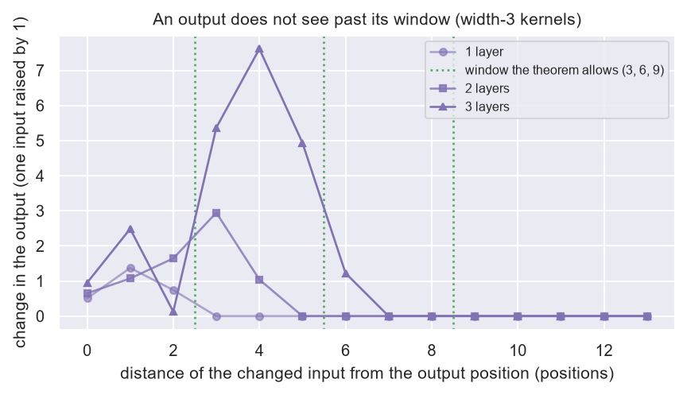
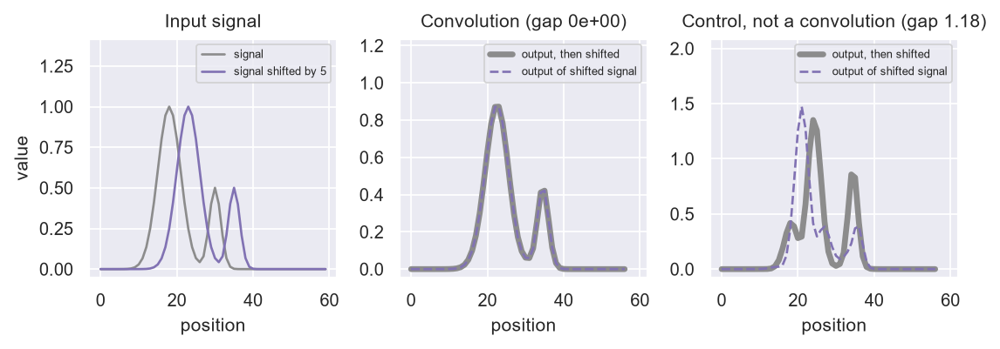

# 33. Convolution

**In the repository:**
[`Convolution.lean`](../lean/SquigglyLine/Supporting/NetworkShape/Convolution.lean),
note [`convolution.md`](../docs/supporting/network-shape/convolution.md).
**You need:** chapters 3, 7 and 14.

## The idea

A convolution layer slides one small kernel along a signal. At every
position it multiplies the few inputs under the kernel by the kernel's
weights and adds them up. The same weights are used at every position.
In Python:

```
[sum(kernel[j] * signal[position + j] for j in range(kernel_width))
 for position in positions]
```

People use convolutions because a pattern means the same wherever it
appears, and because a kernel has few weights however long the signal is.
This chapter asks the question of chapter 14: what does the layer do to
slope? And two more: how far can an output see, and what do stride and
upsampling do to squiggle? The signal has one dimension.

> A convolution layer is no steeper than the summed sizes of its kernel
> weights, whatever the length of the signal. A stride of two doubles
> the slope.

## An example you can do by hand

Take a kernel of width 3 with weights `1, −2, 1`. The summed sizes are
`1 + 2 + 1 = 4`. Two signals that differ by at most 0.1 at every position
have outputs that differ by at most `4 × 0.1 = 0.4`.

Check one position. Let the signal be `5, 5, 5` under the kernel and the
other signal be `5.1, 4.9, 5.1`. The output is `1×5 − 2×5 + 1×5 = 0` for
the first and `5.1 − 9.8 + 5.1 = 0.4` for the second. The gap is 0.4, and
the bound is reached.

**Locality.** The output at one position depends on the three inputs
under the kernel. Stack two such layers: the second output reads three
outputs of the first, and those read inputs a little further on. The
theorem below allows a window of `2 × 3 = 6` positions.

**Stride.** Let `model` have slope at most 3. Reading it at every second
position gives `model(2 × input)`. Moving the input by 0.1 moves the
argument by 0.2, so the output moves by at most `3 × 0.2 = 0.6`: slope at
most 6.

## The statement

```lean
/-- **A convolution is no steeper than its summed kernel.** If two signals
differ by at most `max_gap` everywhere, their outputs differ by at most
`max_gap` times the summed sizes of the kernel weights. The length of the
signal does not enter. -/
theorem abs_convolution_sub_le
    (kernel_width : ℕ)
    (kernel : Kernel)
    {signal : Signal}
    {other_signal : Signal}
    {max_gap : ℝ}
    (signals_are_close :
      ∀ position, |signal position - other_signal position| ≤ max_gap)
    (position : ℕ) :
    let output_gap  :=
      |APPLY_CONVOLUTION kernel_width kernel signal position
        - APPLY_CONVOLUTION kernel_width kernel other_signal position|
    let kernel_size := ∑ j ∈ Finset.range kernel_width, |kernel j|
    let gap_limit   := kernel_size * max_gap
    output_gap ≤ gap_limit := by
```

*Read aloud:* if two signals differ by at most `max_gap` at every
position, then at any position their convolutions differ by at most the
summed sizes of the kernel weights times `max_gap`.

`Signal` is a number for each position, `Kernel` a weight for each offset,
and `APPLY_CONVOLUTION` is the Python above. `∑ j ∈ Finset.range
kernel_width, |kernel j|` adds the sizes `|kernel 0|, |kernel 1|, ...`.
The kernel size is the whole bill, so the slope a layer can add is set by
its few weights.

```lean
/-- **Stride is squeezing.** Reading a signal at every second position is
squeezing it sideways by two. -/
theorem stride_eq_compress
    (model : RealFunction) :
    let strided_model : RealFunction := fun input => model (2 * input)  -- every second position
    let squeezed_model := COMPRESS 2 model
    strided_model = squeezed_model := by
```

*Read aloud:* reading a model at every second position is exactly the
model squeezed by a factor of two.

`COMPRESS` is the squeeze of chapter 7. The result that follows from it
is the slope claim.

```lean
/-- **Each stride doubles the slope** of what the later layers see. -/
theorem lipschitzWith_stride
    {slope_limit : SlopeLimit}
    (slope_is_bounded : LipschitzWith slope_limit model) :
    let strided_slope_limit := 2 * slope_limit  -- the same climb over half the run
    let strided_model : RealFunction := fun input => model (2 * input)
    LipschitzWith strided_slope_limit strided_model := by
```

*Read aloud:* if `model` has slope at most `slope_limit`, then `model`
read at every second position has slope at most `2 × slope_limit`.

Two more results are named here. `convolution_congr` says an output
depends only on the `kernel_width` inputs under the kernel, and
`iterate_convolution_congr` says that after `layer_count` layers it
depends only on the inputs within `layer_count * kernel_width` of it.
`convolution_stack_reads_only_its_exact_window` is tighter: it depends
only on the inputs within `layer_count * (kernel_width - 1)` of it.
`upsample_eq_compress` says stretching by two is squeezing by one half,
and `stride_upsample` says a stride of two after an upsampling gives the
signal back.

## Why it is true

**Slope.** Each output is a sum of kernel weights times inputs. Two
outputs differ by a sum of kernel weights times input gaps. Each input gap
is at most `max_gap`, so the sum is at most the sum of the weight sizes
times `max_gap`. No position and no length of signal enters.

**Locality.** An output reads only `kernel_width` inputs. If two signals
agree on those, the sums agree term by term. For `layer_count` layers,
each layer reaches further. A kernel reads its own position and the
`kernel_width - 1` positions after it, so each layer adds
`kernel_width - 1` to the reach. The first theorem counts `kernel_width`
for each layer, which is one too many for each layer and still true. The
tighter theorem counts `kernel_width - 1`.

**Measured:** one input of a stack of width-3 kernels is raised by 1, and the
output change is plotted against how far away it was. It is exactly zero
beyond the window.



**Stride.** The function `fun input => model (2 * input)` and
`COMPRESS 2 model` are the same function, by unfolding the definition. So
everything proved about squeezing applies. In particular `lipschitzWith_stride` is
the squeeze theorem of chapter 7 read for a factor of two: the same climb
over half the run. Upsampling is `model(input / 2)`, which is a squeeze
by one half, and two squeezes multiply their factors
(`compress_compress`), so `2 × 1/2 = 1` and the signal comes back.

## What it explains

Why convolutional networks are cheap. The slope a layer can add is
bounded by a few numbers, and the bound does not grow with the length of
the signal. A kernel of three weights is as steep as it is, on a signal of
ten positions or a million.

Why they find local patterns. By the locality result, a squiggle made by
the layers is made from a window of the input, and the same kernel makes
it at every position.

**Measured:** shifting the signal by 5 positions shifts the output of a
convolution by 5 positions, and a layer whose weights depend on the position
does not do this.



Why downsampling and upsampling go together in a U-shaped network. A
stride squeezes and an upsample stretches, and the two undo each other
exactly. What the proof adds is that the squeeze has a price: each stride
doubles the slope of what later layers see, and with it the frequency.

## How this meets the squiggly line

Through **slope** (chapter 3) and through the general theorem of
**nearness** (chapter 4 and chapter 7). A convolution layer's slope is
set by a few kernel weights, and it makes squiggle locally. A stride is a
squeeze in the exact sense of chapter 7: closer, steeper by the same
factor, and no better in loss. This is the first of the three answers of
chapter 14: stacking multiplies slope.

## Run it yourself

The notebook [`ch33_convolution.ipynb`](../experiments/part5/ch33_convolution.ipynb)
uses a one-dimensional convolution layer on random seeded signals, and a sine
for stride. It has 8 checks, all passing, and two identities printed as "by construction, cannot fail" that are not evidence. These are **measured** numbers: an
experiment is evidence, not a proof.

- **By hand.** Kernel `1, −2, 1`: the outputs are 0 and 0.4, and the gap
  equals the bound 0.4.
- **Slope.** Over 200 random kernels and signals of length 10, 1000 and
  100 000, the largest output gap over the bound was 0.997, 1.000 and 1.000,
  never above 1. With the gap lined up with the kernel signs, the kernel
  `0.5, 0.5, −1` and gap 2 give exactly 4. Control: a layer whose weights are
  scaled by a number that depends on the position is not a convolution, and
  its output gap was 1.81, 11.67 and 1001.73 times the bound at the three
  lengths: the length enters.
- **Locality.** For 1, 2 and 3 layers of width 3, changing an input beyond
  3, 6 and 9 positions left the output exactly unchanged, also with a ReLU
  between the layers. The farthest input that mattered was at 3, 5 and 7
  positions. That is inside the window the first theorem allows, and it is
  exactly the window of the tighter one: `layer_count × (3 − 1) + 1`
  positions is 3, 5 and 7. The measurement came first; the tighter theorem
  (`convolution_stack_reads_only_its_exact_window`) was proved after it.
- **Shift.** The largest difference between the output of the shifted signal
  and the shifted output was 0 for the convolution, and 1.179 for the
  control (the largest output is 0.872).
- **Stride.** `sin(3x)` has slope 3.0000, and read at every second position
  6.0000. An input step of 0.1 moved the output by at most 0.5910 (bound 0.6).
  A slope of 1.5000 became 6.0000 after two strides. That a stride is the
  squeeze `COMPRESS 2`, and that a stride after an upsampling gives back the
  model, are identities of the definitions (difference 0.0e+00, by
  construction, cannot fail): they are not evidence.

Run it with
`jupyter nbconvert --to notebook --execute --inplace experiments/part5/ch33_convolution.ipynb`.

## What is not shown

- **Images.** The kernel here has one dimension.
- **Pooling as the way to downsample.** Max pooling of two lines is in
  the note on vanishing gradients, not here.
- **Padding and the edges of the signal.** The signal here goes on for
  ever in one direction.
- **Whether real kernels reach the bound.** The theorem is an upper
  limit. A trained kernel is usually gentler.

## Check yourself

1. A kernel has weights `0.5, 0.5, −1`. Two signals differ by at most 2
   everywhere. How far apart can their outputs be?
2. After four layers with kernels of width 5, how many positions can an
   output depend on, by `iterate_convolution_congr`?
3. A model has slope at most 1.5. What is the slope limit after two
   strides of two in a row?

**Answers.** (1) The summed sizes are `0.5 + 0.5 + 1 = 2`, so at most
`2 × 2 = 4`, by `abs_convolution_sub_le`. (2) The window is
`4 × 5 = 20` positions further on by `iterate_convolution_congr`, and
`4 × 4 = 16` further on by the tighter theorem. (3) One stride gives `2 × 1.5 = 3`
by `lipschitzWith_stride`. A second stride is applied to the strided
model, which has slope at most 3, so it gives `2 × 3 = 6`.

Previous: [32. Depth against width](32-depth-against-width.md) · Next: [34. Capacity and compression](34-capacity-and-compression.md)
