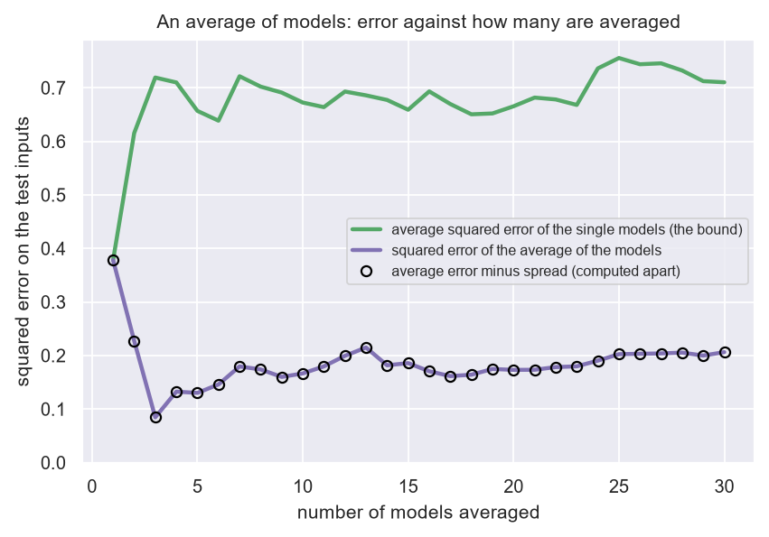
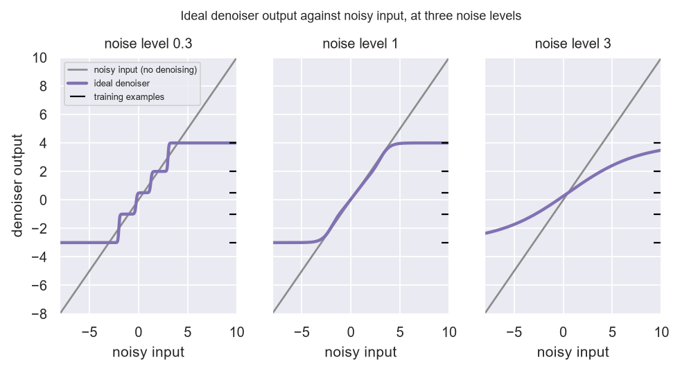

# 37. Ensembles and the ideal denoiser

**In the repository:**
[`Averaging.lean`](../lean/SquigglyLine/Supporting/NewInputs/Averaging.lean),
note [`averaging.md`](../docs/supporting/new-inputs/averaging.md).
**You need:** chapters 11, 14, 15 and 36.

## The idea

People who enter prediction contests average the answers of several
models, and it almost always helps. People who train diffusion models
rely on a network that removes noise from an image. Both are averages,
and one fact about averages explains why the first helps and what the
second must be.

Under squared error, the best single guess for an unknown is the weighted
mean of the candidates. And the mean of several predictions has less
error than the predictions have on average, by exactly the amount they
disagree.

> The squared error of an average is the average squared error minus the
> spread. And the ideal denoiser is an attention head over the training
> set.

## An example you can do by hand

Two models predict 8 and 14 for a label of 10. Each gets share 0.5.

```
average prediction  =  0.5 × 8 + 0.5 × 14  =  11
error of the average  =  (11 − 10)²  =  1
average error  =  0.5 × (8 − 10)² + 0.5 × (14 − 10)²  =  0.5 × 4 + 0.5 × 16  =  10
spread  =  0.5 × (8 − 11)² + 0.5 × (14 − 11)²  =  0.5 × 9 + 0.5 × 9  =  9
```

And `10 − 9 = 1`. The two models are each off, by 2 and by 4, and they
are off on opposite sides. The average keeps what they agree on and loses
what they disagree on.

For the denoiser, take two training examples, 0 and 4, on a line. A noisy
input arrives at 1. With `noise_level` 1 the scores are
`−(1 − 0)² / 2 = −0.5` and `−(1 − 4)² / 2 = −4.5`. The shares are
`1 / (1 + exp(−4))`, about 0.982, and 0.018. The output is
`0.982 × 0 + 0.018 × 4`, about 0.07. Nearly the nearest example. With
`noise_level` 10 the scores are `−0.005` and `−0.045`, the shares are
about 0.51 and 0.49, and the output is about 1.96, close to the plain
average, 2.

## The statement

The ensemble. `BLEND` is the average of the predictions with the given
shares, `sum(shares[i] * predictions[i] for i in member_set)` in Python.

```lean
/-- **The error of the average is the average error minus the spread.** -/
theorem error_of_the_average_equals_average_error_minus_spread
    (shares_sum_to_one : ∑ i ∈ member_set, shares i = 1)
    (label : ℝ) :
    let blend_error   := (BLEND member_set shares predictions - label) ^ 2
    let average_error :=
      ∑ i ∈ member_set, shares i * (predictions i - label) ^ 2
    let spread        :=
      ∑ i ∈ member_set, shares i *
        (predictions i - BLEND member_set shares predictions) ^ 2
    blend_error = average_error - spread := by
```

*Read aloud:* when the shares add to one, the squared error of the blend
equals the share-weighted squared error of the members, minus the
share-weighted squared distance of the members from the blend.

The spread is a sum of squares, so it is never negative. That gives
`ensemble_error_is_at_most_average_member_error`: when the shares are also positive, the blend is at
least as good as the members are on average. The blend is also no steeper
than its steepest member (`average_slope_is_at_most_steepest_member`).

The ideal denoiser.

```lean
/-- The ideal denoiser for the training examples `examples` at noise level
`noise_level`. Given a noisy input `noisy_input`, each example gets a share
that falls with its squared distance from `noisy_input`, and the output is the
examples averaged with those shares. -/
noncomputable def DENOISE_IDEALLY
    (noise_level : ℝ)
    (examples : Examples → Space)
    (noisy_input : Space) : Space :=
  ATTEND (fun i => -‖noisy_input - examples i‖ ^ 2 / (2 * noise_level ^ 2))
    examples
```

*Read aloud:* the ideal denoiser is an attention head, whose query is
the noisy input, whose tokens are the training examples, and whose score
is minus the squared distance divided by twice the squared noise level.

`‖ ... ‖` is the length of a vector. `ATTEND` is the head of chapter 36.

```lean
/-- **No other guess is better.** Among all outputs `other_output`, the ideal
denoiser has the least squared distance to the examples, weighted by how
likely each is to be the clean one. -/
theorem ideal_denoiser_is_the_best_guess
    (noise_level : ℝ)
    (examples : Examples → Space)
    (noisy_input : Space)
    (other_output : Space) :
    let shares :=
      APPLY_SOFTMAX fun j =>
        -‖noisy_input - examples j‖ ^ 2 / (2 * noise_level ^ 2)  -- Gaussian likelihood of each example
    let denoised := DENOISE_IDEALLY noise_level examples noisy_input
    let denoiser_spread := ∑ i, shares i * ‖examples i - denoised‖ ^ 2
    let other_spread    := ∑ i, shares i * ‖examples i - other_output‖ ^ 2
    denoiser_spread ≤ other_spread := by
```

*Read aloud:* with those shares, no other output is closer to the
examples, on the share-weighted squared distance, than the ideal denoiser.

The file also has `ideal_denoiser_stays_inside_the_examples`: the output never leaves
the region the training examples span.

## Why it is true

**The ensemble.** Write the squared error of any centre as the weighted
sum of squares, minus a cross term, plus a centre term (`weighted_squared_distance_to_a_centre_expanded`).
Do it twice, once with the label as the centre and once with the blend as
the centre. Both share the same sum of squares. With the blend as centre
the cross and centre terms collapse to the blend squared, so the spread is
the sum of squares minus the blend squared. Subtract that from the average
error and what is left is the squared error of the blend.

**Weight averaging.** For a model linear in its weights, averaging the
weights is averaging the lines (`averaging_weights_is_averaging_lines`). So the same
bound holds for averaged weights (`averaged_weights_error_is_at_most_average_member_error`).

**The best guess.** The weighted squared distance to any point splits
into the weighted squared distance to the weighted mean plus the squared
distance from the mean to that point (`weighted_squared_distance_splits_at_the_mean`). The first
part does not depend on the point. The second is never negative and is
zero at the mean. So the mean is the best guess (`weighted_mean_is_the_best_single_guess`).
The cross term vanishes because the offsets from the mean cancel
(`offsets_from_the_weighted_mean_cancel`).

**The denoiser.** By definition (`ideal_denoiser_equals_weighted_mean_of_examples`) it is
that weighted mean, with the softmax of the scores as shares. Apply the
best-guess result. The hull statement is `attention_output_lies_among_the_values`.

## What it explains

**Why ensembles work.** The gain is exactly the disagreement. If the
members agree, there is nothing to gain, and if they err on different
sides, the gain is large. The spread is the variance term of chapter 43.

**Measured.** Thirty fitted models, each linear in its weights, are averaged with equal shares. The purple curve is the squared error of the average. The green curve is the average squared error of the same models, which the theorem bounds it by. The black circles are that average error minus the spread, computed apart, and they sit on the purple curve; that is an identity (the circles are the green curve minus the spread, and the gain equals the spread), not a result.



**What a diffusion model aims at.** With Gaussian noise, the weight of an
example falls with its squared distance from the noisy input, as the score
above says. That this is the right weight is Bayes' rule (**recalled**, not
proved here). Given it, the proof says the best possible denoiser is an
attention head over the training set.

**From the formula** (not a fit). The output of the ideal denoiser for five training examples on a line, against the noisy input, at three noise levels. At noise level 0.3 it steps from one example to the next. At 3 it is a smooth curve that stays between the extreme examples.



The puzzle that follows is in the note. A denoiser that reached its target
would only return blends of its training examples, and at low noise it
would return copies. Real diffusion models make new images, so they do not
reach the target. Why they do not, and what they draw instead, is
**open**.

## How this meets the squiggly line

Through **averages** (chapter 15). The theorem says a line gets near the
data by being steep, and an average is no steeper than the steepest of
its members. Each member fits the data by being squiggly in its own way.
Between the data points the squiggles disagree and the average cancels
them. That the ensemble thereby gives back some of the slope its members
paid for is **argued**. The denoiser's shares are set by nearness
(chapter 4) to the training set.

## Run it yourself

[`ch37_ensembles_and_the_denoiser.ipynb`](../experiments/part6/ch37_ensembles_and_the_denoiser.ipynb) has 16 checks that
could fail, all passing, and 13 lines that are not counted: 12 identities (or things the code forces), printed as "by
construction, cannot fail", and one reported number. **Measured** means a fit, a training run or a sampled model was run;
**from the formula** means the chapter's formula was evaluated (random numbers, hand examples, the denoiser's own
formula). The members are 30 ridge fits, linear in their weights, to bootstrap resamples of 40 noisy points. These are
checks, not proofs.

**Identities, not counted.** These hold for any numbers, so the notebook prints them as identities: the blend is never worse
than the average error of its members and the gain equals the spread (largest gap `2.2e-16`); the blend of the 30 is no
steeper than its steepest member (10.202 against 26.143, the triangle inequality, which could fail only on a bug);
averaged weights predict the average of the predictions (`6.7e-16`) and are no worse than the average member (0.2063
against 0.7103); the split of the weighted squared distance (`2.8e-14`), none of 10000 random points beating the weighted
mean, and the unweighted mean losing by exactly the formula (0.356 on average); and, for 203 other outputs for each of 300
inputs, none beats the ideal denoiser, each loses by exactly the squared distance (`8.5e-14`), and a denoiser at three times
the noise level is one more of them (it loses 1.368 on average). The control of two runs of a two-layer product trained
from opposite starts is also forced: the second run is the exact negation of the first by symmetry, so the midpoint error
(1.159, with both runs at error `7.6e-32` at weights (0.782, 1.164) and (−0.782, −1.164)) is not a finding.

**Measured**

- **The gain.** The average error of the 30 members is 0.7103, the spread 0.5040 and the error of their average 0.2063. The
  average beats member 1 (0.3781, a good member) and the average member (0.7103). Control: with shares 1.5 and −0.5 the
  blend (1.3045) is worse than the average error (0.1409).
- **Slope control, a report and not a test.** With shares 1.5 and −0.5, 619 of 870 pairs give a blend steeper than the
  steeper of the two members. The control was changed after a first look (shares summing to 2 were tried first and were a
  poorer control), and "over half" was not stated beforehand, so this is a number, not a pass.
- **The best guess.** A numerical minimiser started away from the weighted mean ends within `3.6e-08` of it.
- **Bayes' rule (recalled in the chapter).** In a simulation of 4 million draws, the mean clean example at five noisy values
  agrees with the ideal denoiser to within 1.51 standard errors. The denoiser at three times the noise level is off by up to
  487.2.

**From the formula** (counted: they could fail)

- **The split.** In 2000 random cases the error of the blend equals the average error minus the spread to `6.8e-13`. With
  shares that sum to 1.5 the two sides differ by up to 915.2. With a negative share the identity still holds.
- **The denoiser.** The two worked examples give shares 0.982 and 0.018 with output 0.0719, shares 0.51 and 0.49 with output
  1.96, and exactly 2 half way. The output stayed inside the hull in 3000 cases in one dimension and 300 in the plane.
  Control: without the division by the sum of the weights, 299 of 300 outputs left the hull.

Run it with `jupyter nbconvert --to notebook --execute --inplace experiments/part6/ch37_ensembles_and_the_denoiser.ipynb`.

## What is not shown

- **That the shares are the softmax above.** That is Bayes' rule with
  Gaussian noise, recalled, not proved.
- **The two limits** of high and low noise are argued, not proved.
- **Why real diffusion models make new images.** Open.
- **Weight averaging for networks.** Only the linear case is proved. For
  two weights multiplied, the midpoint between a fit and its mirror image
  outputs zero (`halfway_to_the_mirror_image_everything_is_lost`, chapter 35).
- **Ensembles under other losses.** The split is for squared error.

## Check yourself

1. Three models predict 1, 2 and 6 for a label of 3, with shares one
   third each. What is the spread?
2. The ideal denoiser sees a noisy input exactly half way between two
   training examples, 0 and 4. What does it return?
3. Could the ideal denoiser return a point outside the stretch from the
   smallest to the largest training example?

**Answers.** (1) The blend is 3, so the error of the blend is 0. The
average error is `(4 + 1 + 9) / 3 = 14/3`. By `error_of_the_average_equals_average_error_minus_spread` the spread is
`14/3`, about 4.67. Check: `((1 − 3)² + (2 − 3)² + (6 − 3)²) / 3` is the
same. (2) The two scores are equal, so the shares are one half each, and
the output is 2 (`attention_with_equal_scores_is_the_plain_average`). (3) No, by
`ideal_denoiser_stays_inside_the_examples`.

Previous: [36. Attention](36-attention.md) · Next: [38. Mixing: graphs, noise schedules and guidance](38-mixing.md)
