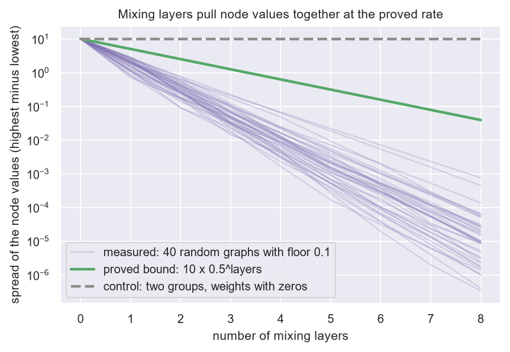
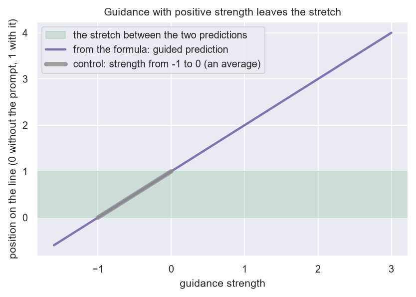

# 38. Mixing: graphs, noise schedules and guidance

**In the repository:**
[`Mixing.lean`](../lean/SquigglyLine/Supporting/NewInputs/Mixing.lean),
[`OnAverage.lean`](../lean/SquigglyLine/Supporting/NewInputs/OnAverage.lean),
note [`mixing.md`](../docs/supporting/new-inputs/mixing.md).
**You need:** chapters 15, 36 and 37.

## The idea

Chapter 36 showed that tokens under attention are pulled together, and
chapter 37 that an average of models is no steeper than they are. Many
other parts of modern models are averages under another name. This chapter
goes through five, then one that looks like an average and is not, then
two facts about averages themselves.

- A **graph network** replaces every node by a weighted sum of nodes.
- A diffusion **noising schedule** mixes the data with fresh noise.
- **Data augmentation** averages a model over shifts or flips of its input.
- A **baseline** in policy gradient is subtracted from every reward.
- **Classifier-free guidance** blends two predictions, with one weight
  negative. That is the one that is not an average.

> A layer that averages cannot add squiggle and pulls its inputs
> together. Guidance, with a negative weight, is the exception that
> shows the rule.

## An example you can do by hand

**Graph.** Three nodes. Every weight is at least `weight_floor` = 0.2, and
each row of weights adds to one, for instance 0.5, 0.3, 0.2. The values
range from 0 to 10. One layer leaves two nodes at most
`1 − 3 × 0.2 = 0.4` times the range apart, so 4. After three layers,
`0.4^3 = 0.064` times 10, so 0.64.

**Noising.** Each step keeps `1 − noise_rate` of the signal and adds
`noise_rate` of fresh noise. With `noise_rate` = 0.1, after ten steps the
signal's share is `0.9^10`, about 0.35, and the noise's share is 0.65.

**Guidance.** Without the prompt the model predicts 1, with it 2, and the
guidance strength is 1. The guided prediction is `2 × 2 − 1 × 1 = 3`. The
prompt alone moves the prediction by 1, and guidance moves it by 2, which
is `1 + 1` times as far. And 3 is not between 1 and 2.

**Median.** Labels 1, 2 and 100. The mean is 34.3. A median is 2. Squared
error is least at 34.3, absolute error at 2.

## The statement

Graph networks. `APPLY_MESSAGE_PASSING` makes each node a weighted sum of
the nodes: `sum(node_weights[node][j] * node_values[j] for j in nodes)`.

```lean
/-- **A message-passing layer shrinks the spread.** If every row of weights
adds to one and every weight is at least `weight_floor`, two nodes end no
further apart than `1 - node_count * weight_floor` times the range of the
values. -/
theorem abs_messagePassing_sub_le
    {node_weights : Nodes → Nodes → ℝ}
    {weight_floor lower_bound upper_bound : ℝ}
    (weights_above_floor : ∀ i j, weight_floor ≤ node_weights i j)
    (rows_sum_to_one : ∀ i, ∑ j, node_weights i j = 1)
    {node_values : Nodes → ℝ}
    (values_above_lower : ∀ j, lower_bound ≤ node_values j)
    (values_below_upper : ∀ j, node_values j ≤ upper_bound)
    (node other_node : Nodes) :
    let passed       := APPLY_MESSAGE_PASSING node_weights node_values node
    let other_passed :=
      APPLY_MESSAGE_PASSING node_weights node_values other_node
    let gap_size     := |passed - other_passed|
    let disagreeable := 1 - Fintype.card Nodes * weight_floor  -- `node_count * weight_floor` is shared, the rest can differ
    let value_range  := upper_bound - lower_bound
    gap_size ≤ disagreeable * value_range := by
```

*Read aloud:* if every node gives every node at least `weight_floor` of
its weight, then after one layer any two nodes differ by at most
`1 − node_count × weight_floor` times the range of the values.

After `layer_count` layers the factor is to that power
(`abs_iterate_messagePassing_sub_le`). It is the same statement as the
merging of tokens in chapter 36.

The curves are **measured**, the green line **proved**: the spread of the node values of 40 random graphs falls below the bound at every layer, while two groups that only listen to themselves (a case with zeros in the weights, no floor) do not shrink at all.



The noising schedule. A state is the pair (share of signal, share of
noise) of the variance.

```lean
/-- **The signal's share is the product of the factors `1 - noise_rate`.**
With the same `noise_rate` at every step it is `(1 - noise_rate) ^ step_count`
of what it was. -/
theorem iterate_noisingStep_signal
    (noise_rate : ℝ)
    (split : VarianceSplit)
    (step_count : ℕ) :
    let signal_after    :=
      ((TAKE_NOISING_STEP noise_rate)^[step_count] split).1
    let signal_expected := (1 - noise_rate) ^ step_count * split.1  -- one factor of 1 - noise_rate per step
    signal_after = signal_expected := by
```

*Read aloud:* after `step_count` noising steps the signal's share is
`(1 − noise_rate)^step_count` of what it was.

`.1` picks the first of the pair, the signal. The two shares keep adding
to one (`noisingStep_sum`).

Guidance. `APPLY_GUIDANCE` is `(1 + strength) × with_prompt − strength ×
without_prompt`.

```lean
/-- **Guidance is not an average.** For a positive strength the guided
prediction is not on the stretch between the two predictions it is made
from. -/
theorem guidance_notMem_segment
    {guidance_strength : ℝ}
    (strength_pos : 0 < guidance_strength)
    {without_prompt with_prompt : Space}
    (predictions_differ : with_prompt ≠ without_prompt) :
    let guided  :=
      APPLY_GUIDANCE guidance_strength without_prompt with_prompt
    let stretch := segment ℝ without_prompt with_prompt
    guided ∉ stretch := by
```

*Read aloud:* with a positive strength and two different predictions,
the guided prediction lies off the stretch between them.

`segment` is the stretch between two points, and `∉` means "is not in".
The guided move is `1 + guidance_strength` times the plain one
(`guidance_sub`, `norm_guidance_sub`).

The line is **from the formula**: the position of the guided prediction on the line through the two predictions, 0 for the prediction without the prompt and 1 for the one with it. For a positive strength it is above 1, off the stretch. For strengths from -1 to 0 the weights are both non-negative, an average, and it stays on the stretch.



The rest are named. Averaging a model over moves of its input gives a
model that ignores the moves (`averageOverMoves_smul`) and is no steeper
if the moves keep distances (`lipschitzWith_averageOverMoves`). A baseline
pushes nothing on average (`sum_mul_baseline_eq_zero`), so subtracting one
changes no average push (`sum_mul_sub_baseline`). Absolute error is least
at a median (`sum_abs_sub_median_le`). And a random direction with
uncorrelated coordinates, each of mean square `mean_square`, has overlap
with a fixed direction of mean square `mean_square` times its squared
length (`sum_mul_sq_overlap`).

## Why it is true

**Graph layer.** Two weighted sums whose weights all sit above a floor
share `node_count × weight_floor` of their weight, and the shared part
cancels. The rest is `1 − node_count × weight_floor`, times the range of
the values. This is the lemma behind chapter 36, `abs_sum_mul_sub_sum_mul_le`.
Depth is the same induction on bands as there.

**Noising.** One step multiplies the signal by `1 − noise_rate`. Do it
`step_count` times: induction, with the factor pulled out each time.

**Guidance.** On the stretch, a point is the plain prediction plus a share
of the step, and that share is at most one. The guided point is the plain
prediction plus `1 + guidance_strength` of the step. Suppose the two
points were equal. Then `1 + guidance_strength − share` times the step
would be zero. The step is not zero, because the predictions differ, and
the factor is at least `guidance_strength`, which is positive. That is a
contradiction.

**Baseline.** The push on a softmax policy is "action taken minus share of
the action chosen". Averaged over the action taken, the first part is
the share of the action chosen, and the second takes the same share away:
zero. With two actions each of share
0.5 and the first chosen, `0.5 × (1 − 0.5) + 0.5 × (0 − 0.5) = 0`.

**Random directions.** Squaring the overlap gives a term for every pair of
coordinates. Uncorrelated means the average of every mixed pair is zero,
so only the squares survive. With a direction of length one in
`dimension` dimensions, `mean_square = 1 / dimension`: with 100 dimensions
the mean squared overlap is 0.01.

## What it explains

**Blurring in graph networks.** Deep graph networks make node features
alike. The proof gives that as a rate, the same as for attention.

**The forward process of diffusion.** The data is averaged with noise,
and the weight on the data shrinks geometrically.

**Guidance.** It is the one step of a diffusion sampler that can leave the
region the examples span, which is how it can push samples toward the
prompt harder than the model alone does.

**Medians.** A line trained on squared error goes through the mean of the
labels at each input, and one trained on absolute error through their
median. A few wild labels do not move a median. This is why a robust loss
is robust.

**Random features.** Random vectors in many dimensions hardly overlap. This
is the on-average form of the fact behind travel falling as the model grows.

## How this meets the squiggly line

Through **averages** (chapter 15). A layer that averages cannot add
squiggle, and pulls its inputs together: the blurring of graph networks,
the fading of the signal in the schedule, and the gentleness of a model
averaged over moves. Guidance has one negative weight, so it is not an
average, and it can leave the region an average must stay in.

## Run it yourself

[`ch38_mixing.ipynb`](../experiments/part6/ch38_mixing.ipynb) checks each statement on small models with 21 `[PASS]` lines. An experiment is
evidence, not a proof. Numbers marked **measured** came from running a model; **from the formula** means the chapter's own
formula was evaluated; two checks are by construction and are not evidence. Graph layer (**measured**): in 300 random graphs on 5 nodes with
floor 0.1, every layer through 8 left a spread at most `0.5^k` times the range, the worst spread being 0.724 of the
bound after a layer; a layer built to be as bad as allowed reached the bound (5.0000 against 5.0000). With zeros in the
weights the spread stayed at 10.000 after 8 layers, where the bound would be 0.0391. Noising: the sampled noising
(**measured**, 400 000 draws) left a signal share of 0.3494 after ten steps at rate 0.1, against 0.9^10 = 0.3487.
Iterating the step's formula matched the closed form to 4.1e-16 (**from the formula**), and a schedule with rates 0.02
and 0.18 alternating left 0.3351, not 0.3487 (**from the formula**). Guidance (**from the formula**): in 12 000 cases with positive strength the
guided point was never on the stretch (nearest 0.119 away); strengths from -1 to 0 stayed on it. That the guided move is
`1 + strength` times the plain step is by construction. Averaging over shifts (**measured**) gave the same value at every shift
of an input, and a change per distance of at most 1.084, under the model's own constant 2; averaging over scalings,
which keep no distances, gave 1.831 where the model's constant was 1. A constant baseline changed the average push by at
most 2.2e-16; a baseline equal to the reward changed it by 0.078. Squared error was least at 34.33 and absolute error at 2
for the labels 1, 2, 100. The mean square overlap was exact to 3.0e-16 in 10 dimensions, and 0.00998 against 0.01
in 100 (standard error 3.1e-05); with two coordinates made equal it was 1.960 where the formula gives 0.980.

```bash
jupyter nbconvert --to notebook --execute --inplace experiments/part6/ch38_mixing.ipynb
```

## What is not shown

- **Graph networks on a sparse graph.** The rate needs every weight to have
  a floor. On a real graph that holds only after enough layers for every
  node to reach every other, and that step is not shown.
- **That training on augmented data pushes toward the averaged model.**
  Argued.
- **That a baseline lowers the noise** of the policy gradient.
- **The reverse process of diffusion**, and what guidance does over a
  whole sampling run.
- **That random directions hardly overlap with high chance**, and not just
  on average.

## Check yourself

1. A graph layer has `weight_floor` = 0.1 on 4 nodes, and the node values
   range over 20. By how much can two nodes differ after one layer?
2. Guidance strength 2, without prompt 3, with prompt 4. What is the
   guided prediction?
3. A diffusion schedule has `noise_rate` = 0.5. What share of the signal
   is left after three steps?

**Answers.** (1) At most `(1 − 4 × 0.1) × 20 = 12` (`abs_messagePassing_sub_le`).
(2) `3 × 4 − 2 × 3 = 6`. It is 3 away from 3, three times the plain step of
1 (`guidance_sub`), and off the stretch from 3 to 4
(`guidance_notMem_segment`). (3) `0.5^3 = 0.125`
(`iterate_noisingStep_signal`).

Previous: [37. Ensembles and the ideal denoiser](37-ensembles-and-the-denoiser.md) · Next: [39. Hard choices and temperature](39-hard-choices-and-temperature.md)
