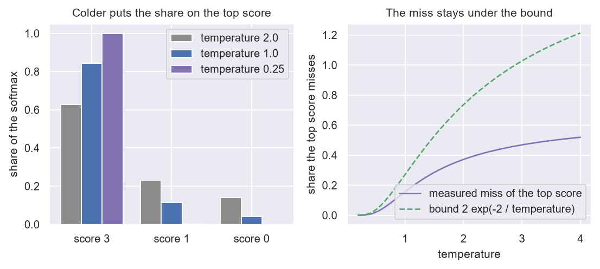
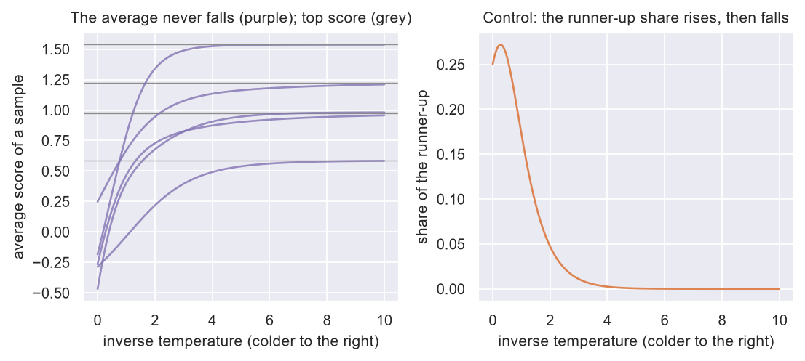

# 39. Hard choices and temperature

**In the repository:**
[`HardChoices.lean`](../lean/SquigglyLine/Supporting/NetworkShape/HardChoices.lean),
[`Temperature.lean`](../lean/SquigglyLine/Supporting/NetworkShape/Temperature.lean),
notes [`attention.md`](../docs/supporting/network-shape/attention.md) and
[`network-slope.md`](../docs/supporting/network-shape/network-slope.md).
**You need:** chapters 3, 15 and 36.

## The idea

Anyone who has sampled text from a language model has met the
temperature dial. Turn it down and the model repeats its favourite
answer. Turn it up and the answers vary, and some are worse.

Sampling at a temperature means taking the softmax of the scores
divided by the temperature. The softmax turns scores into shares that
add up to one, as in chapter 36. Dividing by a small temperature makes
the gaps between scores large, so the best score takes almost all the
share. In the limit the softmax is a **hard choice**: it picks the top
score and nothing else.

A hard choice is a step. All its slope sits at the jump, and nowhere
else. That is the squiggly line again, in its sharpest form. This
chapter proves two things about the dial and one thing about getting a
gradient through a hard choice.

> As the temperature falls, the average score of a sample never falls,
> and the top score takes nearly all the share.

## An example you can do by hand

Three answers have scores 3, 1 and 0. The exponentials are about 20.09,
2.72 and 1, and they add up to about 23.81.

At temperature 1 the shares are the exponentials divided by that total:
0.844, 0.114 and 0.042. The average score of a sample is
`3 × 0.844 + 1 × 0.114 + 0 × 0.042`, about 2.65. The top score misses
`1 − 0.844 = 0.156` of the share.

At temperature 0.5 the scores become 6, 2 and 0. The exponentials are
about 403.4, 7.39 and 1, adding up to about 411.8. The shares are
0.980, 0.018 and 0.002. The average score is about 2.96, which is
higher. The top score misses only 0.020.

The top score leads the others by at least 2. That number, 2, is the
`gap` in the statement below. There are three answers, so the statement
promises a miss of at most `2 × exp(−2 / temperature)`. At temperature 1
that is `2 × 0.135 = 0.27`, and the true miss, 0.156, is under it. At
temperature 0.5 it is `2 × 0.018 = 0.037`, and the true miss, 0.020, is
under that.

**The straight-through trick.** A hard step has slope zero away from its
jump, so gradient descent cannot see through it. Take a hard step with
value 1 at the point 0.3, and a gentle stand-in `2 × input` with slope 2.
Define `through(input) = hard(0.3) − soft(0.3) + soft(input)`. At the
point 0.3 it is `1 − 0.6 + 0.6 = 1`: the value of the hard step. Its slope
is 2: the slope of the stand-in.

## The statement

```lean
/-- **A cold softmax picks the top score.** If score `top` leads every other
by at least `gap`, then at temperature `temperature` its share is within
`(choice_count - 1) * exp (-gap / temperature)` of one. -/
theorem cold_softmax_picks_the_top_score
    [DecidableEq Choices] [Nonempty Choices]
    {scores : Choices → ℝ}
    {top : Choices}
    {gap temperature : ℝ}
    (temperature_pos : 0 < temperature)
    (top_leads : ∀ j, j ≠ top → scores j + gap ≤ scores top) :
    let cold_scores := fun j => scores j / temperature
    let top_miss    := 1 - APPLY_SOFTMAX cold_scores top
    let bound       :=
      (Fintype.card Choices - 1) * exp (-gap / temperature)  -- each of the other choices has share at most exp (-gap / temperature)
    top_miss ≤ bound := by
```

*Read aloud:* if the top score leads every other by at least `gap`, then
the share the top score fails to get is at most the number of other
choices times `exp(−gap / temperature)`.

`APPLY_SOFTMAX` is the softmax of chapter 36. `Fintype.card Choices` is
the number of choices. As `temperature` falls, `−gap / temperature`
becomes very negative, and the bound goes to zero.

**Measured** for the scores 3, 1 and 0, the softmax at three temperatures
is on the left, and the share the top score misses, against the
temperature and under the bound `2 × exp(−2 / temperature)`, is on the
right:



```lean
/-- **A colder sampler picks better answers on average.** With
`inverse_temperature` one over the temperature, the average score of a sample
from the softmax never falls as `inverse_temperature` rises. -/
theorem colder_sampler_picks_better_on_average [Nonempty Answers]
    (scores : Answers → ℝ)
    {lower higher : ℝ}
    (lower_le_higher : lower ≤ higher) :
    let lower_average :=
      ∑ i, APPLY_SOFTMAX (fun j => lower * scores j) i * scores i
    let higher_average :=
      ∑ i, APPLY_SOFTMAX (fun j => higher * scores j) i * scores i
    lower_average ≤ higher_average := by
```

*Read aloud:* the average score of a sample, drawn from the softmax of
the scores times `inverse_temperature`, never falls when
`inverse_temperature` is raised.

`inverse_temperature` is one over the temperature, so a high one is a
cold sampler. The sum `∑ i, share i * scores i` is the average score:
each score weighted by its share.

**Measured** for five random lists of six scores, the average score of a
sample against the inverse temperature rises and levels off at the top
score (left). On the right, for one list, the share of the runner-up is a
control: it rises and then falls, so the theorem is about the average and
not about every share:



The other results of the two files are named here. `hard_step_sends_no_gradient_back`
says a hard step has slope zero away from its jump.
`straight_through_forward_is_the_hard_step` says the trick `APPLY_STRAIGHT_THROUGH` has the
value of the hard step. `straight_through_backward_has_the_stand_in_slope` says it has the
slope of the stand-in. `hopfield_recall_equals_ideal_denoiser` says that for patterns and
a state of length one, the update of a modern Hopfield network is the
ideal denoiser of chapter 37.
`hopfield_recall_equals_ideal_denoiser_for_any_state` says the same with
less assumed: the state may have any length, and the patterns need only
have the same length as each other. `snapping_moves_output_at_most_slope_times_distance` and
`nearest_entry_is_the_gentlest_snap` say that replacing a code by an entry of a
codebook moves a decoder's output by at most its slope times the distance
to the entry, and that the nearest entry gives the smallest bound.

## Why it is true

**The cold softmax.** The shares add up to one, so what the top score
misses is exactly what the other choices hold between them
(`miss_is_others_share`). Take one other choice. Its share is its
exponential divided by the total, and the total is at least the top
score's exponential. So its share is at most the ratio of the two
exponentials, which is `exp` of its score minus the top score, all
divided by the temperature. The top score leads by at least `gap`, so
that is at most `exp(−gap / temperature)` (`other_share_le`). Add up the
bound once for each of the other choices.

**The average score.** The average score is a ratio: the sum of each
score times its exponential, over the sum of the exponentials
(`average_form`). To compare two values of `inverse_temperature`,
multiply both sides out. Then the claim is about a double sum over every
pair of answers. For one pair, the better answer gains more weight from
the larger `inverse_temperature` than the worse one does, and that gain
is the non-negative term `pair_gain`. Adding the terms over all pairs
gives `average_score_rises_as_temperature_falls_cross_multiplied`, and the theorem follows.

**The straight-through trick.** Forward, the two stand-in terms cancel
and leave the hard value. Backward, the first two terms are constants, so
only the slope of `soft` is left.

## What it explains

**Temperature as a dial for the slope.** Dividing the scores by a
temperature changes their slope by that factor, and never changes their
order. The note says the same dial is used to repair an overconfident
classifier after training (**recalled**: Guo et al. 2017). The two proofs
here give the sampling side. One dial moves quality up and variety down,
and the dial is the slope of the scores: the colder the sampler, the
steeper, the closer to a hard choice.

**Gumbel-softmax.** The cold softmax is the gentle stand-in used when a
network has to pick. The bound says how close it is to the pick it
stands in for.

**Straight-through gradients.** The trick keeps the value of a step and
borrows the slope of a line. The proofs say exactly that, and no more:
they do not say the borrowed slope points the right way.

**Hopfield recall.** Recalling a stored pattern is denoising. The state
moves toward the stored patterns nearest to it and never leaves the
region they span.

## How this meets the squiggly line

Through **slope** (chapter 3) and **averages** (chapter 15). A hard
choice is all slope at one point. A softmax is the average that lets you
pay for that slope gradually, with the temperature as the price. The
colder the temperature, the more slope is bought, and the more of the
softness is lost.

## Run it yourself

The notebook
[`ch39_hard_choices_and_temperature.ipynb`](../experiments/part6/ch39_hard_choices_and_temperature.ipynb)
makes 15 checks with seeded random draws. It is evidence, not a proof. It
checks the hand example: the shares are 0.844, 0.114, 0.042 and 0.980,
0.018, 0.002, and the averages are 2.646 and 2.957, as above. The bound
`(count − 1) × exp(−gap / temperature)` holds in all 24000 cases (2000
lists of 2 to 12 scores, 12 temperatures); the smallest bound minus miss
is −1.1e-16, in a list of 2 choices with the gap over the temperature
at 18.9. For two choices the miss is `exp(−x) / (1 + exp(−x))`, so the
bound is not exact there: it is tight to rounding only because the gap over
the temperature is large. With twice the true gap, as a control, the bound fails in 10986 of
those cases, by up to 0.267. The average score never falls as the sampler
gets colder in 2000 lists over 200 inverse temperatures (the smallest step
is −1.8e-15). As a control, the runner-up share is not monotone in 1667 of
the 2000 lists. For the straight-through trick, the value 1 and the slope 2 at 0.3 hold
by construction, so the notebook prints them as such and does not count
them as evidence. What it does check is that the hard step has slope 0 at
0.3 and a difference quotient of 50000 at its jump. The Hopfield update equals the ideal
denoiser to 1.0e-15 over 500 draws; patterns of unequal length, as a
control, break it by up to 0.950. The recalled vector is 3.6e-15 from the
span of the patterns. For a decoder with slope limit 6.897, no snap
breaks the bound in 6000 pairs (the largest change per distance is 1.790).
This claim has no control: the bound is the definition of a slope limit
applied to two points, and a false slope limit would fail trivially.

One thing the experiment found beyond the first statement: the equality
with the denoiser also holds, to 7.5e-16, for a state of length 1.5. So
the hypothesis that the state has length one was stronger than needed.
This is now **proved**:
`hopfield_recall_equals_ideal_denoiser_for_any_state` drops the hypothesis
on the state, and asks of the patterns only that they all have the same
length. The reason is short. The overlap score and the squared-distance
score of a pattern differ by half the squared length of the state plus half
the squared length of the pattern, over the temperature. If that is the same
number for every pattern, a softmax does not see it. The control in the
notebook, patterns of unequal length, is exactly the case this does not
cover.

Run it with
`jupyter nbconvert --to notebook --execute --inplace experiments/part6/ch39_hard_choices_and_temperature.ipynb`.

## What is not shown

- **Any measure of variety that falls at every step.** Only the two ends
  are proved: the average score rises, and a cold softmax puts nearly all
  its share on the top score. A measure such as the entropy is not shown
  to fall at each step.
- **The Gumbel noise.** It makes the pick a random draw from the softmax.
  It is not shown.
- **That the straight-through slope is a good direction.** Only that it is
  the slope of the stand-in.
- **The classic Hopfield network of 1982,** with its energy that only
  falls. Only the modern update, for patterns and a state of length one.
- **The codebook as it is trained.** Only the cost of one snap.

## Check yourself

1. Two answers have scores 2 and 0. At temperature 1, how little of the
   share can the top score have?
2. The same scores, at temperature 0.5. What does the bound say now?
3. In the straight-through trick above, what is the value and the slope
   at the point 0.3?

**Answers.** (1) The gap is 2 and there is one other choice, so the miss
is at most `exp(−2) = 0.135` (`cold_softmax_picks_the_top_score`). The top score
has at least 0.86. (2) The miss is at most `exp(−4)`, about 0.018, so the
top share is at least 0.98. (3) The value is 1, by `straight_through_forward_is_the_hard_step`,
and the slope is 2, by `straight_through_backward_has_the_stand_in_slope`.

Previous: [38. Mixing: graphs, noise schedules and guidance](38-mixing.md) · Next: [40. Neighbours](40-neighbours.md)
