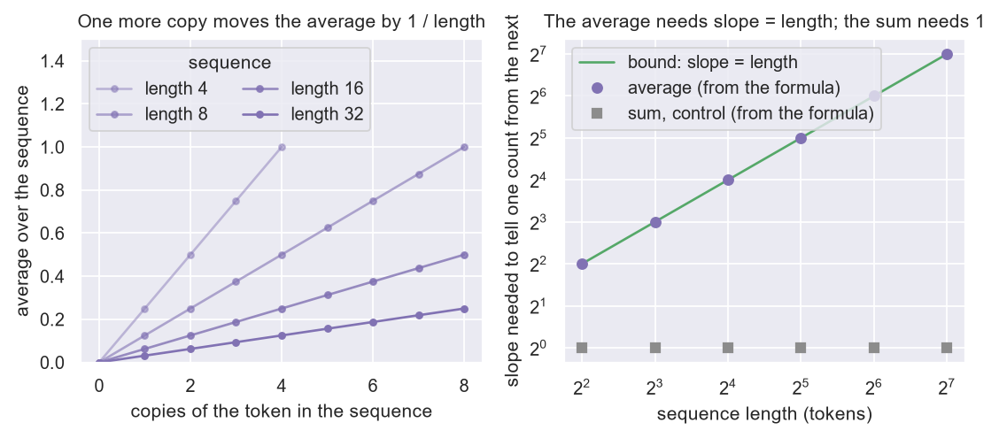
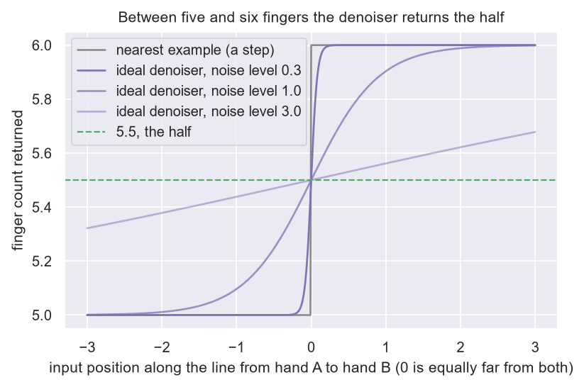

# 41. Counting

**In the repository:**
[`Counting.lean`](../lean/SquigglyLine/Supporting/NewInputs/Counting.lean),
note [`counting.md`](../docs/supporting/new-inputs/counting.md).
**You need:** chapters 3, 15, 36 and 37.

## The idea

Image models make a recognisable kind of mistake. A hand has six
fingers. A horse has five legs. A prompt asks for three cats and the
picture has two.

These are all mistakes of number. A count is a **step**: a whole number
that jumps from `count` to `count + 1`, with nothing between. The models in this
book are made of averages and of pieces with limited slope. An average
does not jump, and a limited slope cannot jump. So a count is about the
hardest thing to ask of them.

> A smooth model cannot go from `count` to `count + 1` without passing
> through the half, an average blends counts, and telling two counts
> apart takes slope.

This chapter does not say that these facts are why a real image model
draws six fingers. It says that counting is hard for the kind of model
the proofs describe.

## An example you can do by hand

**A half on the way.** A read-out says 5 at the start of a path and 6 at
the end, and changes smoothly in between. Say it is
`5 + fraction × fraction`. At `fraction = 0.707` the square is about 0.5,
so the read-out says 5.5. Whatever the read-out is, if it is continuous
it hits 5.5 somewhere.

**A blend of hands.** Describe each hand by two numbers: its finger
count and one other feature. Hand A is `(5, 0)` and hand B is `(6, 2)`.
The noisy input `(7.5, 0)` is at distance 2.5 from A, since
`7.5 − 5 = 2.5`. It is at distance `√(1.5² + 2²) = √6.25 = 2.5` from B.
So it is equally far from both. The ideal denoiser returns half of each:
`½ × ((5, 0) + (6, 2)) = (5.5, 1)`. The finger count is 5.5. This is the
same whatever the noise level.

**The price of a jump.** A model says 5 at one image and 6 at another
image at distance 0.2. Its slope is at least `1 / 0.2 = 5`. If the two
images are at distance 0.01, the slope is at least 100.

## The statement

```lean
/-- **Between two counts there is a half.** A read-out that is continuous along
a path, and says `count` at one end and `count + 1` at the other, says
`count + 1/2` somewhere on the path. -/
theorem between_two_counts_there_is_a_half
    {readout : RealFunction}
    {count : ℝ}
    (readout_is_continuous : ContinuousOn readout (Set.Icc 0 1))
    (readout_at_start : readout 0 = count)
    (readout_at_end : readout 1 = count + 1) :
    ∃ fraction ∈ Set.Icc (0 : ℝ) 1,
      let half_count := count + 1 / 2
      readout fraction = half_count := by
```

*Read aloud:* if a read-out is continuous along a path from 0 to 1 and
says `count` at the start and `count + 1` at the end, then somewhere
along the path it says `count + 1/2`.

`Set.Icc 0 1` is the path: every `fraction` from 0 to 1. `ContinuousOn`
says the read-out has no jumps along it.

```lean
/-- **The ideal denoiser blends counts.** At a noisy input equally far from two
training examples, it returns the point half way between them: half of one hand
and half of the other. -/
theorem ideal_denoiser_blends_two_equally_far_examples
    (noise_level : ℝ)
    (examples : Fin 2 → Space)
    {noisy_input : Space}
    (equidistant :
      ‖noisy_input - examples 1‖ = ‖noisy_input - examples 0‖) :
    let denoised := DENOISE_IDEALLY noise_level examples noisy_input
    let midpoint := (1 / 2 : ℝ) • (examples 0 + examples 1)  -- half of each example
    denoised = midpoint := by
```

*Read aloud:* if a noisy input is equally far from two training
examples, the ideal denoiser returns the midpoint of the two.

`Fin 2` is a list of two examples, numbered 0 and 1. `DENOISE_IDEALLY` is
the ideal denoiser of chapter 37: an attention head over the training
examples. `•` multiplies a point by a number.

```lean
/-- **Being sharp about a count costs slope.** A model that says `count` at one
input and `count + 1` at another has slope at least one over the distance
between them. -/
theorem sharp_count_costs_slope
    {Inputs : Type*} [PseudoMetricSpace Inputs]
    {model : Model Inputs}
    {slope_limit : SlopeLimit}
    (slope_is_bounded : LipschitzWith slope_limit model)
    {input other_input : Inputs}
    {count : ℝ}
    (model_at_input : model input = count)
    (model_at_other_input : model other_input = count + 1) :
    let output_change     := (1 : ℝ)  -- from `count` to `count + 1`
    let max_output_change := slope_limit * dist input other_input
    output_change ≤ max_output_change := by
```

*Read aloud:* if a model with slope at most `slope_limit` says `count`
at one input and `count + 1` at another, then 1 is at most `slope_limit`
times the distance between the inputs.

This is the statement you read in chapter 2. Divide both sides by the
distance to get the slope bound.

Two more results are named. `equal_scores_give_the_point_half_way` says an attention
head that scores two examples equally returns the midpoint of their
values. `convolution_stack_reads_only_its_window` says that after some layers of
convolution an output depends only on the inputs within a window.

## Why it is true

**A half on the way.** The value `count + 1/2` lies between the two ends,
`count` and `count + 1`. A continuous read-out along a path that starts
below a value and ends above it must hit it. That is the intermediate
value theorem, which the Lean proof calls directly. The only work is the
check that half lies between the ends (`half_between`).

**A blend.** Two equal distances give two equal scores, since the
denoiser scores each example by minus its squared distance over a noise
term. A head with equal scores gives each example an equal share. So its
output is the plain average, which for two examples is the midpoint
(`equal_scores`, then `equal_scores_give_the_point_half_way`).

**The price of a jump.** The slope condition says two outputs differ by at
most `slope_limit` times the distance between the inputs. The outputs
differ by exactly 1, because `count` and `count + 1` are 1 apart
(`gap_is_one`). So 1 is at most `slope_limit` times the distance.

## What it explains

**Six fingers and five legs.** A model that moves smoothly through the
space of images cannot go from five fingers to six without passing
through images that are neither. An ideal denoiser, at an input equally
far from a five-finger hand and a six-finger hand, returns an average of
the two, and an average of hands does not have a whole number of
fingers. Telling the two apart in a sharp way takes slope, and two images
that differ by one finger are close, so the slope is large. Every result
in this book says slope must be paid for.

**What the proofs add.** People have long observed that image models
miscount. The proofs do not add that observation. They show that, for a
model made of averages and limited slope, counting is hard in three
separate ways: smoothness, blending and slope.

## How this meets the squiggly line

Through **slope** (chapter 3) and **averages** (chapter 15). The theorem
says a line gets near the data by being steep. A count is the limit of
that: all step, and no slope anywhere else. An average cannot make a
step, and a model of limited slope can only round its corners.

## Run it yourself

[`ch41_counting.ipynb`](../experiments/part6/ch41_counting.ipynb) checks the three
statements on small exact models, and one use of the third for an average
over a sequence. It does not train anything. A read-out from 5 to 6 that is
continuous said 5.5 in all four cases tried, at `fraction = 0.7071` for
`5 + fraction²`; a read-out with a jump never came within 0.500 of it.
For the two hands, the ideal denoiser returned `(5.5, 1)` at every noise
level from 0.1 to 10, and returned the midpoint in 200 random equidistant
cases in 4 dimensions (largest error 3.8e-15). Moved by 1 towards B, at
noise level 1, the finger count became 5.9034, matching the
`tanh` formula to 7.8e-16. In 900 smooth models that say 5 and 6 at
distances 0.2, 0.05 and 0.01, the largest slope times the distance was never
below 1.1649 (a straight line gives exactly 1, which holds by construction and is not
evidence). For models that say 5 and 5.5 the smallest was 0.6649, below 1,
so the bound with gap 1 fails there, as it should.

For an average over a sequence of `length` tokens, one more copy of a
token moves the average by `1 / length`, so by the formula the slope needed
to tell the counts apart is `length` (4, 8, 16, 32, 64 and 128 for those
lengths), and a sum needs 1 at every length. These come from the formula,
not from a run. What was run is a linear program for the smallest
worst-case count error over every read-out of the average with slope at most
a limit. For lengths 8, 16 and 32 the error was 0 at slope limit `length`
and 2.0000, 4.0000 and 8.0000 at half the length; from the sum with slope
limit 1 it was 0.



The ideal denoiser between two hands passes through 5.5 at every noise
level (**measured**); the nearest-example answer jumps.



These are checks of small cases by measurement, not proofs. Run it with
`jupyter nbconvert --to notebook --execute --inplace experiments/part6/ch41_counting.ipynb`.

## What is not shown

- **That this is why real models miscount.** The facts show that counting
  is hard for a model built from averages and limited slope. They do not
  show that it is the cause of any real error. That is a question about
  trained networks and needs experiments. **open**
- **That all the mistakes are mistakes of number.** That is an observation
  about pictures, not a statement these proofs can reach.
- **That such a model cannot count at all.** It can, at a cost in slope
  and with layers that see the whole image. Newer models miscount less
  (**recalled**), which fits "expensive" better than "impossible".
- **Attention.** An attention layer does see the whole image. What it can
  count, and at what cost, is not analysed here.
- **The model of the proofs.** A read-out that is continuous along a
  path, a denoiser built from a training set of two examples, and a
  slope limit that holds everywhere.

## Check yourself

1. A read-out is continuous along a path and says 3 at the start and 4 at
   the end. What value must it take somewhere?
2. Two training examples have finger counts 5 and 6. The ideal denoiser
   is at an input equally far from both. What finger count does it
   return?
3. Two images are at distance 0.05. A model says 2 at one and 3 at the
   other. What can you say about its slope?

**Answers.** (1) 3.5 (`between_two_counts_there_is_a_half`). (2) 5.5, the midpoint
(`ideal_denoiser_blends_two_equally_far_examples`). (3) The slope limit times 0.05 is at
least 1, so the slope limit is at least `1 / 0.05 = 20`
(`sharp_count_costs_slope`).

Previous: [40. Neighbours](40-neighbours.md) · Next: [42. Same kernel, same predictions](42-same-kernel.md)
