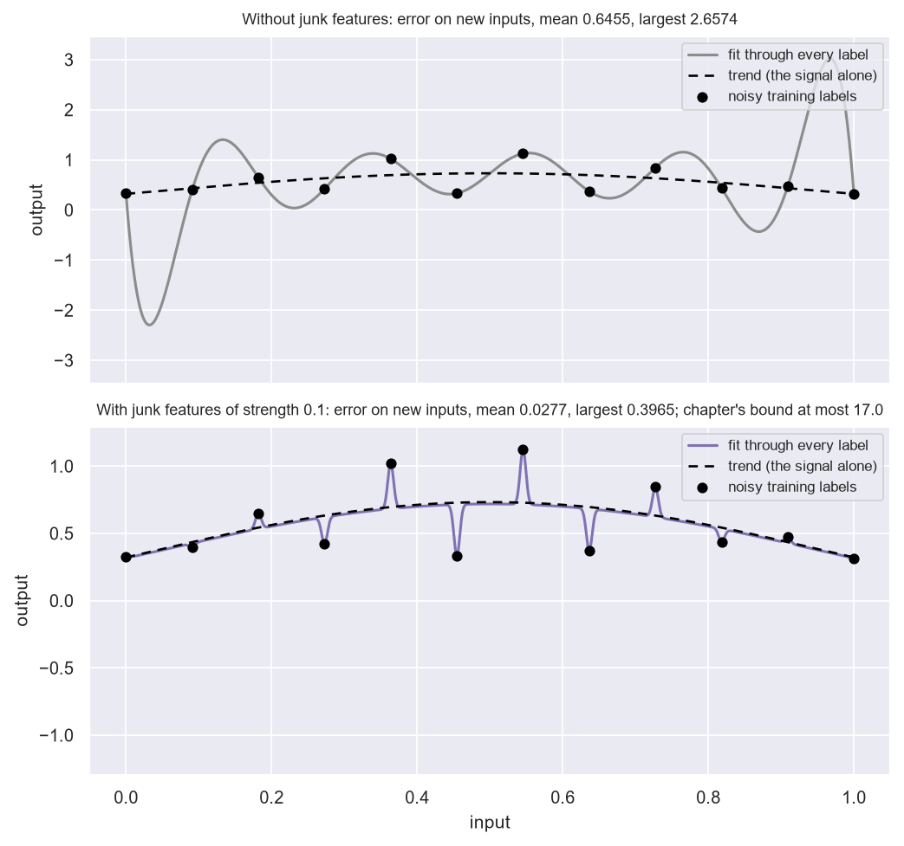
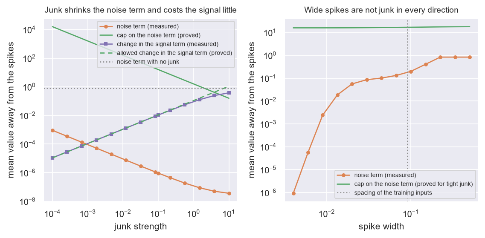

# 44. Benign overfitting

**In the repository:**
[`BenignOverfitting.lean`](../lean/SquigglyLine/Supporting/NewInputs/BenignOverfitting.lean),
note [`benign-overfitting.md`](../docs/supporting/new-inputs/benign-overfitting.md).
**You need:** chapters 9, 10, 16 and 43.

## The idea

Big networks fit their training labels exactly, mistakes and all, and
still do well on new data (**recalled**: Zhang et al. 2017). The old
advice said a model that fits the noise must do badly. For some linear
models it is now proved that it need not: the fit can swallow the noise
harmlessly (**recalled**: Bartlett, Long, Lugosi and Tsigler 2020).

How can a model fit noise and not be hurt by it? The kernel picture gives
a short answer. Split what is left to fit into two parts. The **signal**
is the real pattern, along a direction where the model is strong, of
strength `signal_strength`. The **noise** is the mistakes in the labels,
along a direction where the model is weak, of strength `noise_strength`.
The nearest fit of chapter 9 fits both exactly. At a new input, each part
is divided by the strength of its direction. The noise is therefore
divided by a small number, and does a lot of damage.

Now add many features that have nothing to do with the task. Call their
strength `junk_strength`, the same in every direction. Strengths add, so
every direction gains `junk_strength`, and the noise is divided by a
bigger number.

> With junk features of strength `junk_strength`, the damage that fitting
> the noise does at a new input is at most the size of the overlap
> divided by `junk_strength`, however weak the noise direction was. The
> signal term loses at most the fraction `junk_strength / signal_strength`
> of itself.

## An example you can do by hand

The signal has overlap 6 with the new input and strength 3. Its term is
`6 / 3 = 2`. The noise has overlap 1 with the new input and a tiny
strength, 0.01. Its term is `1 / 0.01 = 100`. The fit gets the training
labels right and is wrecked at the new input.

Add junk features. Every strength goes up by `junk_strength`.

| junk_strength | signal term | noise term | cap `1 / junk_strength` |
|---|---|---|---|
| 0 | 2 | 100 | none |
| 0.1 | 1.935 | 9.09 | 10 |
| 1 | 1.5 | 0.990 | 1 |

Check the middle row. The signal term is `6 / (3 + 0.1) = 1.935`. The
noise term is `1 / (0.01 + 0.1) = 9.09`, which is below the cap
`1 / 0.1 = 10`. The signal lost `2 − 1.935 = 0.065`. The allowed loss is
`2 × 0.1 / 3 = 0.067`.

Check the last row. The noise term is `1 / 1.01 = 0.990`, below its cap
of 1. The signal lost 0.5, and the allowed loss is `2 × 1 / 3 = 0.667`.

The junk is most useful when `junk_strength` sits between the two
strengths: much bigger than the noise's 0.01, much smaller than the
signal's 3. At 0.1 the noise went from 100 to 9, and the signal barely
moved.

## The statement

The first statement says what the fit does to a new input. The fit is
`GET_SPLIT_FIT`: the start weights plus the transpose of the model
applied to the signal over its strength plus the noise over its strength.

```lean
theorem inner_splitFit
    (whole_predict : Weights →L[ℝ] Outputs)
    (start_weights : Weights)
    (query_features : Weights)
    (signal : Outputs)
    (noise : Outputs)
    (signal_strength : ℝ)
    (noise_strength : ℝ) :
    let fit :=
      GET_SPLIT_FIT whole_predict start_weights signal noise signal_strength
        noise_strength
    let new_answer   := inner ℝ query_features fit
    let start_answer := inner ℝ query_features start_weights
    let signal_move  :=
      inner ℝ (whole_predict query_features) signal / signal_strength
    let noise_move   :=
      inner ℝ (whole_predict query_features) noise / noise_strength
    new_answer = start_answer + signal_move + noise_move := by
```

*Read aloud:* at a new input the fit's answer is the start answer, plus
the signal's overlap with the test row divided by `signal_strength`,
plus the noise's overlap with the test row divided by `noise_strength`.

The **test row** is `whole_predict query_features`, as in chapter 42: how
alike the new input is to each training point. The **overlap** of the
signal with it is their inner product. Two companion results say that the
fit gives the training labels exactly (`splitFit_fits`) and that no other
fit is nearer to the start (`splitFit_is_nearest`).

The second statement is the cap on the damage.

```lean
theorem abs_noise_damage_le
    (whole_predict : Weights →L[ℝ] Outputs)
    (query_features : Weights)
    (noise : Outputs)
    {noise_strength junk_strength : ℝ}
    (noise_strength_nonneg : 0 ≤ noise_strength)
    (junk_strength_pos : 0 < junk_strength) :
    let overlap := inner ℝ (whole_predict query_features) noise
    let damage  := |overlap / (noise_strength + junk_strength)|
    let damage_cap :=
      ‖whole_predict query_features‖ * ‖noise‖ / junk_strength  -- Cauchy–Schwarz bounds the overlap
    damage ≤ damage_cap := by
```

*Read aloud:* with junk of strength `junk_strength` added, the noise
term is at most the size of the test row times the size of the noise,
divided by `junk_strength`.

`‖ ... ‖` is the length of a vector, as in chapter 4. The overlap is at
most the product of the two lengths. In the example, take that product to
be 1, so the cap is `1 / junk_strength`. The assumption
`noise_strength_nonneg` is what lets the cap ignore how weak the noise
direction was: weaker only makes the bound easier.

Two more results complete the picture. `abs_signal_loss_le` says that
adding `junk_strength` to a strong direction changes its term by at most
the fraction `junk_strength / signal_strength` of itself. And
`benign_overfitting` puts it together. For a whole model whose kernel is
the real kernel plus a junk kernel of strength `junk_strength`, the
nearest fit fits the labels exactly, moves the answer at a new input by
the two terms with the raised strengths, and has its noise term capped.

## Why it is true

**The fit.** The fit puts the signal over its strength and the noise over
its strength into the transpose of the model. Applying the model gives
back signal plus noise, which are exactly the errors. So it fits. Matching
an inner product with it against the test features moves the transpose
across, which is the test row. That gives the two terms.

**The cap.** Dividing by `noise_strength + junk_strength` is dividing by
something at least as big as `junk_strength`. That can only shrink the
number. The overlap itself is at most the size of the test row times the
size of the noise, by the Cauchy–Schwarz inequality you met in chapter 3.

**The signal.** The difference between `overlap / signal_strength` and
`overlap / (signal_strength + junk_strength)` is the first term times
`junk_strength / (signal_strength + junk_strength)`. That fraction is at
most `junk_strength / signal_strength`.

## What it explains

When the noise direction is very weak, the nearest fit pays a fortune to
fit it. That is the peak of double descent (chapter 10). Plenty of spare
features gives the noise a cheap place to go: they fit it on the training
set, and carry almost none of it to new inputs. Chapter 43 had the same
fact as a floor under every strength. The floor is the junk.

What had to be assumed is stated in plain sight. The cap is useful only
if the size of the test row does not grow with the junk. That holds when
a new input's junk features are unrelated to those of the training
inputs, which is what happens with many random features (**recalled**,
not proved here). The bound is written in terms of the size of the test
row so this assumption is visible.

## How this meets the squiggly line

This is the **travel** of chapter 9 seen from the test set. More
parameters put the nearest fit nearer. A short trip disturbs the function
little. Double descent is the case with too few spare parameters, where
the trip is long. Benign overfitting is the case with plenty. It also
uses the **kernel** of chapter 10, in which strengths from separate sets
of features add.

## Run it yourself

[`ch44_benign_overfitting.ipynb`](../experiments/part7/ch44_benign_overfitting.ipynb)
uses two models that are linear in their weights. The first has explicit
features: real ones, and 200 junk ones built so that the junk kernel is
exactly `junk_strength` times the identity. The second is a kernel model on
12 training inputs in `[0, 1]`: a smooth Gaussian real kernel (width 0.22),
whose strong direction has strength 5.33 and whose weakest has strength
`1.1e-7`, plus a junk kernel that is a narrow spike (width 0.004) at each
training input. The labels are the signal plus noise along the weakest
direction. These are measurements, not proofs.

**The table.** The nearest fit, computed by a pseudo-inverse and not by the
formula, gives **measured** signal terms 2.0000, 1.9355 and 1.5000 and noise
terms 100.000, 9.091 and 0.990 for junk strength 0, 0.1 and 1. The cap is
`‖test row‖ × ‖noise‖ / junk_strength`. In this model the test row has length
`√37 = 6.08`, not 1 as the table assumed, so the caps are 60.8 and 6.08 and
the noise terms are below them.

**The three statements.** In 300 random models (random strengths, random
start weights, random queries with a junk part) the identity of
`inner_splitFit` held to `4e-14`, the split fit gave the labels and equalled
the pseudo-inverse fit to `3e-14`, the largest noise term was 0.520 of its
cap, and the largest signal change, measured from two fits, was 0.998 of its allowance. The control
leaves the noise direction out of the junk, so the junk is not the same in
every direction. At junk strength 0.1 the true noise term is then 100.00, not
the formula's 9.09, and it is above the cap 60.8.

**Both fits pass through every label, and only one follows the trend.** The
vertical residual at the 12 training inputs, the only thing the loss sees, is
`1.1e-9` without junk and `1.3e-15` with junk strength 0.1.



The figure is **measured**. Over 400 random new inputs the mean error against
the trend is 0.6455 without junk (largest 2.657) and 0.0277 with junk
(largest 0.3965). At every one of the 400 inputs the error is below the
chapter's bound, the noise cap plus the allowed signal loss, and the worst
ratio is 0.0234. The bound is loose: at most 17.0 against a largest error of
0.40.

My first prediction was a fall by a factor of 100 in the mean error, and it
was wrong. The fall was 23, for the whole error, and 33 for the noise part
alone. Two things account for it. The signal part loses the fraction
`junk_strength / signal_strength` the chapter allows, here about 2 percent
of a trend of size about 1. And the noise sits in the spikes: 42 percent of
the random inputs fell within 5 spike widths of a training input, where the
fit still holds its noise. Away from the spikes the mean noise part falls
from 0.828 to `9.3e-7`.



The figure is **measured**, on the 231 inputs away from the spikes. Left: the
noise term falls as the junk strength grows, from `9.0e-4` at junk strength
`1e-4` to `3.6e-8` at 10 (the notebook prints every node), below the cap at all 400 inputs for each of 14 junk
strengths. The signal change stays below its allowance and is within 2 percent of it up to junk strength 0.1
(`1.07e-2` against `1.09e-2` at 0.1), so that bound is nearly tight there; at junk strength 10 the change is 0.38 against an allowance of 1.09.
Right: at junk strength 0.1, narrow spikes (width 0.004 to 0.013, where the
junk Gram matrix differs from the identity by at most `1e-10`) leave a noise
term below `0.02`. As the spikes widen the junk kernel stops being the same
in every direction, and at width 0.22 and wider the noise term is back at
0.83, the size it had with no junk. The cap was not exceeded even then: it is
about 17, so it was too loose to catch the failure. The explicit-model
control above is the one where it was exceeded.

Run it with

```bash
jupyter nbconvert --to notebook --execute --inplace experiments/part7/ch44_benign_overfitting.ipynb
```

It prints 21 `[PASS]` lines, the same on every run.

## What is not shown

The proofs are for a **fixed kernel**, with **one signal direction and
one noise direction**, and junk features of the **same strength in every
direction**.

- **That real noise lies in weak directions.** This is the assumption
  that the signal is simple and the noise is not. **open**
- **That junk features are spread evenly.** Real extra features are not
  exactly orthogonal. **open**
- **Deep networks.** As everywhere here, the kernel is fixed. **open**

## Check yourself

1. The noise has overlap 2 with a new input, and the product of the
   lengths of the test row and the noise is 2. The noise strength is 0
   and the junk strength is 4. What is the noise term, and what is the
   cap on it?
2. A signal of strength 10 has overlap 20. Junk of strength 1 is added.
   How much can its term change at most?
3. The junk strength is 30 and the signal strength is 3. What does
   `abs_signal_loss_le` tell you about the signal?

**Answers.** (1) The noise term is `2 / (0 + 4) = 0.5`. The cap is
`2 / 4 = 0.5`, as in `abs_noise_damage_le`. The two agree because the
noise strength is 0 and the overlap equals the product of the lengths.
(2) The term is `20 / 10 = 2`. By `abs_signal_loss_le` it changes by at
most `2 × 1 / 10 = 0.2`. (3) Very little. The allowed loss is the term
times `30 / 3 = 10`, ten times the term itself, so the bound allows the
signal to be lost completely. The junk has to be much weaker than the
signal for this result to protect it.

Previous: [43. Bias and variance](43-bias-and-variance.md) · Next: [45. Pruning and forgetting](45-pruning-and-forgetting.md)
