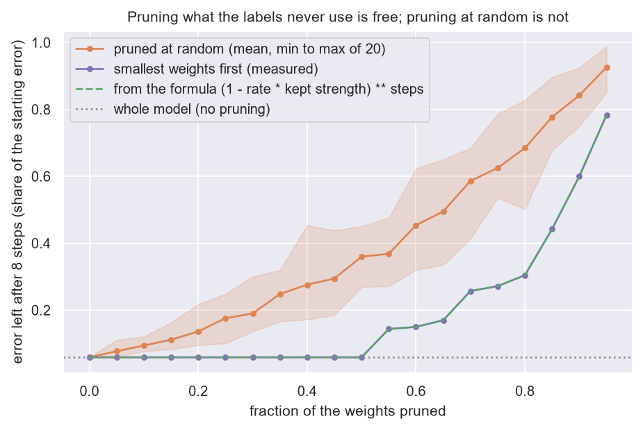
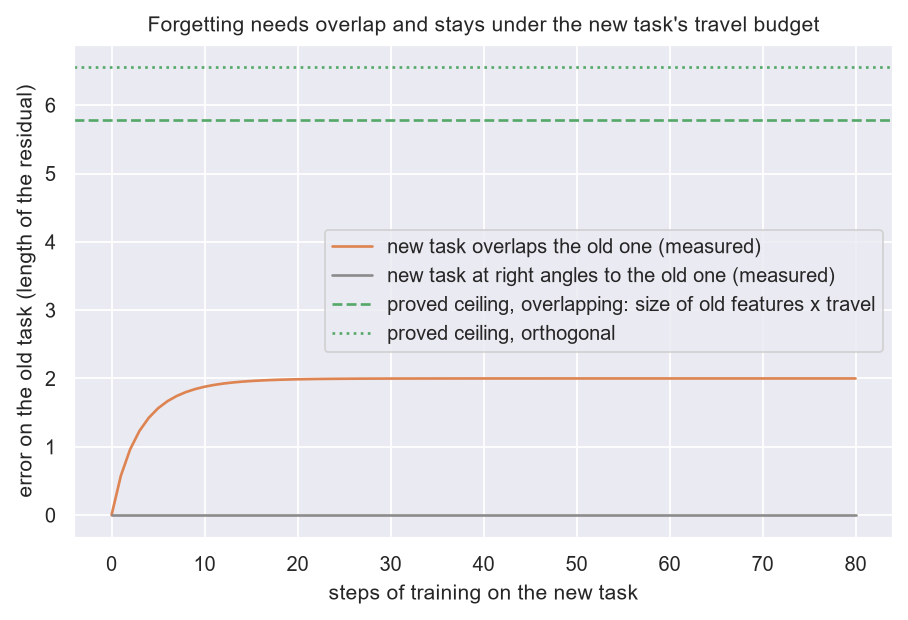

# 45. Pruning and forgetting

**In the repository:**
[`Pruning.lean`](../lean/SquigglyLine/Supporting/NewInputs/Pruning.lean),
[`Forgetting.lean`](../lean/SquigglyLine/Supporting/NewInputs/Forgetting.lean),
notes [`lottery-ticket.md`](../docs/supporting/new-inputs/lottery-ticket.md) and
[`forgetting.md`](../docs/supporting/new-inputs/forgetting.md).
**You need:** chapters 9, 10 and 16.

## The idea

Two habits of people who train models look unrelated. They cut weights
out of a trained network, because most of them seem unneeded. And they
train a network on a second task, and watch it lose the first.

Both are a change to a model that already fits something. In the book's
terms, both are a change to the kernel of chapter 10, and a fixed kernel
says exactly what the change costs.

Pruning takes weights away. More weights put the fit nearer (chapter 9),
so fewer weights should put it farther. Yet the **lottery ticket**
hypothesis says a small network inside a big one can do as well
(**recalled**: Frankle and Carbin 2019). The proof says when both are
true.

Forgetting is the loss of an old task after training on a new one
(**recalled**: McCloskey and Cohen 1989; French 1999). The proof says
that a step on the new task reaches the old task only through one table:
how alike the model finds the old inputs and the new ones.

> Pruning subtracts a kernel, so it slows training and moves the fit
> farther, and it costs nothing along a direction where the dropped
> weights had no strength. A step on a new task changes the old errors
> only through the cross kernel, and by at most the new task's travel
> times the size of the old features.

## An example you can do by hand

**Pruning.** Take learning rate 0.1. Along one direction of the labels
the kept weights have strength 2 and the dropped weights have strength 3.
The whole model has strength 5.

- The whole model multiplies its error by `1 − 0.1 × 5 = 0.5` per step.
- The pruned model multiplies it by `1 − 0.1 × 2 = 0.8` per step.

After 3 steps the whole model has `0.5³ = 0.125` of its error left and
the pruned model has `0.8³ = 0.512`. Now suppose the dropped weights had
strength 0. Both models would multiply by 0.8, and nothing is lost.

**Forgetting.** Take learning rate 0.2. At one old input the old error is
1. The cross kernel between that input and the one new input is 0.5, and
the new error is −4. One step on the new task gives

```
old error after = 1 − 0.2 × 0.5 × (−4) = 1.4
```

The step fixed the new input and made the old error larger. If instead
the cross kernel were 0, the old error would stay 1.

## The statement

Chapter 10 defined the kernel as `predict (adjoint predict ...)`. For
pruning, `whole_predict` is the model with all its weights, `kept_predict`
is the model with the weights you keep, and `dropped_predict` is the model
with the weights you cut. `IS_KERNEL_SUM` says the whole kernel is the
kept kernel plus the dropped kernel. `strengths_add` says that along a
direction where the kept weights have one **strength** (chapter 10) and
the dropped weights have another, the whole model has the sum.

```lean
theorem pruning_slows_a_direction_down
    {learning_rate : ℝ}
    {kept_strength : ℝ}
    {dropped_strength : ℝ}
    (learning_rate_nonneg : 0 ≤ learning_rate)
    (dropped_strength_nonneg : 0 ≤ dropped_strength)
    (whole_rate_le_one :
      learning_rate * (kept_strength + dropped_strength) ≤ 1)
    (step_count : ℕ) :
    let whole_strength := kept_strength + dropped_strength
    let whole_share    := (1 - learning_rate * whole_strength) ^ step_count
    let pruned_share   := (1 - learning_rate * kept_strength) ^ step_count
    whole_share ≤ pruned_share := by
```

*Read aloud:* after any number of steps, the pruned model has at least as
large a share of its error left as the whole model. The condition
`whole_rate_le_one` keeps the learning rate small enough that the whole
model does not overshoot.

Two more results finish the pruning half. `winning_ticket` says that if
the dropped weights have no strength along a direction, the pruned and
whole models keep the same error along it at every step, given the same
starting error. `pruning_moves_the_fit_farther` says that with tight features
(chapter 9) on both sides, the travel of the pruned model times
`√kept_strength` equals the travel of the whole model times
`√(kept_strength + dropped_strength)`.

For forgetting there is one set of weights and two tasks. The old task has
`predict` and `labels`. The new task has `new_predict` and `new_labels`.

```lean
theorem forgetting_goes_through_the_cross_kernel
    (predict : Weights →L[ℝ] Outputs)
    (new_predict : Weights →L[ℝ] NewOutputs)
    (labels : Outputs)
    (new_labels : NewOutputs)
    (learning_rate : ℝ)
    (weights : Weights) :
    let linear_predict : LinearPredictor Weights Outputs := predict
    let new_linear_predict : LinearPredictor Weights NewOutputs := new_predict
    let stepped_weights :=
      TAKE_GRADIENT_STEP new_predict new_labels learning_rate weights
    let residual_after  := GET_RESIDUAL linear_predict labels stepped_weights
    let residual_before := GET_RESIDUAL linear_predict labels weights
    let new_residual    := GET_RESIDUAL new_linear_predict new_labels weights
    let cross_push      := predict (adjoint new_predict new_residual)  -- the cross kernel applied to the new error
    residual_after = residual_before - learning_rate • cross_push := by
```

*Read aloud:* a gradient step on the new task changes the old errors by
the learning rate times the **cross kernel** applied to the new errors.
The cross kernel is `predict (adjoint new_predict ...)`: the chapter 10
kernel, but with the old inputs on one side and the new inputs on the
other. The weights do not appear.

```lean
theorem forgetting_is_at_most_predict_size_times_travel
    (predict : Weights →L[ℝ] Outputs)
    (new_predict : Weights →L[ℝ] NewOutputs)
    (labels : Outputs)
    (new_labels : NewOutputs)
    (learning_rate : ℝ)
    (start_weights : Weights)
    (step_count : ℕ)
    (new_fit :
      new_predict
        ((TAKE_GRADIENT_STEP new_predict new_labels learning_rate)^[step_count]
          start_weights) = new_labels) :
    let linear_predict : LinearPredictor Weights Outputs := predict
    let new_linear_predict : LinearPredictor Weights NewOutputs := new_predict
    let trained_weights :=
      (TAKE_GRADIENT_STEP new_predict new_labels learning_rate)^[step_count]
        start_weights
    let residual_change :=
      ‖GET_RESIDUAL linear_predict labels trained_weights
        - GET_RESIDUAL linear_predict labels start_weights‖
    let new_travel :=
      GET_TRAVEL new_linear_predict new_labels start_weights
    let ceiling := ‖predict‖ * new_travel
    residual_change ≤ ceiling := by
```

*Read aloud:* if gradient descent fits the new task, the old errors have
changed by at most the size of the old features times the new task's
travel. `‖predict‖` is the most that `predict` can stretch a move of the
weights.

Other results in `Forgetting.lean`: `forgetting_along_one_direction` reads the
change along one direction of the old labels, and
`separate_features_forget_nothing` says that if the cross kernel
is zero, any number of steps on the new task leave the old errors exactly
where they were.

## Why it is true

**Strengths add.** The kernel of the whole model is the kept kernel plus
the dropped kernel, by the meaning of `IS_KERNEL_SUM`. Apply both to the
same direction. Each one gives its own strength times the direction, and
the strengths add. The proof is one rewrite.

**Pruning slows a direction.** By chapter 10, one step multiplies the
error along the direction by `1 − learning_rate × strength`. After
`step_count` steps the share left is that factor to the power
`step_count`. The whole model has the larger strength, so its factor is
smaller. This is the strong-directions-first result of chapter 18, used
twice: once for the pruned strength and once for the whole one.

**A winning ticket.** With no dropped strength, the whole model has the
same strength as the kept model. Both models then multiply the error by
the same factor each step. If they start with the same error, they keep
the same error.

**The fit moves farther.** With tight features, the travel is the starting
error divided by `√strength` (chapter 10). The pruned model has the kept
strength and the whole model has the sum. With the same starting error,
cross-multiplying gives the statement. With kept strength 1 and dropped
strength 3, the pruned travel is `√4 = 2` times the whole travel.

**Forgetting.** A step on the new task adds `learning_rate × transpose ×
new error` to the weights. The old outputs change by the old matrix times
that. The old error changes by the same amount with a minus sign. That is
the cross kernel applied to the new error. If the cross kernel is zero,
every step adds nothing, and an induction on the step count finishes it.

**The ceiling.** Moving the weights by a distance changes the old outputs
by at most `‖predict‖` times that distance (`forgetting_is_at_most_predict_size_times_distance`).
Gradient descent that fits the new task has moved no further than the
nearest fit (chapter 13, `gradient_descent_fit_is_the_nearest_fit`). The distance to
the nearest fit is the travel. Put the two together.

## What it explains

**Lottery tickets.** The puzzle was that parameters buy nearness, so
cutting them should hurt, and yet small networks can win. The proof does
not remove the cost. Pruning costs in general. It costs nothing along a
direction where the dropped weights had no strength. So a winning ticket
is not a small model that is as good in every way. It holds all the
strength in the directions the labels use, and what was cut pointed
somewhere the data never looks.

**Forgetting.** A step that corrects an answer at a new input also moves
the answer at every old input the kernel ties to it. If the old label
agrees, that is generalisation. If it disagrees, that is forgetting. It is
the same mechanism as chapter 42, with the old task as the test set.
Separate features, meaning a zero cross kernel, give no forgetting at all.
The travel of the new task is the budget that forgetting cannot exceed,
which is a reason for gentle fine-tuning: a small move spends a small
budget.

## How this meets the squiggly line

Travel (chapter 9) is the main idea. In pruning, cutting weights raises
the travel by the exchange rate of `pruning_moves_the_fit_farther`. In
forgetting, the travel of the new task becomes the ceiling on what the old
task can lose. Both use the kernel and the strength of chapter 10, and
pruning uses the one factor per step of chapter 13.

## Run it yourself

The notebook `experiments/part7/ch45_pruning_and_forgetting.ipynb` uses a model linear in its weights, with fixed feature
matrices, and 26 checks (3 more lines in the output are marked "by construction, cannot fail" and are not evidence). An experiment is evidence, not a proof. Every hand example above reproduces: `0.125` and `0.512`,
`1.4`, and `0.25` and `0.81`.

**Pruning.** The model has 20 data points and 120 weights, each pointing at one of 20 directions of the labels; the labels use
10 of them, and the 60 smallest weights point at the other 10 (built that way). The whole kernel equals the kept kernel plus the
dropped kernel for 50 random splits, to rounding. At every fraction pruned, in both orders, the share of error left along each used
direction is `(1 − learning_rate × kept_strength)^step_count` to `10⁻¹⁵` and is at least the whole model's. With a learning rate
that gives `learning_rate × strength = 2.79`, the whole share exceeds the pruned share by up to 49: the condition
`whole_rate_le_one` matters. Pruning the 60 smallest leaves the residual identical to the whole model's at 21 step counts
(**measured**: difference `4 × 10⁻¹⁶`). Pruning 60 at random leaves 0.3596 of the error after 8 steps, against 0.0590 for the whole
model (measured by training).

**measured**, from the notebook:



The smallest-first curve lies on the curve computed from the formula (**from the formula**, not a run) and stays flat until the 60 weights that the labels never use are gone, then
rises. Whether magnitude pruning finds such a ticket in a real network is not tested here.

**Travel.** With tight features (kept strength 1, dropped strength 3), the pruned travel is 1.952 and the whole travel is 0.976, so the
product identity holds to rounding and the ratio is 2. The starting vertical error is 1.952 for both, so the longer travel is not
from a larger error. With the kept rows of unequal lengths the identity fails by 0.153.

**Forgetting.** One step on the new task changes the old residual by `−learning_rate` times the cross kernel applied to the new
residual, to `2 × 10⁻¹⁵`, over 100 random cases. With a cross kernel of zero, 100 steps leave the old residual unchanged to
`7 × 10⁻¹⁶`; with an overlapping new task the old residual changes by 0.60 of its length. After fitting the old task, the old
error after fitting an overlapping new task is 2.000 against a ceiling of 5.786 (new-task travel 3.800, starting vertical error
3.901); at right angles it stays at `3 × 10⁻¹⁵`. For 80 descent-fitted cases the change is at most 0.423 of the ceiling. A fit
that is not the nearest one (the control) broke the ceiling in 164 of 200 cases, by up to 5.317.

**measured**, from the notebook (the ceiling is `‖predict‖` times the travel, computed from the matrices):



The ceiling holds but is loose here: the measured change is well under it. Run it with
`jupyter nbconvert --to notebook --execute --inplace experiments/part7/ch45_pruning_and_forgetting.ipynb`.

## What is not shown

- **That real networks contain tickets.** This is the hypothesis, an
  observation about trained networks, and it is not derived here.
  **open**
- **Finding the ticket.** Why cutting the smallest weights should find the
  unused directions is not shown. **open**
- **The starting function.** The two models are compared from the same
  starting error. Dropping weights also changes what a model computes
  before training, and that is not modelled.
- **Deep networks.** Both halves are for a model linear in its weights,
  with fixed features. Kernels of a deep network do not simply add when
  weights are removed, and the cross kernel of a deep network changes as
  it trains. **open**
- **Whether more parameters help forgetting.** They shorten the travel but
  can also enlarge the old task's features. Which wins is not settled.
  **open**
- **The remedies.** Replay, frozen weights and penalties on important
  weights are not modelled. **open**

## Check yourself

1. The kept weights have strength 2 along a direction and the dropped
   weights have strength 0 there. After 10 steps, how do the pruned and
   whole models compare along it?
2. Learning rate 0.1, kept strength 1, dropped strength 4. What share of
   the error is left after 2 steps for each model?
3. The old task's features have size 3 and the new task's travel is 0.5.
   At most how much can the old errors change?

**Answers.** (1) They have the same error, from `winning_ticket`, given
the same starting error. (2) The whole strength is 5, and
`0.1 × 5 = 0.5` is at most 1, so `pruning_slows_a_direction_down` applies. The whole
model has `0.5² = 0.25` left and the pruned model has
`(1 − 0.1)² = 0.81` left. (3) At most `3 × 0.5 = 1.5`, from
`forgetting_is_at_most_predict_size_times_travel`, if gradient descent fits the new task.

Previous: [44. Benign overfitting](44-benign-overfitting.md) · Next: [46. The dimpled manifold](46-the-dimpled-manifold.md)
