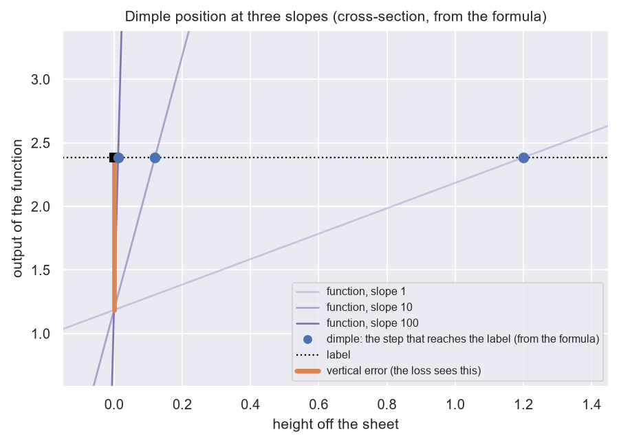
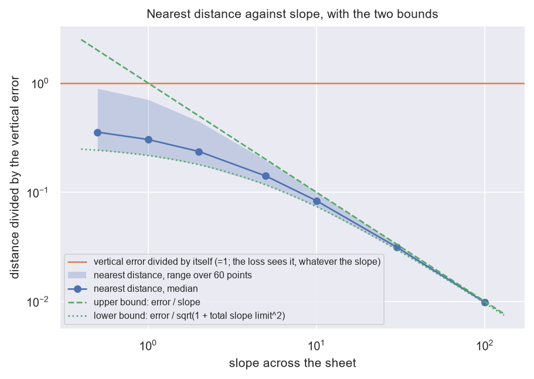

# 46. The dimpled manifold

**In the repository:**
[`Dimple.lean`](../lean/SquigglyLine/Supporting/NewInputs/Dimple.lean),
note [`dimpled-manifold.md`](../docs/supporting/new-inputs/dimpled-manifold.md).
**You need:** chapters 1, 3 and 5.

## The idea

A well-known puzzle: take a photo that a model labels correctly, change
each pixel by an amount too small to see, and the model gives a different
label. These are **adversarial examples**.

Here is a picture of why. Real photos do not fill the space of all pixel
grids. They lie on a thin sheet inside it, called the **data manifold**.
The hypothesis of Shamir, Melamed and BenShmuel (2021) is that a trained
classifier draws its boundary along the sheet, and dips a little to one
side or the other, in shallow **dimples**, to put each training example on
the right side. An adversarial example is then a small step straight off
the sheet, across a dimple (**recalled**: Shamir, Melamed and BenShmuel
2021).

This chapter proves the part of that picture which fits the squiggly
line. Split an input into a `position` on the sheet and a `height` off it.
Real data has height zero. Take a function that does something gentle on
the sheet and has a steep slope across it.

> The loss on real data does not depend on the slope across the sheet. Yet
> that slope decides how far you must step to change any label: the error
> divided by the slope.

This is chapter 1 again. The loss sees the vertical error. The nearest
distance is something else, and here the loss cannot see it at all.

## An example you can do by hand

Let the function along the sheet have the value 2 at a data point, so
`profile position = 2`. Let the slope across the sheet be 10. The function
is

```
profile position + slope × height  =  2 + 10 × height
```

At height 0 it gives 2, whatever the slope is. Suppose the label at that
point is 5, so the vertical error is 3.

- Step off the sheet by `(5 − 2) / 10 = 0.3`. The function gives
  `2 + 10 × 0.3 = 5`. You hit the label exactly.
- With slope 100 the step is `3 / 100 = 0.03`.
- With slope 1 the step is 3.

The step is along the height only. It does not move along the sheet. And
the loss at the data point is the same for all three slopes, because the
height there is 0.

**From the formula** (the steps) and **measured** (the nearest distances): a
cross-section at one position of a real profile with a label 1.2 above it. The
lines are the function at three slopes, and the blue dots are the steps off the
sheet that reach the label, at heights 1.2, 0.12 and 0.012, computed from the
formula `(label − profile) / slope`.



## The statement

```lean
theorem residualLoss_dimpled_onManifold
    (loss_fn : RealFunction)
    (profile : Model Position)
    (slope : ℝ)
    (position : Position)
    (label : ℝ) :
    let dimpled_model := EVALUATE_DIMPLED_MODEL profile slope
    let data_point : DataPoint (DimpledInput Position) :=
      (PLACE_ON_MANIFOLD position, label)
    let loss_of_dimpled := GET_RESIDUAL_LOSS loss_fn dimpled_model data_point
    let loss_of_profile := loss_fn (label - profile position)
    loss_of_dimpled = loss_of_profile := by
```

*Read aloud:* on a real data point, any loss of the dimpled function is
the loss of `profile`, whatever `slope` is.

Here `DimpledInput Position` is a position together with a height.
`PLACE_ON_MANIFOLD position` is a real input: that position at height
zero. `EVALUATE_DIMPLED_MODEL profile slope` is the function
`profile position + slope × height`. `loss_fn` is any loss, as in
chapter 5.

```lean
theorem dimpled_dimple
    (slope_ne_zero : slope ≠ 0)
    (position : Position)
    (label : ℝ) :
    let dimpled_model := EVALUATE_DIMPLED_MODEL profile slope
    let dimple        := MAKE_DIMPLE profile slope position label
    dimpled_model dimple = label := by
```

*Read aloud:* for any data point and any label, the input obtained by
stepping straight off the sheet makes the function give that label.

`MAKE_DIMPLE profile slope position label` is that input: the same
position, at height `(label − profile position) / slope`. The theorems
`dimple_fst` and `dist_onManifold_dimple` say that it does not move along
the sheet and that the step has length `|label − profile position| / slope`.

```lean
theorem nearestDist_dimpled_bounds
    {profile_slope_limit : SlopeLimit}
    {dimple_slope : SlopeLimit}
    (profile_is_lipschitz : LipschitzWith profile_slope_limit profile)
    (dimple_slope_pos : 0 < (dimple_slope : ℝ))
    (position : Position)
    (label : ℝ) :
    let dimpled_model := EVALUATE_DIMPLED_MODEL profile dimple_slope
    let data_point : DataPoint (DimpledInput Position) :=
      (PLACE_ON_MANIFOLD position, label)
    let vertical_error   := GET_VERTICAL_ERROR dimpled_model data_point
    let nearest_distance := GET_NEAREST_DISTANCE dimpled_model data_point
    let total_slope_limit := profile_slope_limit + dimple_slope
    let stretch          := √(1 + (total_slope_limit : ℝ) ^ 2)  -- Pythagoras: 1 across, the total slope up
    let lower_bound      := vertical_error / stretch
    let upper_bound      := vertical_error / dimple_slope  -- the dimple step reaches the line after error / slope
    let is_above_lower   := lower_bound ≤ nearest_distance
    let is_below_upper   := nearest_distance ≤ upper_bound
    is_above_lower ∧ is_below_upper := by
```

*Read aloud:* at a real data point, the nearest distance is at least the
vertical error over `√(1 + total_slope_limit²)` and at most the vertical
error over the slope across the sheet.

The function `lipschitzWith_dimpled` says that the dimpled function has
slope at most `profile_slope_limit + dimple_slope`, which is what the lower
bound needs.

## Why it is true

**The loss cannot see the slope.** At a real input the height is zero, so
`slope × height` is zero and the function equals `profile`. The loss is a
function of the error, and the error is the same.

**Any label is one step away.** Choose the height
`(label − profile position) / slope`. Then `slope × height` is exactly
`label − profile position`, and adding `profile position` gives `label`.
The input moved only in height, and the distance from the real input is
that height.

**The upper bound.** The nearest point of the curve is no further than any
point of the curve. The point at the end of the step is on the curve, and
its distance is the error divided by the slope.

**The lower bound.** This is the slope sandwich of chapter 3. A function
that is gentle along the sheet, with slope at most `profile_slope_limit`,
and has slope `dimple_slope` across it, has total slope at most their sum.
The sandwich then gives the lower bound with that total.

## What it explains

The squiggly line theorem said that being close to the data has a price,
and the price is slope. That sounded as if a function near its data must
be a badly behaved one.

The dimpled picture shows where the price can be paid: off the sheet. A
function can be gentle everywhere real data lives and steep where real
data never goes. It then passes within a hair of every data point in the
nearest sense, and that is what having adversarial examples means. For a
large slope across the sheet, the two bounds agree up to a constant, so
the adversarial distance is the vertical error divided by that slope.

**Measured**, for 60 data points at seven slopes: the nearest distance (found by a search that does not use the bounds)
falls between the two bounds, which are from the formula. The vertical error
is drawn as 1 because the axis is divided by it.



Two functions can agree on every real input, have the same loss on every
data set, and differ without limit in how fragile they are. This also
answers an old question of the project: why should the nearest distance
matter if the loss cannot see it? Because it is the distance to the
nearest adversarial example.

## How this meets the squiggly line

It uses slope and nearness, from chapters 3 and 4. The sandwich of chapter
3 gives the lower bound. The two distances of chapter 1 are the whole
story: the loss counts the vertical one, and the step off the sheet is the
nearest one. That the loss is blind to the slope across the sheet is the
point of chapter 5.

## Run it yourself

[`ch46_the_dimpled_manifold.ipynb`](../experiments/part7/ch46_the_dimpled_manifold.ipynb)
uses the dimpled function of the theorems, with the profile
`sin(3 position) + 0.5 sin(position)` (slope limit 3.5), and distances taken
as in the Lean file: the larger of the position gap and the height gap, then
Pythagoras with the label gap. The nearest distance is found by a numerical
search that does not use the bounds, so the checks of it are **measured**.
All 420 pairs of 60 data points and 7 slopes lie between the two bounds.
The median vertical error is 0.8013. The median nearest distance is 0.2784 at
slope 1 and 0.00791 at slope 100, which is 35.2 times smaller with the same
loss. At slope 100, nearest distance times slope over vertical error is between
0.9661 and 0.9984; the lower bound allows 0.9661. The smallest value is at
position −0.0051, where the profile has slope 3.4996, almost its limit, so the
lower bound is nearly reached. As a control, understating the profile's slope
limit as 0 puts the nearest distance below the claimed lower bound in all 420
pairs. Putting the same points at height 0.1 changes the squared loss from
48.40 at slope 0.5 to 6018.34 at slope 100. The function at the step reaches
the label to within `8.9e-16` at 1000 random points, and a step of 90 percent
of the length misses by 10 percent of the error.

Some things the notebook prints are **by construction, cannot fail**, and are
not evidence: that the loss at height 0 is the same at every slope (squared
total 48.399008), and that the step moves only in height and has length error
over slope. The step heights in the first figure are **from the formula**.
These are checks of one profile, not proofs. The Lean theorems cover any
Lipschitz profile.

```
jupyter nbconvert --to notebook --execute --inplace experiments/part7/ch46_the_dimpled_manifold.ipynb
```

## What is not shown

- **That training produces dimples.** The hypothesis says training first
  pulls the boundary onto the sheet and then dimples it. Nothing here is
  about what training does. The statement is only that the loss leaves the
  slope across the sheet free. **open**
- **Curved sheets.** The model has a flat sheet and one direction off it.
  The real claim is about curved, high-dimensional sheets. **open**
- **Why the slope ends up large.** The loss does not care about it, but
  that does not say which slope training picks. **open**

## Check yourself

1. The function along the sheet has value 4 at a data point, the label is
   10, and the slope across the sheet is 3. How far off the sheet must you
   step to make the function give 10?
2. Two functions have the same `profile` and different slopes across the
   sheet. Does their loss on real data differ?
3. The slope across the sheet is 10, the slope along it is at most 1, and
   the vertical error is 3. Between what two numbers is the nearest
   distance?

**Answers.** (1) `(10 − 4) / 3 = 2`, from `dimpled_dimple` and
`dist_onManifold_dimple`. (2) No, from `residualLoss_dimpled_onManifold`.
(3) The total slope limit is 11, so the lower bound is `3 / √(1 + 11²)`,
which is `3 / √122`, about 0.27. The upper bound is `3 / 10 = 0.3`. That
is `nearestDist_dimpled_bounds`.

Previous: [45. Pruning and forgetting](45-pruning-and-forgetting.md) · Next: [47. What is not here](47-what-is-not-here.md)
