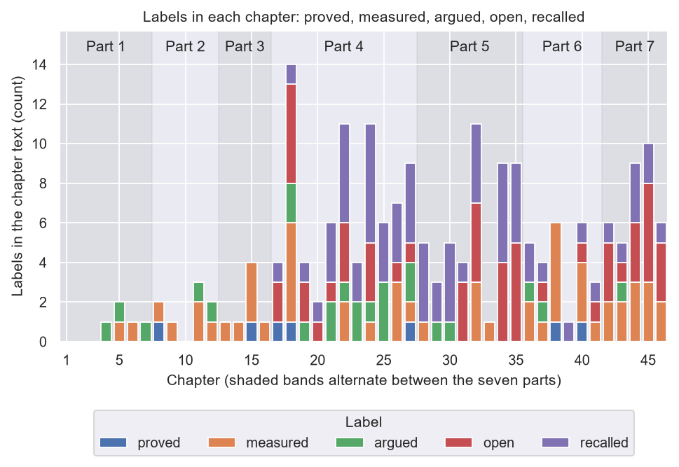

# 47. What is not here

**In the repository:**
[`docs/wishlist.md`](../docs/wishlist.md),
[`docs/insights.md`](../docs/insights.md),
[`docs/supporting-proofs.md`](../docs/supporting-proofs.md).
**You need:** nothing, but it will mean more after the rest.

A book of proofs should end by saying where the proofs stop.

This map is **counted from the text**: for each chapter 1 to 46 it counts how often the labels **proved**, **measured**, **argued**, **open** and **recalled** appear. The counts are of labels in the text, not of theorems, and nothing was run or measured to get them.



## The one missing piece

Nearly every proof in parts II and III rests on the same assumption: a
model that is linear in its weights, which is the same as a fixed
kernel. The features do not change while the model trains.

Real networks are useful because their features **do** change. So what
is here is the bookkeeping of deep learning with one piece missing. The
bookkeeping is worth having. It says which effects need nothing more
than a fixed kernel to appear, and that list turned out to be long. But
it does not explain what a network gains by learning its features.

## Three open questions about the theorem itself

1. **How squiggly is a random network?** Chapter 8 built a network with
   chosen weights whose reach halves with every layer. For random
   weights, how the reach depends on width, depth and the scale of the
   weights is not known here. This is all that is left of the
   "parameters" claim of chapter 1.
2. **Does training find the shift?** Chapter 4 proved that a small move
   of each input makes the fit exact. Whether gradient descent finds
   that move is open.
3. **What survives a moving kernel?** Each note in the repository says,
   for its own result, what is expected to carry over. None of that is
   proved.

## Measured, not proved

- The constant in "nearest distance is about `0.2974 / frequency`" for
  sines.
- The rate at which travel falls as parameters are added.
- That the test error peaks where the travel peaks.
- Every number about networks with random weights.

## How to keep reading

You have now seen every tool the repository uses: slope, nearness,
travel, the kernel and the lift, folds, and averages. The rest is those
six, applied.

- **Every result, by topic and by paper:**
  [`docs/supporting-proofs.md`](../docs/supporting-proofs.md). Pick a
  topic you know, read its note, then open its Lean file and read the
  statements.
- **What the proofs have in common:**
  [`docs/insights.md`](../docs/insights.md).
- **What is not proved yet, and what is in the way:**
  [`docs/wishlist.md`](../docs/wishlist.md).
- **The full account of the experiments:**
  [`docs/RESOLUTION.md`](../docs/RESOLUTION.md).

Good first files to read on your own, all short:
[`Counting.lean`](../lean/SquigglyLine/Supporting/NewInputs/Counting.lean),
[`SameKernel.lean`](../lean/SquigglyLine/Supporting/NewInputs/SameKernel.lean),
[`Capacity.lean`](../lean/SquigglyLine/Supporting/NetworkShape/Capacity.lean)
and
[`SmallSteps.lean`](../lean/SquigglyLine/Supporting/Training/SmallSteps.lean).

## If you find a mistake

A statement in Lean cannot be wrong in the sense of not following from
its givens. It can still say less than its plain-words summary claims,
or assume more than is reasonable. That is the kind of mistake to look
for, and reading statements closely is how to find it. If you find one,
open an issue on the repository.

## Run it yourself

The notebook counts the five labels in each chapter two ways, per line and with one regular expression over all the text, and checks that the totals agree. The totals over chapters 1 to 46 are 7 proved, 54 measured, 24 argued, 53 open and 68 recalled. The check can catch a bug in one of the two counting methods. It cannot catch a wrong idea of what to count, or a label used loosely in the text, because both methods read the same files for the same string.

```
jupyter nbconvert --to notebook --execute --inplace experiments/part7/ch47_what_is_not_here.ipynb
```

Previous: [46. The dimpled manifold](46-the-dimpled-manifold.md) · Next: [48. The waves of the primes](48-the-waves-of-the-primes.md)
