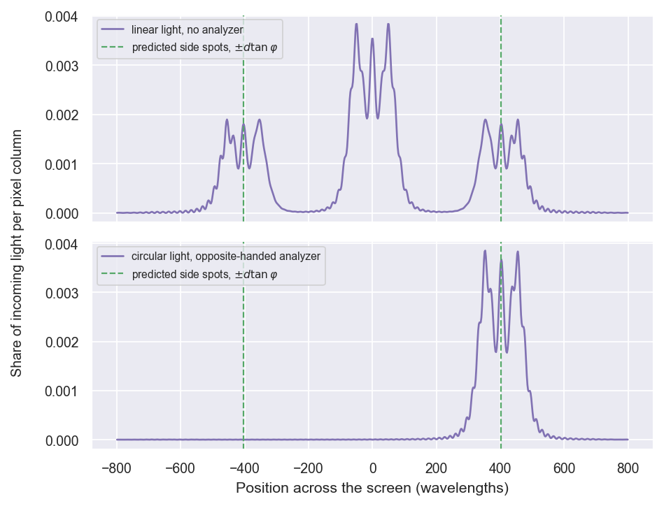

# A trained plate between two polarizers

**Code:** [`experiments/optics/`](../../experiments/optics). **Proofs:**
[`TrainedPlate.lean`](../../lean/SquigglyLine/Networks/TrainedPlate.lean).
**Builds on:**
[three polarizers](three-polarizers.md) and
[chapter 12 of the book](../../book/12-polarizers.md).

Notes from 18 Nov 2026. Each statement is marked **proved** (in Lean),
**derived** (worked out here, a few lines), **checked** (the simulation
reproduces it; the number is in the notebook), **measured** (a training run)
or **recalled** (textbook or a paper, not derived here). The predictions in
the last section were written before any training run of this note.

## The picture

The three-polarizer experiment has a horizontal plate, a plate at 45° and a
vertical plate. A quarter of the light gets through. Take the middle plate
out and nothing gets through.

Now let the middle plate have a different angle at every point. Where its
angle is 0° or 90° it passes nothing. Where it is 45° it passes the most. So
the middle plate is a picture, drawn in angles, and the light that leaves the
last plate carries that picture. Fine stripes in the picture bend the light,
as a diffraction grating does. So the middle plate can send light from one
place to another.

Shine a handwritten digit through the three plates and let the light travel
to a screen with ten marks. **Training** means choosing the angle at every
point of the middle plate so that a 7 lights the mark for 7. The plate is
then fixed. It computes as the light passes through, and it spends no power.

This is a small diffractive optical network. Networks of printed diffracting
plates that classify digits exist (Lin et al. 2018, **recalled**). What this
note adds is the plate made of polarizer angles, what it costs in light, and
the link to the proofs of this repository.

## The model

Lengths are in wavelengths. The light at a point is a pair of complex numbers
`(E_x, E_y)`, the horizontal and the vertical vibration.

- **A plate** with axis angle `θ` at a point replaces the light there by its
  shadow on the axis: `E ← u (u · E)` with `u = (cos θ, sin θ)`. (**proved**
  for one point: `malus`, `three_polarizers`.)
- **A gap** of length `d` lets the light spread. Each of the two parts
  spreads by the angular-spectrum rule: take the Fourier transform, multiply
  the part at spatial frequency `(fx, fy)` by `exp(2πi d √(1 − fx² − fy²))`,
  drop the parts with `fx² + fy² > 1`, transform back. (**recalled**. The two
  parts are treated as two separate waves, which is right for small angles.)
- **The screen** reads brightness, `|E_x|² + |E_y|²`, added up inside each of
  ten windows. The largest window is the answer.

The plates and gaps are linear in the light. The screen squares it. That
square is the only nonlinear step, as the README says of polarizer stacks.

## What one plate does

The three formulas for one point of the plate are **proved** in
`TrainedPlate.lean`. What a whole plate does to light that then travels (the
grating rule and the two tables) is **derived** from them here and
**checked** in the notebook.

**Between crossed linear polarizers.** Horizontal light of size 1 meets a
plate at angle `θ` and then a vertical plate. What leaves is vertical, of size

```
cos θ × sin θ = ½ sin 2θ
```

(**proved**, `plate_between_crossed_polarizers`.)

The three-polarizer experiment is the case `θ = 45°`: size ½, brightness ¼
(**proved**, `three_polarizers`). With `θ` chosen at each point, the three
plates are a **mask**: a number between `−½` and `½` at each point, which
multiplies the light. The sign matters. Two points with opposite signs
cancel where their light meets.

**A plate with a steadily turning axis is a grating.** Let the axis turn by
half a turn every `Λ` wavelengths, `θ(x) = πx / Λ`. Then for horizontal light
of size 1 the light after the plate (with no third plate) is

```
E_x = ½ + ½ cos(2πx/Λ)        E_y = ½ sin(2πx/Λ)
```

(**proved** at each point, `plate_on_horizontal_light`.)

A wave `exp(±2πi x/Λ)` across the plate leaves at the angle `φ` with
`sin φ = ±λ/Λ` (the grating rule, **recalled**). Reading the sizes off:

| where the light goes | share of the light that came in |
|---|---|
| straight on | 1/4 |
| bent to `+φ` | 1/8 |
| bent to `−φ` | 1/8 |
| absorbed by the plate | 1/2 |

So a linear plate always splits the bent light in two, one half to each
side. Whatever is aimed at one mark also lands at its mirror image.

**With circular light the plate bends light to one side only.** Circular
light of brightness 1 is `(1, i)/√2`. After a plate at angle `θ`:

```
u (u · E) = ½ (1, i)/√2  +  ½ exp(2iθ) (1, −i)/√2
```

Half the size stays as it was. The other half has the opposite handedness
and has picked up the phase `2θ`. (**proved**, `plate_on_circular_light`.
This is the geometric phase, **recalled** as a name.) Keep only the
opposite-handed light, with a circular analyzer, and the plate is a pure
**phase plate**: it multiplies the light by `½ exp(2iθ(x))`. With
`θ = πx/Λ` all of that light bends to `+φ` and none to `−φ`:

| where the light goes | share of the light that came in |
|---|---|
| bent to `+φ`, handedness flipped | 1/4 |
| straight on, handedness kept (the analyzer removes it) | 1/4 |
| absorbed by the plate | 1/2 |

So the angle is the weight, and **the slope of the angle steers the light**:

```
sin φ = (λ/π) × dθ/dx
```

## How this meets the squiggly line

The angle map `θ(x)` of a plate is a line that the training draws. A steeper
line bends light further: the bend is the slope. A plate that sends light
from every part of the digit to every mark needs a squiggly angle map, and
how squiggly it can be is capped by the pixel: the angle may change by less
than a quarter turn from one pixel to the next, so with pixels of width `p`
the largest bend is `sin φ = λ/(2p)`. To move light sideways by `s` the gap
must be at least `s / tan φ`, about `2ps/λ` for small bends. That fixes the
gap from the pixel and the size of the picture.

And the light budget is Malus's law. One plate between analyzers passes at
most a quarter. A stack of `N` plates with small turns between neighbours
keeps almost everything (**proved**, `quarter_turn_arrives`: a quarter turn
in `N` steps keeps at least `1 − π²/(8N)`), and a stack with large turns
loses light at every plate.

## What the device can compute (derived)

Let `x` be the digit as a list of pixel sizes. The light on the screen is
`T x` for one fixed complex table `T`, set by the plates and gaps. The light
in window `j` is

```
score_j(x) = Σ over points of window j of |(T x)|² = xᵀ Q_j x
```

with `Q_j` symmetric and never negative. Three things follow.

1. **Each score is a sum of squares of straight-line readings** of the
   digit, at most four per screen point (two vibrations, each with a real and
   an imaginary part). This is the degree-two lift of chapter 11 with
   constrained weights. No plate count changes that: more plates only change
   which `T` can be reached.
2. **A brighter lamp changes nothing.** `score_j(c x) = c² score_j(x)` for
   every `j`, so the largest window stays the largest.
3. **No gap, no mixing.** With no gap the plates act on each point alone, so
   the light at a screen point depends on one pixel only. With the windows
   beside the digit the screen stays dark. The gap is what lets pixels meet.

## How to train the plate

The plate is a table of angles, one per pixel. Training is ordinary gradient
descent through the model above, done in torch.

1. **Parameters.** One real number `θ` per pixel per plate. The model uses
   only `cos θ` and `sin θ`, so no bound on `θ` is needed.
2. **Forward.** Digit as the size of the light, input polarizer, then plate,
   gap, plate, gap, ..., analyzer if there is one, screen.
3. **Loss.** Divide the ten window sums by their total, multiply by a
   temperature, and take the cross-entropy with the label. Dividing by the
   total makes the loss blind to brightness, as point 2 says it should be.
   A second term rewards light in the windows, or the plate learns to be
   right and nearly dark.
4. **Start.** Angles drawn at random. A start with all angles equal passes
   no light through crossed polarizers and has zero gradient there.
5. **For a plate that will be made.** Train with what the making allows:
   angles rounded to the levels on offer (four, for micro-polarizer arrays:
   0°, 45°, 90°, 135°, **recalled**), with the rounding in the forward pass
   and the unrounded slope in the backward pass; a little noise on the
   angles; and a small sideways shift of each plate at every step.
6. **Out.** Each plate is saved as an image of angles.

The numbers used in the runs, the encoding of the digit and of the answer,
a loss worked by hand and the slope at one plate pixel are in
[chapter 12 of the book](../../book/12-polarizers.md#how-the-plate-is-trained).

## Predictions, written before the run (18 Nov 2026)

A prototype on 15 Nov 2026 (5000 digits, one seed, not kept) gave 0.86 for
three polarizer plates and for three phase plates, and 0.27 with no gap. The
predictions below use that and the derivations above. Each has a rule for
when it counts as failed, and the same rule is applied to every seed.

- **P1, the grating table.** In the simulation the turning plate sends 1/4,
  1/8 and 1/8 of the light straight on and to the two sides, to within 2% of
  the light that came in, and the side spots sit at `d × tan φ` to within one
  pixel. With circular light and a circular analyzer the `−φ` spot holds less
  than a thousandth of the light. Failed if any number is outside its margin.
- **P2, the gap is needed.** Three polarizer plates, trained the same way at
  the design gap `2ps/λ` and at a twentieth of it. The short gap loses at
  least 0.15 of test accuracy. Failed otherwise. (With no gap at all the
  light at a screen point depends on one pixel only. That is a check of the
  code and is not evidence.)
- **P3, one side or two.** One trained plate, same gap and screen. The
  circular version puts a larger share of the light on the screen into the
  correct window than the crossed linear version. Failed if the linear
  version is ahead on two of three seeds. If it fails, the mirror-image
  argument does not govern a trained plate, and this note will say so.
- **P4, the price of polarizers.** Three polarizer plates and three lossless
  phase plates differ by less than 0.03 in test accuracy, and the polarizer
  stack delivers less than a quarter of the light of the phase stack. Failed
  if either half is false.
- **P5, a brighter lamp.** Multiplying the digit by 3 changes no prediction
  on the test set. This holds by construction of the model; it is a check of
  the code and is not evidence.
- **No prediction** is made for how accuracy changes from one plate to three,
  or against a plain linear classifier on the pixels. Both are reported as
  measured.

## What the simulation gave (18 Nov 2026)

Everything in this section is **measured** or **checked**, and every number
is printed in
[`polarizer_classifier.ipynb`](../../experiments/optics/polarizer_classifier.ipynb).
The training runs are in [`run_sweep.py`](../../experiments/optics/run_sweep.py)
and the model in [`optics.py`](../../experiments/optics/optics.py).

**The setting.** Pixels of 2 wavelengths. The digit is 56 pixels wide, the
plate 96, the ten windows 12 each. The gap is 636 wavelengths, from the rule
above with the longest move from a digit pixel to a window. Training used
55,000 MNIST digits for 4 passes, with three seeds, and the test used the
10,000 test digits. The step size, the temperature and the weight of the
light term were chosen once, on 5,000 held-out digits, for the stack of three
polarizer plates, and then used for every device. The best setting was at the
edge of the values tried, so a better one may exist.

| device | test accuracy, mean of 3 seeds | lowest and highest seed | share of the digit's light in the windows |
|---|---|---|---|
| one plate between crossed polarizers | 0.879 | 0.877 to 0.881 | 0.019 |
| one plate, circular light and analyzer | 0.933 | 0.932 to 0.934 | 0.035 |
| three polarizer plates with gaps | 0.975 | 0.974 to 0.976 | 0.007 |
| three polarizer plates, gap a twentieth | 0.797 | 0.788 to 0.813 | 0.0001 |
| one lossless phase plate | 0.913 | 0.910 to 0.915 | 0.241 |
| three lossless phase plates | 0.974 | 0.974 to 0.975 | 0.077 |
| a plain linear classifier on the pixels | 0.916 | 0.915 to 0.917 | no light |
| three polarizer plates, never trained | 0.091 | 0.083 to 0.103 | 0.004 |


**The predictions.**

- **P1 held.** The turning plate sent 0.247 of the light straight on and
  0.125 to each side, and the side spots were 0.4 of a pixel from
  `d × tan φ`. With circular light and the analyzer, the `+φ` spot held
  0.247 and the `−φ` spot 0.0004.
- **P2 held, narrowly on one seed.** The short gap lost 0.161, 0.188 and
  0.187 of accuracy; the line was 0.15.
- **P3 held on all three seeds.** With one plate, the correct window got
  0.026 of the light on the screen with circular light and 0.016 with
  crossed linear polarizers. The circular plate was also more accurate
  (0.933 against 0.879), which was not predicted.
- **P4 held.** Three polarizer plates and three phase plates differed by at
  most 0.002 in accuracy, and the polarizer stack delivered 0.09 to 0.11 of
  the light of the phase stack.


**Not predicted, reported as measured.**

- **Three polarizer plates beat a plain linear classifier on the pixels**,
  0.975 against 0.916. The scores are degree two in the pixels, so this does
  not contradict anything above. The linear classifier's step size was not
  tuned.
- **The linear plate became a sign mask.** Under the digit, 79% of the
  angles of the trained plate are within 10° of 45° or 135°, where a plate
  with random angles has 22%. Outside the digit, where no light falls, it is
  23%: those angles never moved. At 45° and 135° the mask value is `+½` and
  `−½`, the two largest. One seed. A plate made of two angles only has not
  been tried.
- **Being right is cheap in light, and the training did not buy more.** Even
  the lossless phase plates put only 8% to 24% of the light into the
  windows. The rest lands on the screen between them.



## A plate that can be made: predictions, written before the run (19 Nov 2026)

The trained angles above are free, exact and perfectly lined up. A made
plate has a few angle levels, some error in every angle, and plates that sit
a little off. These predictions were written after the results above and
before any run with rounding, noise or shifts. "The free plate" is the
device as trained above, same seed. Each prediction is judged per seed and
counts as failed if it fails on two of three seeds.

- **Q1, two angles are enough for the plate between crossed polarizers.**
  Trained with the angles rounded to 45° and 135° in the forward pass, it is
  within 0.02 of the free plate's test accuracy. (This comes from the
  picture of the trained plate, which is mostly those two angles.)
- **Q2, rounding that plate after training.** Rounding the free plate's
  angles to 0°, 45°, 90°, 135° with no retraining loses less than 0.05.
- **Q3, the stack needs the rounding in the training.** For three polarizer
  plates, rounding the free angles to four levels after training loses more
  than 0.10. Trained with the rounding in the forward pass, the four-level
  stack reaches at least 0.94.
- **Q4, plates that sit off.** The free stack loses more than 0.20 when its
  second and third plates are each moved 2 pixels sideways. A stack trained
  with a fresh random shift of up to 2 pixels on each plate at every step
  loses less than 0.05 at that shift, and is within 0.03 of the free stack
  when nothing is shifted.
- **Q5, error in the angles.** Random error of 5° (standard deviation) on
  every angle costs the free stack less than 0.02.

## What is not shown

- Nothing here is built. It is a simulation of an idealised plate: no
  reflections, no thickness, perfect polarizers, light of one colour from one
  source.
- With an ordinary lamp or a phone screen the light is not coherent.
  Brightness adds instead of size, the signs are gone, and the device is
  weaker. Not simulated here.
- Plates that can be made. The trained angles here are free, exact and
  perfectly lined up. Training with a few angle levels, angle noise and
  shifted plates (step 5 of the training) has not been run.
- The statements marked **derived** are not in Lean. Lean has what one
  point of a plate does. It has no gap, so nothing about light that travels.
